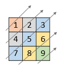
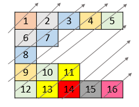
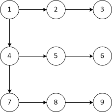
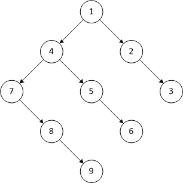

# In-place BFS. Linear Time. No Separate Queues. C++ 68ms (100%), Java 13ms (100%).

**Author:** sergei99
**Votes:** 11
**Link:** [https://leetcode.com/problems/diagonal-traverse-ii/solutions/4317289/](https://leetcode.com/problems/diagonal-traverse-ii/solutions/4317289/)

---

# Intuition
We need to flatten a 2D array and return the matrix in a diagonal order:


There can be up to $10^5$ rows consisting of up to $10^5$ elements each, but no more than $10^5$ elements in total. Neither the matrix nor any row could be empty. Row lengths may vary within the matrix, e.g.:


Therefore we don't know the exact positions of elements in the resultant array until we process all the preceding elements.

The matrix can be represented as a binary tree where the leftmost column's elements can have up to 2 children (their neigbours to the bottom and to the right if any), and other elements can have up to 1 child (right neighbour) - thanks to @the_att_21 for this idea (https://leetcode.com/problems/diagonal-traverse-ii/solutions/4316028/c-simple-bfs/).



If we turn it by $45\\degree$, the tree becomes more obvious:



Now all we need is traverse it using a BFS algorithm, so each level is completely scanned from left to right before moving on to the next level.

# Approach

First of all we turn down any recursion: $10^5$ levels of nested function calls would be an overkill. If we are not using recursion, then we should maintain a queue of elements to walk through. E.g. as we traverse the level 2 (elements `7 5 3`), we add positions of `8` and `6` to that queue to process them afterwards. The size of the queue would be limited by the size of the largest diagonal of the matrix, but the point is, do we actually need a separate container for the queue?

Let's take a closer look at it. Consider element processing from the previous example step by step:
| Step <td colspan=2> **Result** </td> |||<td colspan=2> **Queue** </td> |||||
|-|-|-|-|-|-|-|-|
| 1 | ||||| `(0, 0)` |<td> </td> <td> </td> <td> </td> <td> </td> |
| 2 | `1` ||||| `(1, 0)` | `(0, 1)` <td> </td> <td> </td> <td> </td> <td> </td> |
| 3 | `1` | `4` |||| `(0, 1)` <td> `(2, 0)` </td> <td> `(1, 1)` </td> <td> </td> <td> </td> |
| 4 | `1` | `4` | `2` ||| `(2, 0)` <td> `(1, 1)` </td> <td> `(0, 2)`</td> <td> </td> <td> </td> |
| 5 | `1` | `4` | `2` | `7` || `(1, 1)` | `(0, 2)` <td> `(2, 0)` </td>  <td> `(2, 1)` </td> <td> </td> <td> </td> |

As we consume an index pair from the queue, we add element referenced by that pair to the output vector. Therefore, if we could store pairs right in the output vector, we could just replace them with values as we go. This way we would have a nice memory footprint and benefit from the data locality, e.g.:
https://leetcode.com/problems/diagonal-traverse-ii/submissions/1104099614/

Can we physically squeeze an index pair into a 32-bit quantity, which is the limitation of the return value type? There could be indexes up to $99999$, either for row or column, which require 17 bits of storage. But at the same time the total number of elements does not exceed $10^5$. It turns out that the present test suite does not actually have rows or columns longer than $65535$ elements. If we were not that lucky, then we would have to maintain a separate mini-queue to store those outfit 2 bits for some of the index pairs.

Finally our processing looks like this:
| Step  <td colspan=7>**Result+Queue**</td> |||
|-|-|-|
| 1 | `(0, 0)` <td> </td> <td> </td> <td> </td> <td> </td> <td> </td> <td> </td> <td> </td> |
| 2 | `1` | `(1, 0)` <td> `(0, 1)` </td> <td> </td> <td> </td> <td> </td> <td> </td> <td> </td> <td> </td> |
| 3 | `1` | `4` <td> `(0, 1)` </td> <td> `(2, 0)` </td> <td> `(1, 1)` </td> <td> </td> <td> </td> <td> </td> <td> </td> |
| 4 | `1` | `4` <td> `2` </td> <td> `(2, 0)` </td> <td> `(1, 1)` </td> <td> `(0, 2)` </td> <td> </td> <td> </td> <td> </td> |
| 5 | `1` | `4` <td> `2` </td> <td> `7` </td> <td> `(1, 1)` </td> <td> `(0, 2)` </td> <td> `(2, 0)` </td> <td> `(2, 1)` </td> <td> </td> |

As we go through the queued index pairs, we replace them with element values, and at the end our result array is fully populated with the elements in diagonal order.

## Scala Solution

As a bonus track, we are providing a single pass solution for Scala. Kind LC question designers are giving the input parameter in the form of a singly linked list of singly linked lists. So we don't have random access capability here, and as such, there is no point in storing indexes in the array. So we have to go for a separate queue approach.

We introduce a mutable queue of lists, which might store either submatrices from the current row onwards, or subrows from the current element onwards. Initially it contains the reference to entire matrix. As we proceed, we remove the queue head, and if it has more than one element (be it submatrix or subrow), we add this remainder to the queue. And for submatrices we also add their first row to the queue. When the queue head is a [sub]row, then we add its head element to the result array.

It's a purely imperative algorithm, Java-style (except for pattern matching), not an idiomatic Scala.

# Complexity
- Time complexity: $O(m)$ where $m = \\sum\\limits_{i}length(nums[i])$

- Space complexity: $O(m)$ for the result vector; $O(1)$ for intermediate storage

# Micro-optimizations

Some heuristic have been applied to calculate the result vector capacity in C++. An STL vector is a variable-length structure, so allocating slightly more than we need does not incur additional costs of storage reallocation and element movement.

As for Java, we have to return an array of the exact fixed size, so we probably won't evade movement of the elements except one case of precisely $95998$ elements, which is the maximum across the LC's test suite. All we can do is avoid double allocation: we accumulate the intermediate result in a temporary statically allocated array of the max size mentioned above and when we know the exact size, we create the result array and copy elements to it. We don't use `ArrayList` and such because they only operate boxed numbers. The same trick applies to Scala.

Also we run a full GC in Java and Scala if $n$ exceeds certain threshold (thanks to LC, `System.gc` call is not configured to do nothing). This helps maintaining a smaller memory footprint and does not cost any milliseconds of the execution time.

C++ O3 optimization has been enabled and `stdio` sync disabled, as usually.

# Measurements

| Language | Time | Beating | Memory | Beating |
|-|-|-|-|-|
| C++ | 68 ms | 100% | 59.3 Mb | 100% |
| Java | 13 ms | 100% | 58.52 Mb | 99.89% |
| Scala | 1030 ms | 100% | 80.04 Mb | 100% |

Submission links:
**C++**
https://leetcode.com/problems/diagonal-traverse-ii/submissions/1104099614/
https://leetcode.com/problems/diagonal-traverse-ii/submissions/1104147518/
https://leetcode.com/problems/diagonal-traverse-ii/submissions/1104420367/
**Java**
https://leetcode.com/problems/diagonal-traverse-ii/submissions/1104210474/
**Scala**
https://leetcode.com/problems/diagonal-traverse-ii/submissions/1104353600/
https://leetcode.com/problems/diagonal-traverse-ii/submissions/1104387778/
(note that due to lack of competing solutions in Scala, our code wins 100%, but it might not actually be the optimal one)

There is another 13 ms Java submission from an author who was not using a queue, but implemented a BFS traversal directly on the input array using complicated index calculations, and did calculate the exact output array size up front. Yet they still use an $O(n)$ temporary storage to maintain row lengths and run a preprocessing loop to calculate them.

# Code
``` C++ []
class Solution {
private:
    typedef unsigned short idx_t;

    static unsigned pack(const idx_t i, const idx_t j) __attribute__((always_inline)) {
        return (i << 16) + j;
    }

   static idx_t unpack_i(const unsigned p) __attribute__((always_inline)) {
       return p >> 16;
   }

   static idx_t unpack_j(const unsigned p) __attribute__((always_inline)) {
       return p & ((1u << 16) - 1u);
   }

public:
    vector<int> findDiagonalOrder(vector<vector<int>>& nums) {
        constexpr unsigned MAXC = 95998u;
        const unsigned n = nums.size();
        vector<int> r;
        r.reserve(min(n * n, MAXC));
        unsigned q = 0;
        r.push_back(pack(0, 0));
        while (q < r.size()) {
            unsigned i = unpack_i(r[q]), j = unpack_j(r[q]);
            r[q] = nums[i][j];
            q++;
            if (!j && i + 1 < n) r.push_back(pack(i + 1u, 0u));
            if (j + 1 < nums[i].size()) r.push_back(pack(i, j + 1u));
        }
        return r;
    }
};
```
``` Java []
class Solution {
    private static final int MAXC = 95998;
    private static int[] r = new int[MAXC];

    public int[] findDiagonalOrder(List<List<Integer>> nums) {
        final int n = nums.size();
        if (n > 1000) System.gc();
        int q = 0, t = 1;
        r[0] = 0;
        while (q < t) {
            final int i = r[q] >>> 16, j = r[q] & ((1 << 16) - 1);
            r[q] = nums.get(i).get(j);
            q++;
            if (j == 0 && i + 1 < n) r[t++] = (i + 1) << 16;
            if (j + 1 < nums.get(i).size()) r[t++] = (i << 16) + j + 1;
        }
        if (r.length == q) return r;
        final int[] u = new int[q];
        System.arraycopy(r, 0, u, 0, q);
        return u;
    }
}
```
``` Scala []
object Solution {
    private[this] val MAXC = 95998
    private[this] val r = Array.fill[Int](MAXC)(0)

    def findDiagonalOrder(nums: List[List[Int]]): Array[Int] = {
        val n = nums.length
        if (n > 1000) System.gc()
        var t = 0
        val queue = new collection.mutable.Queue[List[Any]](n)
        queue += nums
        while (!queue.isEmpty) {
            val curr = queue.removeHead() match {
                case head :: Nil  => head
                case head :: tail => queue += tail; head
                case Nil => // unreachable
            }
            curr match {
                case row : List[Any] => queue += row
                case elem : Int => r(t) = elem; t += 1
            }
        }
        if (r.length == t) r
        else r.slice(0, t)
    }
}
```