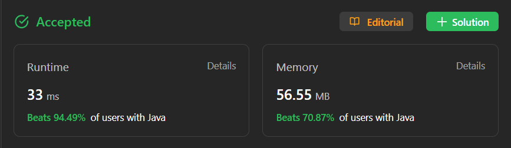

# ✅ Not HARD ✅ O(n) Time O(k) space ✅ Monotonic Decreasing Dequeue ✅ Explained

**Author:** millenium103
**Votes:** 55
**Link:** [https://leetcode.com/problems/constrained-subsequence-sum/solutions/4191339/](https://leetcode.com/problems/constrained-subsequence-sum/solutions/4191339/)

---

# YouTube Video Explanation:
[https://youtu.be/-_cl2m03Pr4](https://youtu.be/-_cl2m03Pr4)

**\uD83D\uDD25 Please like, share, and subscribe to support our channel's mission of making complex concepts easy to understand.**

Subscribe Link: https://www.youtube.com/@leetlogics/?sub_confirmation=1

*Subscribe Goal: 100 Subscribers*
*Current Subscribers: 92*

# Intuition:

The problem essentially asks for the maximum sum of a non-empty subsequence of the array that satisfies a certain condition. This condition is that for every two consecutive integers in the subsequence (nums[i] and nums[j], where i < j), the difference between the indices (j - i) should be less than or equal to k.

The given code provides a solution using dynamic programming with a deque (double-ended queue). It iterates through the array while keeping track of the maximum subsequence sum.

# Approach:

1. Initialize a variable `res` to store the maximum subsequence sum. This variable is set to the value of the first element in the array `A[0]`.
2. Create a deque `q` to maintain a double-ended queue to track possible elements in the subsequence.
3. Iterate through the elements of the array using a loop, and for each element `A[i]`, do the following:
   - Update `A[i]` by adding the value at the front of the deque (if not empty). This step is essential as it helps to maintain the constraint `j - i <= k`.
   - Update the `res` to be the maximum of the current `res` and `A[i]`. This is essentially updating the maximum subsequence sum.
   - Check if the deque is not empty and the current element `A[i]` is greater than the last element in the deque. If so, remove the last element from the deque. This step ensures that the deque only contains elements in non-increasing order.
   - If the current element `A[i]` is greater than 0, add it to the deque. This step is essential for maintaining a sequence of positive elements.
   - Check if the index `i` is greater than or equal to `k` and if the deque is not empty and the front element in the deque is equal to `A[i - k]`. If all these conditions are met, it means that the front element in the deque is `k` steps behind the current element, so it is no longer valid for the subsequence. Remove it from the deque.
4. Finally, return the `res`, which represents the maximum subsequence sum that satisfies the given conditions.

# Complexity Analysis:

- Time Complexity: The code iterates through the array once, resulting in O(n) time complexity.
- Space Complexity: The deque `q` can store up to `k` elements, so the space complexity is O(k).

The code efficiently finds the maximum subsequence sum while considering the index difference constraint.

# Code 

<iframe src="https://leetcode.com/playground/27u7VBSu/shared" frameBorder="0" width="600" height="500"></iframe>

---

