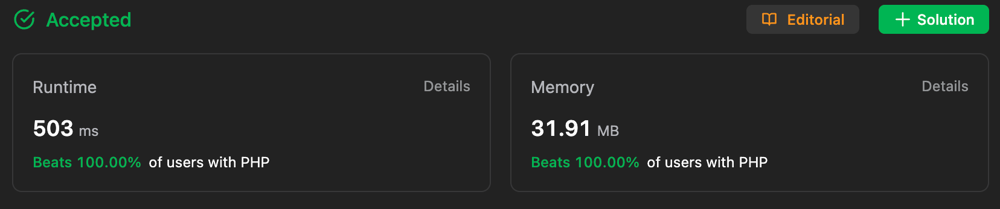
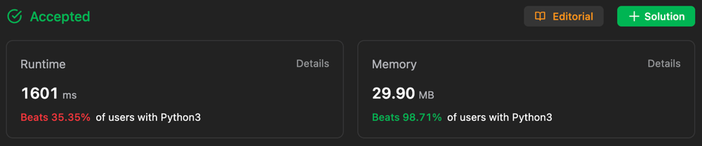

# ✅ Beats 100% 🔥 in Both || Easiest Approach || Detailed Explanation ||

**Author:** Gourav-2002
**Votes:** 4
**Link:** [https://leetcode.com/problems/constrained-subsequence-sum/solutions/4191144/](https://leetcode.com/problems/constrained-subsequence-sum/solutions/4191144/)

---


# PHP


# Python


# Intuition
If we want to get the maximum sum of a non-empty subsequence, we can use DP. dp[i] means the maximum sum of a non-empty subsequence of nums[:i+1]. So the result is max(dp). We can easily get the dp[i] with dp[i] = nums[i] + max(dp[i-k], dp[i-k+1], ..., dp[i-1]). But it will cause TLE. So we need to optimize it. 
<!-- Describe your first thoughts on how to solve this problem. -->

# Approach : Dynamic Programming
1. Here we use a deque to store the index of the max value in the window.
2. The max value in the window is always the first element of the deque.
3. If the max value is out of the window, we pop it from the deque.
4. If the max value is smaller than the new value, we pop it from the deque.
5. Then we append the new value to the deque.
6. We update the dp[i] with nums[i] + dp[deque[0]].
7. We update the result with max(result, dp[i]).

# Algorithm :
1. Initialize a deque q.
2. Initialize a dp array with the same length of nums, and fill it with nums.
3. Iterate the array, for each element nums[i]:
    1. If the first element of q is out of the window, we pop it.
    2. If the first element of q is smaller than dp[i], we pop it.
    3. We append dp[i] to q.
    4. We update dp[i] with nums[i] + dp[q[0]].
    5. We update the result with max(result, dp[i]).
4. Return the result.
<!-- Describe your approach to solving the problem. -->

# Complexity
- Time complexity : O(N)
<!-- Add your time complexity here, e.g. $$O(n)$$ -->

- Space complexity : O(K)
<!-- Add your space complexity here, e.g. $$O(n)$$ -->

## Please Upvote \u2B06\uFE0F if you found this helpful :)

# Code
``` Python []
class Solution:
    def constrainedSubsetSum(self, nums: List[int], k: int) -> int:
        dp = copy.deepcopy(nums)
        q = deque()
        q.append(0)
        for i in range(1,len(nums)):
            while(q[-1] < i-k ):
                q.pop()
            dp[i] = max(dp[i],dp[q[-1]]+nums[i])
            while( len(q)>0 and dp[q[0]] <= dp[i] ):
                q.popleft()
            q.appendleft(i)
        return max(dp)
```
``` C++ []
class Solution {
public:
    int constrainedSubsetSum(vector<int>& nums, int k) {
        vector<int> dp(nums);
        deque<int> q;
        q.push_back(0);
        for (int i = 1; i < nums.size(); i++) {
            while (!q.empty() && q.back() < i - k) {
                q.pop_back();
            }
            dp[i] = max(dp[i], dp[q.back()] + nums[i]);
            while (!q.empty() && dp[q.front()] <= dp[i]) {
                q.pop_front();
            }
            q.push_front(i);
        }
        return *max_element(dp.begin(), dp.end());
    }
};
```
``` Java []
class Solution {
    public int constrainedSubsetSum(int[] nums, int k) {
        int[] dp = Arrays.copyOf(nums, nums.length);
        Deque<Integer> q = new ArrayDeque<>();
        q.offerLast(0);
        for (int i = 1; i < nums.length; i++) {
            while (!q.isEmpty() && q.peekLast() < i - k) {
                q.pollLast();
            }
            dp[i] = Math.max(dp[i], dp[q.peekLast()] + nums[i]);
            while (!q.isEmpty() && dp[q.peekFirst()] <= dp[i]) {
                q.pollFirst();
            }
            q.offerFirst(i);
        }
        int max = Integer.MIN_VALUE;
        for (int num : dp) {
            max = Math.max(max, num);
        }
        return max;
    }
    }
```
``` JavaScript []
/**
 * @param {number[]} nums
 * @param {number} k
 * @return {number}
 */
var constrainedSubsetSum = function(nums, k) {
    let dp = [...nums];
        let q = [];
        q.push(0);
        for (let i = 1; i < nums.length; i++) {
            while (q[q.length - 1] < i - k) {
                q.pop();
            }
            dp[i] = Math.max(dp[i], dp[q[q.length - 1]] + nums[i]);
            while (q.length > 0 && dp[q[0]] <= dp[i]) {
                q.shift();
            }
            q.unshift(i);
        }
        return Math.max(...dp);
};
```
``` C# []
public class Solution {
    public int ConstrainedSubsetSum(int[] nums, int k) {
        int[] dp = (int[])nums.Clone();
        LinkedList<int> q = new LinkedList<int>();
        q.AddLast(0);
        for (int i = 1; i < nums.Length; i++) {
            while (q.Count > 0 && q.Last.Value < i - k) {
                q.RemoveLast();
            }
            dp[i] = Math.Max(dp[i], dp[q.Last.Value] + nums[i]);
            while (q.Count > 0 && dp[q.First.Value] <= dp[i]) {
                q.RemoveFirst();
            }
            q.AddFirst(i);
        }
        int max = int.MinValue;
        foreach (int num in dp) {
            max = Math.Max(max, num);
        }
        return max;
    }
}
```
``` TypeScript []
function constrainedSubsetSum(nums: number[], k: number): number {
let dp: number[] = [...nums];
        let q: number[] = [];
        q.push(0);
        for (let i = 1; i < nums.length; i++) {
            while (q[q.length - 1] < i - k) {
                q.pop();
            }
            dp[i] = Math.max(dp[i], dp[q[q.length - 1]] + nums[i]);
            while (q.length > 0 && dp[q[0]] <= dp[i]) {
                q.shift();
            }
            q.unshift(i);
        }
        return Math.max(...dp);
};
```
``` PHP []
class Solution {

    /**
     * @param Integer[] $nums
     * @param Integer $k
     * @return Integer
     */
    function constrainedSubsetSum($nums, $k) {
        $dp = $nums;
        $q = [];
        array_push($q, 0);
        for ($i = 1; $i < count($nums); $i++) {
            while (end($q) < $i - $k) {
                array_pop($q);
            }
            $dp[$i] = max($dp[$i], $dp[end($q)] + $nums[$i]);
            while (count($q) > 0 && $dp[$q[0]] <= $dp[$i]) {
                array_shift($q);
            }
            array_unshift($q, $i);
        }
        return max($dp);
    }
}
```
``` Ruby []
# @param {Integer[]} nums
# @param {Integer} k
# @return {Integer}
def constrained_subset_sum(nums, k)
    dp = nums.dup
        q = []
        q.push(0)
        
        (1...nums.length).each do |i|
            while !q.empty? && q.last < i - k
                q.pop
            end
            
            dp[i] = [dp[i], dp[q.last] + nums[i]].max
            
            while !q.empty? && dp[q.first] <= dp[i]
                q.shift
            end
            
            q.unshift(i)
        end
        
        dp.max
end
```

