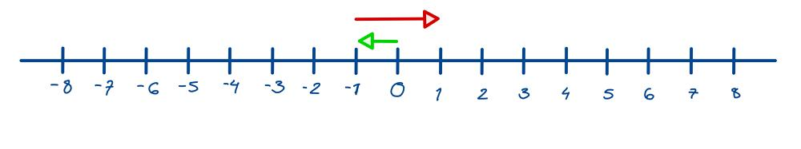

# Golang solution faster than 100% with explanation and images

**Author:** nathannaveen
**Votes:** 1
**Link:** [https://leetcode.com/problems/perform-string-shifts/solutions/1134729/](https://leetcode.com/problems/perform-string-shifts/solutions/1134729/)

---

[1427. Perform String Shifts](https://leetcode.com/problems/perform-string-shifts/)

The idea of this solution is pretty simple. 

* Since there are only two directions, we can shift the strings in one direction. The reason we can shift in only one direction is when the input tells us to shift
    * First left and then right:
        * The right might cancel out the left and will end up with no shift.
        * The right might be greater than the left, so we shift right.
        * The left might be greater than the right, so we shift left.
    * First right then left:
        * The left might be equal to the right, so it will cancel both of them out, and we won't shift.
        * The left might be greater than the right, so we shift left.
        * The left might be smaller than the right, so we shift right.
    * First left then another left:
        * We can only go left because there is no right to cancel out.
    * First right then another right:
        * We only shift right because there is no left for us to cancel the right shift with.

    These are the possibilities that we can shift but in different permutations. This can be shown with the following example:
    
    `s = "abc", shift = [[0,1],[1,2]]`, as we see it firsts tells us to shift left (`0 = left`) by one unit and then to shift right (`1 = right`) by two units. The left gets canceled out by the right, and we have to shift right. This can be shown with an image:
    
	

    
    First, go left by one (green) and then go right by two (red), and we can see that we have to shift right by one.
    
    So we find whether we have to shift right or left by using a counter called `counter`. 
    
    *(Note: Since the current shift is in the format of `[direction, number of shifts]` I am going to be referring to the current shifts direction or the number of shifts)*
    
    We check whether the direction of the current shift is `0`. If it is `0`, we know that we have to shift left, so we subtract the number of shifts from the counter. Else we know that the direction has to be right, shown as `1`, and we add the number of shifts to `counter` because it is right.

* The next part is shifting the letters.
    * First, we can check whether the counter is smaller than `0` (if we have to shift left):
        * We make a variable called `temp` to store the first letter. Then we remake `s` from the second letter to the end, and we add `temp` to the back to `s`. This is basically shifting left.
    * Else we know that counter is greater than or equal to `0` (for shifting right):
        * We make a variable called `temp` to store the last number. Then we remake `s` to the last number plus the rest of the string. This is basically shifting right.

**The Code:**

``` go
func stringShift(s string, shift [][]int) string {
    counter := 0

    for _, ints := range shift {
        if ints[0] == 0 {
            counter -= ints[1]
        } else {
            counter += ints[1]
        }
    }

    for counter != 0 {
        if counter < 0 {
            temp := string(s[0])
            s = s[1:] + temp
            counter++
        } else {
            temp := string(s[len(s)-1])
            s = temp + s[:len(s)-1]
            counter--
        }
    }
    return s
}
```

**We Can Simplify This Solution:** *(We don't use `temp` because we can just add the last and first letter to the end and the last letter to the beginning)*

``` go
func stringShift(s string, shift [][]int) string {
    counter := 0

    for _, ints := range shift {
        if ints[0] == 0 {
            counter -= ints[1]
        } else {
            counter += ints[1]
        }
    }

    for counter != 0 {
        if counter < 0 {
            s = s[1:] + string(s[0])
            counter++
        } else {
            s = string(s[len(s)-1]) + s[:len(s)-1]
            counter--
        }
    }
    return s
}
```