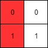
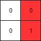
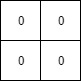

# [1428. Leftmost Column with at Least a One](https://leetcode.com/problems/leftmost-column-with-at-least-a-one/)

| Category | Difficulty | Likes | Dislikes |
| :------: | :--------: | :---: | :------: |
| Algorithms | Medium | 1252 | 152 |

**Tags:** [`array`](https://leetcode.com/tag/array), [`binary-search`](https://leetcode.com/tag/binary-search), [`matrix`](https://leetcode.com/tag/matrix), [`interactive`](https://leetcode.com/tag/interactive)

**Companies:** `uber`, `facebook`

## Description

A **row-sorted binary matrix** means that all elements are `0` or `1` and each row of the matrix is sorted in non-decreasing order.

Given a **row-sorted binary matrix** `binaryMatrix`, return *the index (0-indexed) of the **leftmost column** with a 1 in it*. If such an index does not exist, return `-1`.

**You can't access the Binary Matrix directly.** You may only access the matrix using a `BinaryMatrix` interface:

	- `BinaryMatrix.get(row, col)` returns the element of the matrix at index `(row, col)` (0-indexed).

	- `BinaryMatrix.dimensions()` returns the dimensions of the matrix as a list of 2 elements `[rows, cols]`, which means the matrix is `rows x cols`.

Submissions making more than `1000` calls to `BinaryMatrix.get` will be judged *Wrong Answer*. Also, any solutions that attempt to circumvent the judge will result in disqualification.

For custom testing purposes, the input will be the entire binary matrix `mat`. You will not have access to the binary matrix directly.

 

**Example 1:**


```

Input: mat = [[0,0],[1,1]]
Output: 0

```

**Example 2:**


```

Input: mat = [[0,0],[0,1]]
Output: 1

```

**Example 3:**


```

Input: mat = [[0,0],[0,0]]
Output: -1

```

 

**Constraints:**

	- `rows == mat.length`

	- `cols == mat[i].length`

	- `1 <= rows, cols <= 100`

	- `mat[i][j]` is either `0` or `1`.

	- `mat[i]` is sorted in non-decreasing order.

---

**Links:** [Submissions](https://leetcode.com/problems/leftmost-column-with-at-least-a-one/) | [Solutions](https://leetcode.com/problems/leftmost-column-with-at-least-a-one/)
