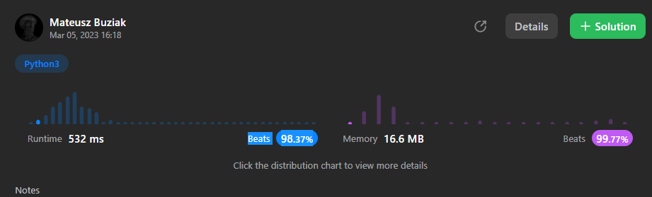

# [Python] i guess it's cheating but it works tho

**Author:** 8uziak
**Votes:** 5
**Link:** [https://leetcode.com/problems/check-if-all-1s-are-at-least-length-k-places-away/solutions/3260737/](https://leetcode.com/problems/check-if-all-1s-are-at-least-length-k-places-away/solutions/3260737/)

---

# Complexity
- Time complexity: O(n)
<!-- Add your time complexity here, e.g. $$O(n)$$ -->

- Space complexity: O(n)
<!-- Add your space complexity here, e.g. $$O(n)$$ -->

# Code
```
class Solution:
    def kLengthApart(self, nums: List[int], k: int) -> bool:
        n = k #'<- the cheating line
        for i in nums:
            if i == 0:
                n += 1
            else:
                if n < k:
                    return False
                n = 0
        return True
```

