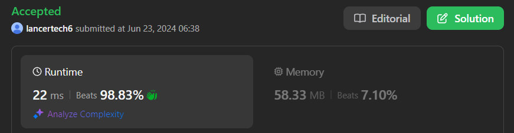

# ✅Beats 100% -Explained with [ Video ] -C++/Java/Python/JS -Sliding Window -Interview Solution

**Author:** lancertech6
**Votes:** 153
**Link:** [https://leetcode.com/problems/longest-continuous-subarray-with-absolute-diff-less-than-or-equal-to-limit/solutions/5354780/](https://leetcode.com/problems/longest-continuous-subarray-with-absolute-diff-less-than-or-equal-to-limit/solutions/5354780/)

---



# YouTube Video Explanation:

### To watch the video please click on "Watch On Youtube" option  available the left bottom corner of the thumbnail.

<!-- **If you want a video for this question please write in the comments** -->

https://youtu.be/tcPwlznFnFs


**\uD83D\uDD25 Please like, share, and subscribe to support our channel's mission of making complex concepts easy to understand.**

Subscribe Link: https://www.youtube.com/@leetlogics/?sub_confirmation=1

*Subscribe Goal: 2250 Subscribers*
*Current Subscribers: 2219*

Follow me on Instagram : https://www.instagram.com/divyansh.nishad/

---

# Intuition
<!-- Describe your first thoughts on how to solve this problem. -->
The problem requires finding the longest subarray where the absolute difference between the maximum and minimum elements is less than or equal to a given limit. To achieve this, we can use a sliding window technique combined with two deques to keep track of the minimum and maximum elements within the current window.

# Approach
<!-- Describe your approach to solving the problem. -->
1. **Deques for Tracking Min and Max:**
   - Use two deques: `increase` to keep track of the increasing order of elements (for the minimum value) and `decrease` for the decreasing order of elements (for the maximum value).

2. **Sliding Window Technique:**
   - Iterate through the array while maintaining a sliding window.
   - For each element, add it to both deques:
     - Remove elements from the back of `increase` deque until the last element is greater than the current element.
     - Remove elements from the back of `decrease` deque until the last element is less than the current element.
   - Add the current element to the back of both deques.
   
3. **Adjust Window:**
   - Check the difference between the maximum and minimum elements in the current window (front elements of the `decrease` and `increase` deques respectively).
   - If the difference exceeds the limit, adjust the window by moving the left pointer until the difference is within the limit again.
   - Remove elements from the deques if they are equal to the element at the `left` pointer before incrementing the `left` pointer.

4. **Track Maximum Size:**
   - Calculate the size of the current valid window and update the maximum size if the current size is larger.

# Complexity
- **Time Complexity:** O(n), where n is the length of the array. Each element is added and removed from the deques at most once, leading to linear time complexity.
- **Space Complexity:** O(n) in the worst case, for the space used by the deques.

# Step by Step Explanation

#### Example
- Input: `nums = [8, 2, 4, 7]`, `limit = 4`
- Expected Output: `2`

#### Initial State
| Index | Value | Increase Deque | Decrease Deque | Left | Right | Max Length |
|-------|-------|----------------|----------------|------|-------|------------|
|       |       |                |                | 0    |       | 0          |

#### Iteration 1: Right = 0
- Add `8` to both deques.
- Deques after adding: `increase = [8]`, `decrease = [8]`
- Max Length = 1

| Index | Value | Increase Deque | Decrease Deque | Left | Right | Max Length |
|-------|-------|----------------|----------------|------|-------|------------|
| 0     | 8     | [8]            | [8]            | 0    | 0     | 1          |

#### Iteration 2: Right = 1
- Add `2` to `increase` and `decrease`.
- Deques after adding: `increase = [2, 8]`, `decrease = [8, 2]`
- Difference: `8 - 2 = 6` > `4`
- Move `left` to `1`, remove `8` from deques.
- Max Length = 1

| Index | Value | Increase Deque | Decrease Deque | Left | Right | Max Length |
|-------|-------|----------------|----------------|------|-------|------------|
| 1     | 2     | [2]            | [2]            | 1    | 1     | 1          |

#### Iteration 3: Right = 2
- Add `4` to `increase` and `decrease`.
- Deques after adding: `increase = [2, 4]`, `decrease = [4, 2]`
- Difference: `4 - 2 = 2` \u2264 `4`
- Max Length = 2

| Index | Value | Increase Deque | Decrease Deque | Left | Right | Max Length |
|-------|-------|----------------|----------------|------|-------|------------|
| 2     | 4     | [2, 4]         | [4, 2]         | 1    | 2     | 2          |

#### Iteration 4: Right = 3
- Add `7` to `increase` and `decrease`.
- Deques after adding: `increase = [2, 4, 7]`, `decrease = [7, 4, 2]`
- Difference: `7 - 2 = 5` > `4`
- Move `left` to `2`, remove `2` from deques.
- Difference: `7 - 4 = 3` \u2264 `4`
- Max Length = 2

| Index | Value | Increase Deque | Decrease Deque | Left | Right | Max Length |
|-------|-------|----------------|----------------|------|-------|------------|
| 3     | 7     | [4, 7]         | [7, 4]         | 2    | 3     | 2          |

### Final Result
- The size of the longest subarray with the absolute difference \u2264 `limit` is `2`.


# Code
```java []
class Solution {
    public int longestSubarray(int[] nums, int limit) {
        
        LinkedList<Integer> increase = new LinkedList<>();
        LinkedList<Integer> decrease = new LinkedList<>();

        int max = 0;
        int left = 0;

        for (int i = 0; i < nums.length; i++) {
            int n = nums[i];

            while (increase.size() > 0 && n < increase.getLast()) {
                increase.removeLast();
            }
            increase.add(n);

            while (decrease.size() > 0 && n > decrease.getLast()) {
                decrease.removeLast();
            }

            decrease.add(n);

            while (decrease.getFirst() - increase.getFirst() > limit) {
                if (nums[left] == decrease.getFirst()) {
                    decrease.removeFirst();
                }
                if (nums[left] == increase.getFirst()) {
                    increase.removeFirst();
                }
                left++;
            }

            int size = i - left + 1;
            max = Math.max(max, size);
        }

        return max;
    }
}
```
```C++ []
class Solution {
public:
    int longestSubarray(vector<int>& nums, int limit) {
        deque<int> increase;
        deque<int> decrease;
        int max_len = 0;
        int left = 0;

        for (int right = 0; right < nums.size(); ++right) {
            while (!increase.empty() && nums[right] < increase.back()) {
                increase.pop_back();
            }
            increase.push_back(nums[right]);

            while (!decrease.empty() && nums[right] > decrease.back()) {
                decrease.pop_back();
            }
            decrease.push_back(nums[right]);

            while (decrease.front() - increase.front() > limit) {
                if (nums[left] == decrease.front()) {
                    decrease.pop_front();
                }
                if (nums[left] == increase.front()) {
                    increase.pop_front();
                }
                ++left;
            }

            max_len = std::max(max_len, right - left + 1);
        }

        return max_len;
    }
};
```
```Python []
class Solution(object):
    def longestSubarray(self, nums, limit):
        increase = deque()
        decrease = deque()
        max_length = 0
        left = 0

        for right in range(len(nums)):
            while increase and nums[right] < increase[-1]:
                increase.pop()
            increase.append(nums[right])
            
            while decrease and nums[right] > decrease[-1]:
                decrease.pop()
            decrease.append(nums[right])
            
            while decrease[0] - increase[0] > limit:
                if nums[left] == increase[0]:
                    increase.popleft()
                if nums[left] == decrease[0]:
                    decrease.popleft()
                left += 1
                
            max_length = max(max_length, right - left + 1)
        
        return max_length
        
```
```JavaScript []
var longestSubarray = function(nums, limit) {
    let increase = [];
    let decrease = [];
    let max = 0;
    let left = 0;
    
    for (let i = 0; i < nums.length; i++) {
        while (increase.length && nums[i] < increase[increase.length - 1]) {
            increase.pop();
        }
        increase.push(nums[i]);
        
        while (decrease.length && nums[i] > decrease[decrease.length - 1]) {
            decrease.pop();
        }
        decrease.push(nums[i]);
        
        while (decrease[0] - increase[0] > limit) {
            if (nums[left] === decrease[0]) {
                decrease.shift();
            }
            if (nums[left] === increase[0]) {
                increase.shift();
            }
            left++;
        }
        
        max = Math.max(max, i - left + 1);
    }
    
    return max;
};
```

