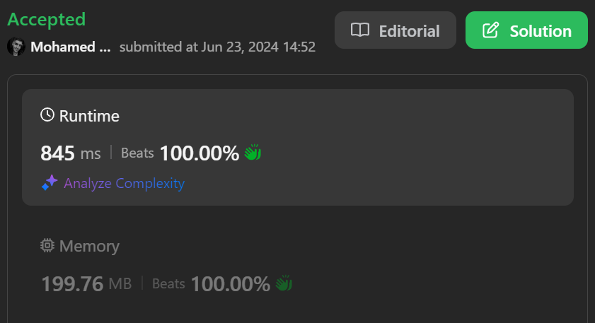

# BEATS 100% Dart Solution

**Author:** Mohamed_Sadeck
**Votes:** 0
**Link:** [https://leetcode.com/problems/longest-continuous-subarray-with-absolute-diff-less-than-or-equal-to-limit/solutions/5357763/](https://leetcode.com/problems/longest-continuous-subarray-with-absolute-diff-less-than-or-equal-to-limit/solutions/5357763/)

---



# Code
```
import 'package:collection/collection.dart';
class Solution {
  int longestSubarray(List<int> nums, int limit) {
    int res = 1;
    int l, r = l = 0;
    var maxHeap = HeapPriorityQueue<int>((a,b)=>b.compareTo(a));
    var minHeap = HeapPriorityQueue<int>((a,b)=>a.compareTo(b));
    maxHeap.add(nums.first);
    minHeap.add(nums.first);
    while(++r<nums.length){
        maxHeap.add(nums[r]);
        minHeap.add(nums[r]);
        while(maxHeap.first - minHeap.first > limit){
            maxHeap.remove(nums[l]);
            minHeap.remove(nums[l]);
            l++;
        }
        res=max(r-l+1,res);
    }
    return res;
  }
}
```