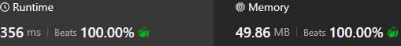

# Two pointers

**Author:** sav20011962
**Votes:** 1
**Link:** [https://leetcode.com/problems/longest-continuous-subarray-with-absolute-diff-less-than-or-equal-to-limit/solutions/5358538/](https://leetcode.com/problems/longest-continuous-subarray-with-absolute-diff-less-than-or-equal-to-limit/solutions/5358538/)

---

# Complexity

# Code
```
class Solution {
    fun longestSubarray(nums: IntArray, limit: Int): Int {
        var min_v = nums[0]
        var max_v = nums[0]
        var left = 0
        var right = 1
        var res = 1
        while (right < nums.size) {
            min_v = minOf(min_v,nums[right])
            max_v = maxOf(max_v,nums[right])
            if (max_v - min_v > limit) {
                if (nums[left]==min_v || nums[left]==max_v) {
                    min_v = nums[left+1]
                    max_v = nums[left+1]
                    for (i in left+2 .. right) {
                        min_v = minOf(min_v,nums[i])
                        max_v = maxOf(max_v,nums[i])
                    }
                }
                left++
            }
            res = maxOf(right - left + 1, res)
            right++
        }
        return res
    }
}
```