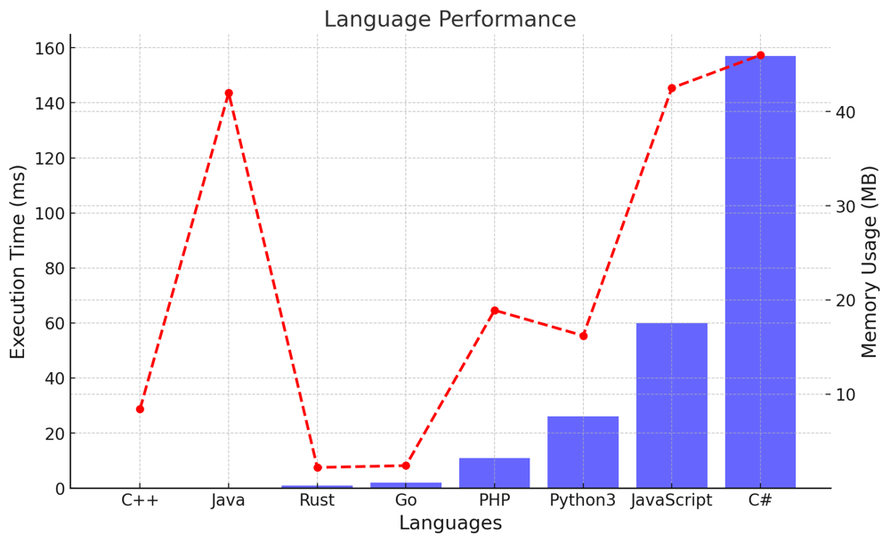

# ✅ 99.80% Iterative Set Stack Simulation

**Author:** vanAmsen
**Votes:** 16
**Link:** [https://leetcode.com/problems/build-an-array-with-stack-operations/solutions/4241217/](https://leetcode.com/problems/build-an-array-with-stack-operations/solutions/4241217/)

---

# Intuition
Given a target list of numbers and a stream of numbers from 1 to $ n $, the goal is to simulate a stack to recreate the target list using just "Push" and "Pop" operations. The intuitive approach is to push each number from the stream onto the stack. If the number is not in the target list, we pop it off immediately. We continue this process until we've constructed the target list in the stack.

# Live Coding + Comments
https://youtu.be/ortH58dpXlE?si=ST32gpGDy-QoorTr

# Approach
1. **Set Conversion**: Convert the target list to a set. This conversion allows us to check the existence of a number in the target list in constant time, $O(1)$. 
2. **Iterative Process**: Iterate through the numbers from 1 up to the last element of the target list.
   - If the current number is in the target set, we only "Push".
   - If the current number is not in the target set, we "Push" and then "Pop" immediately, indicating that the number is not required in the final stack.
3. **Completion**: Once we've reached the last number in the target list, we can be sure that we've constructed the target list in the stack and stop our operations.

# Complexity
- **Time complexity**: $O(n)$. The iteration goes up to the last element of the target list, which could be as large as $n$. Each operation (push/pop) is $O(1)$.
- **Space complexity**: $O(n)$. The combined space required for the `target_set` and the `result` list is linear with respect to $n$.

---

# Code
``` Python []
class Solution:
    def buildArray(self, target: List[int], n: int) -> List[str]:
        target_set = set(target)
        result = []
        
        for i in range(1, target[-1] + 1):
            if i in target_set:
                result.append("Push")
            else:
                result.append("Push")
                result.append("Pop")
                
        return result
```
``` C++ []
class Solution {
public:
    std::vector<std::string> buildArray(std::vector<int>& target, int n) {
        std::unordered_set<int> target_set(target.begin(), target.end());
        std::vector<std::string> result;

        for (int i = 1; i <= target.back(); ++i) {
            if (target_set.find(i) != target_set.end()) {
                result.push_back("Push");
            } else {
                result.push_back("Push");
                result.push_back("Pop");
            }
        }
        return result;
    }
};
```
``` Java []
public class Solution {
    public List<String> buildArray(int[] target, int n) {
        HashSet<Integer> targetSet = new HashSet<>();
        for (int num : target) {
            targetSet.add(num);
        }

        List<String> result = new ArrayList<>();
        for (int i = 1; i <= target[target.length - 1]; i++) {
            if (targetSet.contains(i)) {
                result.add("Push");
            } else {
                result.add("Push");
                result.add("Pop");
            }
        }
        return result;
    }
}
```
``` Go []
func buildArray(target []int, n int) []string {
    targetSet := make(map[int]bool)
    for _, num := range target {
        targetSet[num] = true
    }

    var result []string
    for i := 1; i <= target[len(target)-1]; i++ {
        if targetSet[i] {
            result = append(result, "Push")
        } else {
            result = append(result, "Push")
            result = append(result, "Pop")
        }
    }
    return result
}
```
``` Rust []
impl Solution {
    pub fn build_array(target: Vec<i32>, n: i32) -> Vec<String> {
        let target_set: std::collections::HashSet<_> = target.iter().cloned().collect();
        let mut result = vec![];

        for i in 1..=*target.last().unwrap() {
            if target_set.contains(&i) {
                result.push("Push".to_string());
            } else {
                result.push("Push".to_string());
                result.push("Pop".to_string());
            }
        }
        result
    }
}
```
``` PHP []
class Solution {

function buildArray($target, $n) {
    $targetSet = array_flip($target);
    $result = [];

    for ($i = 1; $i <= end($target); $i++) {
        if (isset($targetSet[$i])) {
            $result[] = "Push";
        } else {
            $result[] = "Push";
            $result[] = "Pop";
        }
    }
    return $result;
}

}
```
``` JavaScript []
function buildArray(target, n) {
    const targetSet = new Set(target);
    const result = [];

    for (let i = 1; i <= target[target.length - 1]; i++) {
        if (targetSet.has(i)) {
            result.push("Push");
        } else {
            result.push("Push");
            result.push("Pop");
        }
    }
    return result;
}
```
``` C# []
public class Solution {
    public IList<string> BuildArray(int[] target, int n) {
        HashSet<int> targetSet = new HashSet<int>(target);
        List<string> result = new List<string>();

        for (int i = 1; i <= target[target.Length - 1]; i++) {
            if (targetSet.Contains(i)) {
                result.Add("Push");
            } else {
                result.Add("Push");
                result.Add("Pop");
            }
        }
        return result;
    }
}
```

# Performance

| Language   | Execution Time (ms) | Memory (MB) |
|------------|---------------------|-------------|
| C++        | 0 ms                | 8.4 MB      |
| Java       | 0 ms                | 42 MB       |
| Rust       | 1 ms                | 2.2 MB      |
| Go         | 2 ms                | 2.4 MB      |
| PHP        | 11 ms               | 18.9 MB     |
| Python3    | 26 ms               | 16.2 MB     |
| JavaScript | 60 ms               | 42.5 MB     |
| C#         | 157 ms              | 46 MB       |




# Why is it optimal?
This approach is optimal because:
1. It avoids unnecessary iterations beyond the last element of the target list. This is significant especially when the last element of the target list is much smaller than $ n $.
2. By converting the target list to a set, we are able to perform constant time lookups, ensuring that our solution is efficient.
3. The solution leverages the properties of the stack and the strictly increasing nature of the target list to minimize the number of operations and achieve the desired result.