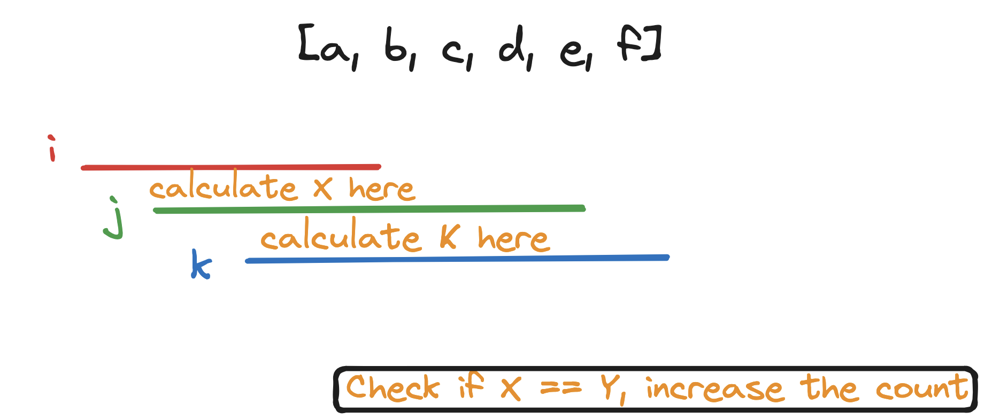
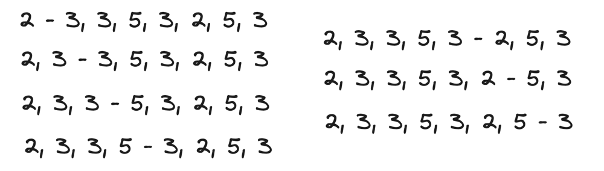
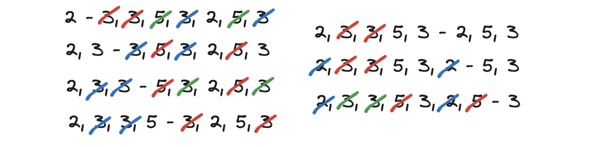

# 🔥🔥 GOD Level Detailed Explanation || 2 Approaches 😨😱🤯

**Author:** hi-malik
**Votes:** 147
**Link:** [https://leetcode.com/problems/count-triplets-that-can-form-two-arrays-of-equal-xor/solutions/5228547/](https://leetcode.com/problems/count-triplets-that-can-form-two-arrays-of-equal-xor/solutions/5228547/)

---

So, let's understand! What question is saying?

```
[a, b, c, d, e, f]
```
We have given an array and we have to define three triplets, in which :
* 0 <= i < j <= k < arr.length

We have to define these `i, j, k` where **j** is strictly greater then **i** and **j** can go to **k**, 
such that from **i -> j** the XOR is defines as
```
X = a[i] ^ a[i + 1]............. ^ a[j - 1]
Y = a[j] ^ a[j + 1]............. ^ a[k]
```
Such that **X = Y**

Now, how many triplets of **i, j, k** are available, such that **X** and **Y** is defines as the above and **X becomes equals to Y**

___
___

**Approach - 1**

> **The trivial approach to solve this problem is, put loop into loop into loop, means :**



But by this approach, the Complexity will be **n^3**

Let me explain you the code first,

1. **Initialization**: We initialize `count` to 0 to keep track of the number of valid triplets. `n` is the length of the input array `arr`.
2. **First Loop (i)**: Iterate through each possible starting index `i` from 0 to `n-1`.
3. **Second Loop (j)**: Iterate through each possible middle index `j` from `i+1` to `n-1`.
4. **Calculate a**: For each pair `(i, j)`, calculate the bitwise XOR value `a` for the subarray from `i` to `j-1`.
5. **Third Loop (k)**: Iterate through each possible ending index `k` from `j` to `n-1`.
6. **Calculate b and Check**: For each `k`, calculate the bitwise XOR value `Y` for the subarray from `j` to `k`. If `X` equals `Y`, increment the `count`.

Here's the solution,

**C++**
```
class Solution {
public:
    int countTriplets(vector<int>& arr) {
        int count = 0;
        int n = arr.size();
        
        for (int i = 0; i < n; i++) {
            for (int j = i + 1; j < n; j++) {
                int a = 0;
                for (int k = i; k < j; k++) {
                    a ^= arr[k];
                }
                
                int b = 0;
                for (int k = j; k < n; k++) {
                    b ^= arr[k];
                    if (a == b) {
                        count++;
                    }
                }
            }
        }
        
        return count;
    }
};
```
**JAVA**
```
class Solution {
    public int countTriplets(int[] arr) {
        int count = 0;
        int n = arr.length;
        
        for (int i = 0; i < n; i++) {
            for (int j = i + 1; j < n; j++) {
                int a = 0;
                for (int k = i; k < j; k++) {
                    a ^= arr[k];
                }
                
                int b = 0;
                for (int k = j; k < n; k++) {
                    b ^= arr[k];
                    if (a == b) {
                        count++;
                    }
                }
            }
        }
        
        return count;
    }
}
```
**PYTHON**
```
class Solution:
    def countTriplets(self, arr: List[int]) -> int:
        count = 0
        n = len(arr)
        
        for i in range(n):
            for j in range(i + 1, n):
                a = 0
                for k in range(i, j):
                    a ^= arr[k]
                
                b = 0
                for k in range(j, n):
                    b ^= arr[k]
                    if a == b:
                        count += 1
        
        return count
```

___
Complexity Analysis
___

* **Time Complexity :-** BigO(N^3)
* **Space Complexity :-** BigO(1)

___
___

**Approach - 2**

Instead of solving in **N^3**, we will solve now in **N^2**.

How, we going to have two pointers :
* **p1** pointer will move outside, the loop
* **p2** pointer will move inside, the loop

Lets say our pointer **p1** is at **b** in the starting and the pointer **p2** is sitting at **e**, and we calculate the **XOR** between **b** and **e** and it comes out to **0**. Now this will help in finding **i, j, k**


* Now put your **i** at **p1**
* **k** at your **p2**
* and the **j** could vary between **c**, **d** and **e**. 


We have calculate the XOR of `b ^ c ^ d ^ e = 0`

But let's say we put **j** on **c**, Now what will happen is, the **`bcde`** will going to split to **`b - cde`**
* Now our **X** will become **b**, because the **X** will be the value before the **j**
* And from **j** to **k**, we are having **Y**, i.e. **cde**

But let's say we put **j** on **d**, Now what will happen is, the **`bcde`** will going to split to **`bc - de`**
* Now our **X** will become **bc**, because the **X** will be the value before the **j**
* And from **j** to **k**, we are having **Y**, i.e. **de**

But let's say we put **j** on **e**, Now what will happen is, the **`bcde`** will going to split to **`bcd - e`**
* Now our **X** will become **bcd**, because the **X** will be the value before the **j**
* And from **j** to **k**, we are having **Y**, i.e. **e**

**All of the above possible scenarios, the XOR from b to e, will 0**

Let's understand with an example,
```
[5, 6, 2, 3, 3, 5, 3, 2, 5, 3, 8, 9]
```

If we look at above, the **XOR** from **p1** to **p2** will always be **0**, because 
* 2 will cut 2
* 3 will cut 3
* 5 will cut 5
* again, 3 will cut 3

We have calculate the XOR, we going to put **i** at **p1**, **k** at **p2**

And let's say we put **j** on **3**, Now what will happen is, the **`2, 3, 3, 5, 3, 2, 5, 3,`** will going to split to **`2 - 3, 3, 5, 3, 2, 5, 3`**
* Now our **X** will have **2**, because the **X** will be the value before the **j** i.e. **X = i to j - 1**
* And from **j** to **k**, we are having **Y**, i.e. **3, 3, 5, 3, 2, 5, 3**

And let's say we put **j** on **3**, Now what will happen is, the **`2, 3, 3, 5, 3, 2, 5, 3,`** will going to split to **`2, 3 - 3, 5, 3, 2, 5, 3`**
* Now our **X** will have **2, 3**, because the **X** will be the value before the **j** i.e. **X = i to j - 1**
* And from **j** to **k**, we are having **Y**, i.e. **3, 5, 3, 2, 5, 3**

And let's say we put **j** on **5**, Now what will happen is, the **`2, 3, 3, 5, 3, 2, 5, 3,`** will going to split to **`2, 3, 3 - 5, 3, 2, 5, 3`**
* Now our **X** will have **2, 3, 3**, because the **X** will be the value before the **j** i.e. **X = i to j - 1**
* And from **j** to **k**, we are having **Y**, i.e. **5, 3, 2, 5, 3**

And let's say we put **j** on **3**, Now what will happen is, the **`2, 3, 3, 5, 3, 2, 5, 3,`** will going to split to **`2, 3, 3, 5 - 3, 2, 5, 3`**
* Now our **X** will have **2, 3, 3, 5**, because the **X** will be the value before the **j** i.e. **X = i to j - 1**
* And from **j** to **k**, we are having **Y**, i.e. **3, 2, 5, 3**

And let's say we put **j** on **2**, Now what will happen is, the **`2, 3, 3, 5, 3, 2, 5, 3,`** will going to split to **`2, 3, 3, 5, 3 - 2, 5, 3`**
* Now our **X** will have **2, 3, 3, 5, 3**, because the **X** will be the value before the **j** i.e. **X = i to j - 1**
* And from **j** to **k**, we are having **Y**, i.e. **2, 5, 3**

And let's say we put **j** on **5**, Now what will happen is, the **`2, 3, 3, 5, 3, 2, 5, 3,`** will going to split to **`2, 3, 3, 5, 3, 2 - 5, 3`**
* Now our **X** will have **2, 3, 3, 5, 3, 2**, because the **X** will be the value before the **j** i.e. **X = i to j - 1**
* And from **j** to **k**, we are having **Y**, i.e. **5, 3**

And let's say we put **j** on **3**, Now what will happen is, the **`2, 3, 3, 5, 3, 2, 5, 3,`** will going to split to **`2, 3, 3, 5, 3, 2, 5 - 3`**
* Now our **X** will have **2, 3, 3, 5, 3, 2, 5**, because the **X** will be the value before the **j** i.e. **X = i to j - 1**
* And from **j** to **k**, we are having **Y**, i.e. **3**
> It will look something like this,



> But if we cancel it out,



So, if the **XOR** from **i** to **k** is **0**. So, how many triplets will come, it will be from **k - i**

Let me give you the code, explanation first!

1. **Initialization**: `count` is initialized to 0 to keep track of the number of valid triplets.
2. **First Loop (i)**: Iterates through each possible starting index `i` from 0 to the length of the array minus 1.
3. **Second Loop (k)**: Iterates through each possible ending index `k` from `i + 1` to the end of the array.
4. **Calculate XOR Value**: For each pair `(i, k)`, calculates the cumulative XOR value `val` for the subarray from `i` to `k`.
5. **Check and Increment**: If `val` is zero, it increments the `count` by `(k - i)`.

Now, let's code it UP!

**C++**
```
class Solution {
public:
    int countTriplets(vector<int>& arr) {
        int count = 0;
        
        for (int i = 0; i < arr.size(); i++) {
            int val = arr[i];
            
            for (int k = i + 1; k < arr.size(); k++) {
                val ^= arr[k];
                
                if (val == 0) {
                    count += (k - i);
                }
            }
        }
        
        return count;
    }
};
```
**JAVA**
```
class Solution {
    public int countTriplets(int[] arr) {
        int count = 0;
    
    for (int i = 0; i < arr.length; i++) {
        int val = arr[i];
        
        for (int k = i + 1; k < arr.length; k++) {
            val = val ^ arr[k];
            
            if (val == 0) {
                count += (k - i);
            }
        }
    }
    
    return count;
    }
}
```
**PYTHON**
```
class Solution:
    def countTriplets(self, arr: List[int]) -> int:
        count = 0
        
        for i in range(len(arr)):
            val = arr[i]
            
            for k in range(i + 1, len(arr)):
                val ^= arr[k]
                
                if val == 0:
                    count += (k - i)
        
        return count
```

___
Complexity Analysis
___

* **Time Complexity :-** BigO(N^2)
* **Space Complexity :-** BigO(1)