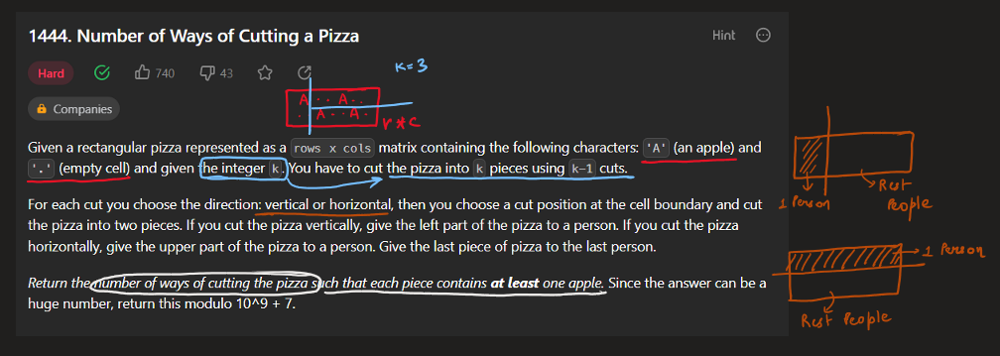
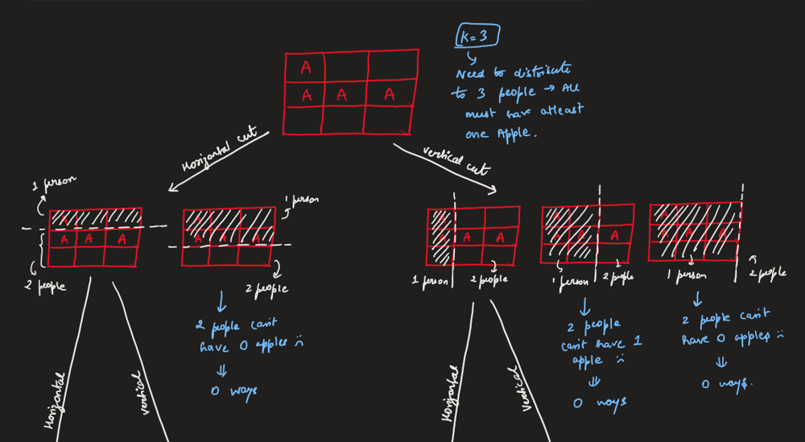
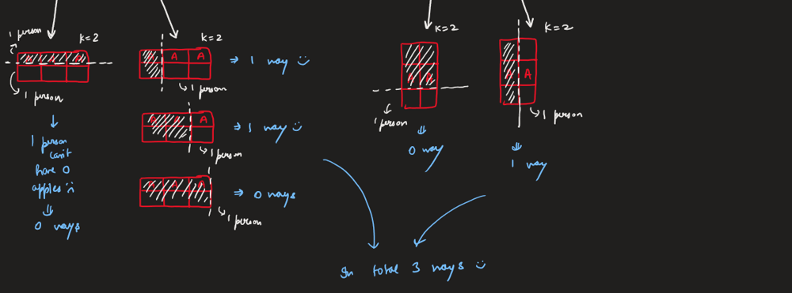
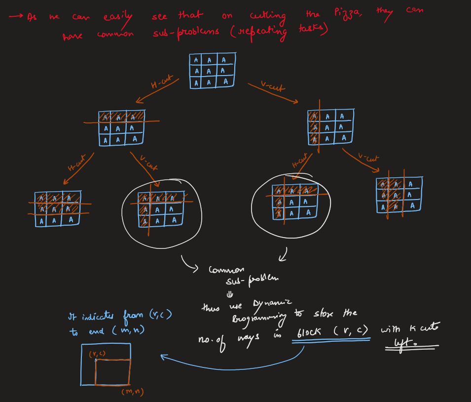
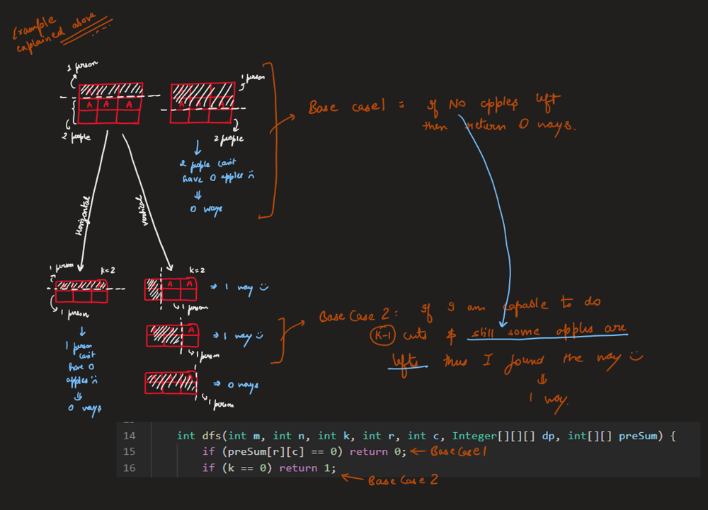
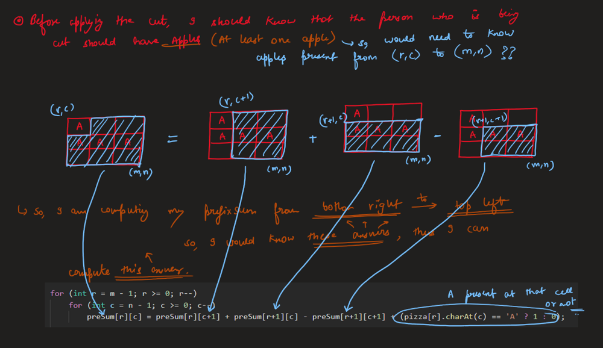
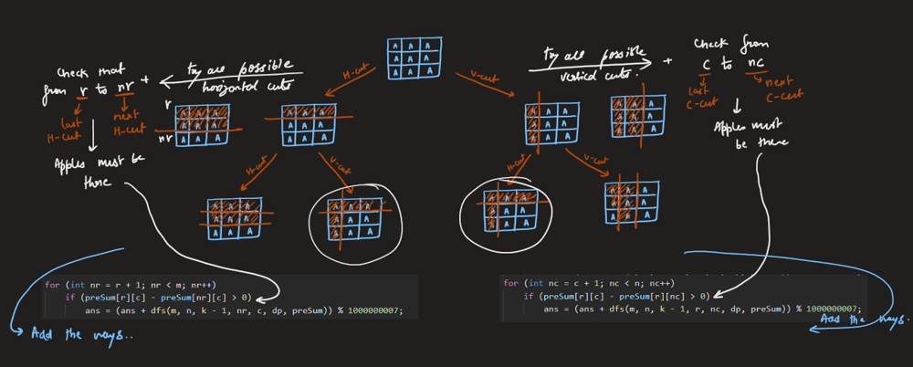
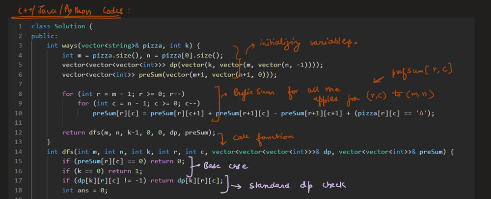
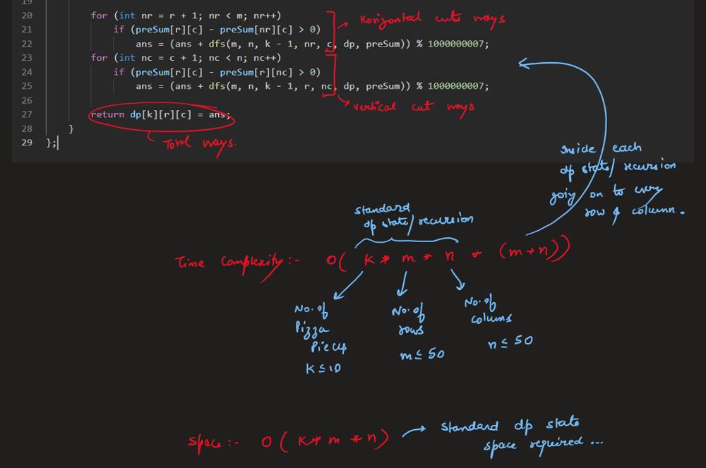

# Image Explanation🏆- [DP + Prefix Sum] - C++/Java/Python

**Author:** aryan_0077
**Votes:** 131
**Link:** [https://leetcode.com/problems/number-of-ways-of-cutting-a-pizza/solutions/3360907/](https://leetcode.com/problems/number-of-ways-of-cutting-a-pizza/solutions/3360907/)

---

# Video Solution (`Aryan Mittal`) - Link in LeetCode Profile
`Number of Ways of Cutting a Pizza` by `Aryan Mittal`


# Approach & Intution











# Code
```C++ []
class Solution {
public:
    int ways(vector<string>& pizza, int k) {
        int m = pizza.size(), n = pizza[0].size();
        vector<vector<vector<int>>> dp(vector(k, vector(m, vector(n, -1))));
        vector<vector<int>> preSum(vector(m+1, vector(n+1, 0)));

        for (int r = m - 1; r >= 0; r--)
            for (int c = n - 1; c >= 0; c--)
                preSum[r][c] = preSum[r][c+1] + preSum[r+1][c] - preSum[r+1][c+1] + (pizza[r][c] == 'A');
        
        return dfs(m, n, k-1, 0, 0, dp, preSum);
    }
    int dfs(int m, int n, int k, int r, int c, vector<vector<vector<int>>>& dp, vector<vector<int>>& preSum) {
        if (preSum[r][c] == 0) return 0; 
        if (k == 0) return 1; 
        if (dp[k][r][c] != -1) return dp[k][r][c];
        int ans = 0;

        for (int nr = r + 1; nr < m; nr++) 
            if (preSum[r][c] - preSum[nr][c] > 0)
                ans = (ans + dfs(m, n, k - 1, nr, c, dp, preSum)) % 1000000007;
        for (int nc = c + 1; nc < n; nc++) 
            if (preSum[r][c] - preSum[r][nc] > 0)
                ans = (ans + dfs(m, n, k - 1, r, nc, dp, preSum)) % 1000000007;

        return dp[k][r][c] = ans;
    }
};
```
```Java []
class Solution {
    public int ways(String[] pizza, int k) {
        int m = pizza.length, n = pizza[0].length();
        Integer[][][] dp = new Integer[k][m][n];
        int[][] preSum = new int[m+1][n+1];

        for (int r = m - 1; r >= 0; r--)
            for (int c = n - 1; c >= 0; c--)
                preSum[r][c] = preSum[r][c+1] + preSum[r+1][c] - preSum[r+1][c+1] + (pizza[r].charAt(c) == 'A' ? 1 : 0);

        return dfs(m, n, k-1, 0, 0, dp, preSum);
    }

    int dfs(int m, int n, int k, int r, int c, Integer[][][] dp, int[][] preSum) {
        if (preSum[r][c] == 0) return 0; 
        if (k == 0) return 1;
        if (dp[k][r][c] != null) return dp[k][r][c];
        int ans = 0;
        
        for (int nr = r + 1; nr < m; nr++) 
            if (preSum[r][c] - preSum[nr][c] > 0)
                ans = (ans + dfs(m, n, k - 1, nr, c, dp, preSum)) % 1_000_000_007;
        for (int nc = c + 1; nc < n; nc++) 
            if (preSum[r][c] - preSum[r][nc] > 0)
                ans = (ans + dfs(m, n, k - 1, r, nc, dp, preSum)) % 1_000_000_007;
                
        return dp[k][r][c] = ans;
    }
}
```
```Python []
class Solution:
    def ways(self, pizza: List[str], K: int) -> int:
        m, n, MOD = len(pizza), len(pizza[0]), 10 ** 9 + 7
        preSum = [[0] * (n + 1) for _ in range(m + 1)]

        for r in range(m - 1, -1, -1):
            for c in range(n - 1, -1, -1):
                preSum[r][c] = preSum[r][c + 1] + preSum[r + 1][c] - preSum[r + 1][c + 1] + (pizza[r][c] == 'A')

        @lru_cache(None)
        def dp(k, r, c):
            if preSum[r][c] == 0: return 0
            if k == 0: return 1
            ans = 0

            for nr in range(r + 1, m):
                if preSum[r][c] - preSum[nr][c] > 0:
                    ans = (ans + dp(k - 1, nr, c)) % MOD                 
            for nc in range(c + 1, n):
                if preSum[r][c] - preSum[r][nc] > 0:
                    ans = (ans + dp(k - 1, r, nc)) % MOD
                    
            return ans

        return dp(K - 1, 0, 0)
```
