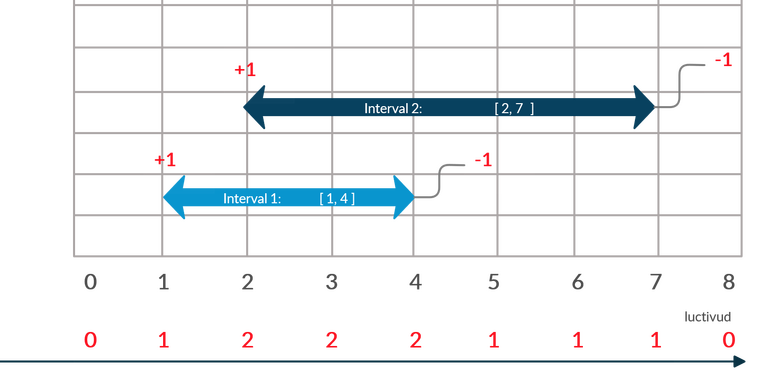

# [C++] Tackle MultiQueries in 3 ways - Explained w/ Diagram Solution

**Author:** luctivud
**Votes:** 42
**Link:** [https://leetcode.com/problems/number-of-students-doing-homework-at-a-given-time/solutions/637034/](https://leetcode.com/problems/number-of-students-doing-homework-at-a-given-time/solutions/637034/)

---

The given problem asks number of overlapping intervals of students at a given time.

# For single query:
We can simply solve it by checking the number of students who are studying at that time through comparing their start time and end time, which will be in O(numberOfStudents) time.
```
int busyStudent(vector<int>& startTime, vector<int>& endTime, int queryTime) {
		// Declare answer variable
        int ans = 0;
		
		// constantly check every interval if it contains queryTime
        for (int i = 0; i < startTime.size(); i++)
            if (startTime[i] <= queryTime && endTime[i] >= queryTime)
                ans++;
        return ans;
    }
```

# For multiple queries:
We can calculate the overlapping intervals at any time by maintaining an array that contains the intervals of all the students. Doing this requires O(maxm_element + numberOfStudents) time.


After mainitaing the array we can calculate the intersections at any instance in O(1) time and hence answer all the queries.
```
class Solution {
public:
    int busyStudent(vector<int>& startTime, vector<int>& endTime, int queryTime) {
        
        // Declare Array of maximum given constraint size to
        // store all the overlapping intervals at any time.
        // Initially no intervals overlap so initialised by 0.
        int overlap_intervals[1002];
        memset(overlap_intervals, 0, sizeof(overlap_intervals));
        
        // For every index in start time 
        // increment the index in array by 1
        for (int i : startTime) 
            overlap_intervals[i] += 1;
        
        // Since the intervals also contains the ending points so
        // decrement will work at index i+1.
        for (int i : endTime) 
            overlap_intervals[i + 1] -= 1;
        
        // Find the overlaps by using prefix sum technique
        for (int i = 0; i < 1001; i++) 
            overlap_intervals[i+1] += overlap_intervals[i];
        
        // return the overlaps at the given query time.
        return overlap_intervals[queryTime];
    }
};
```
As suggested by @[mike-box](https://leetcode.com/mike-box/) the above solution can be improved in the given constaints to cut to O(n log n) by using binary search after sorting both the arrays:

```
class Solution {
public:

    int busyStudent(vector<int>& startTime, vector<int>& endTime, int queryTime) {
		// Sort both the arrays in O(n logn)
        sort(startTime.begin(), startTime.end());
        sort(endTime.begin() ,endTime.end());
		
		// UpperBound(STL) will give the iterator pointing to first greater time than querytime
        int u = upper_bound(startTime.begin(), startTime.end(), queryTime) - startTime.begin();
		
		// LowerBound(STL) will give the iterator pointing to first NOT less than querytime.
        int l = lower_bound(endTime.begin(), endTime.end(), queryTime) - endTime.begin();
		
		// No. of instances when the study has been started before and completed after the query
		// time will be given as u - l :
        return u - l;
    }
};
```

Plz Upvote if you like it.