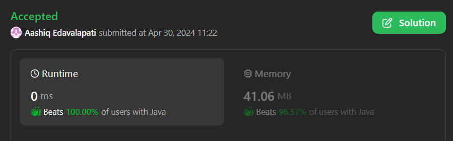

# 🚀🚀Easy Solution||Beats 100%🔥🔥||🌟 Homework Session Counter 📚✨

**Author:** Aashiq_Edavalapati
**Votes:** 10
**Link:** [https://leetcode.com/problems/number-of-students-doing-homework-at-a-given-time/solutions/5090892/](https://leetcode.com/problems/number-of-students-doing-homework-at-a-given-time/solutions/5090892/)

---

# Problem Explanation \uD83D\uDCDA
You are given two arrays, startTime and endTime, representing the start and end times of students' homework sessions respectively. Additionally, you are given a queryTime. Your task is to determine how many students were doing their homework exactly at queryTime, where queryTime falls within the time interval [startTime[i], endTime[i]] for each student.

### Input\uD83D\uDCE5
- `startTime`: An integer array representing the start time of each student's homework session.
- `endTime`: An integer array representing the end time of each student's homework session.
- `queryTime`: An integer representing the time at which we want to count how many students are doing their homework.

### Output\uD83D\uDCE4
- An integer representing the number of students who are doing their homework exactly at `queryTime`, where `queryTime` falls within the time interval `[startTime[i], endTime[i]]` for each student.
---



---


# Intuition \uD83D\uDCA1
To solve this problem, we need to iterate through each student's homework session and check if the queryTime falls within the given interval [startTime[i], endTime[i]]. If it does, we increment a counter to keep track of the number of students who were busy at queryTime.

# Approach \uD83C\uDFC3\u200D\u2642\uFE0F
Iterate through each student using a for loop.
For each student, check if queryTime is between their startTime and endTime using a simple condition.
Increment a counter if the condition is satisfied.
Finally, return the counter which represents the number of students busy at queryTime.

---
# Please upvote if you like the explanation
---

# Code
```java []
class Solution {
    public int busyStudent(int[] startTime, int[] endTime, int queryTime) {
        // Initialize a counter to keep track of the number of students doing homework at queryTime
        int doingHomework = 0;
        
        // Iterate through each student's homework session
        for (int i = 0; i < startTime.length; i++) {
            // Check if queryTime falls within the interval [startTime[i], endTime[i]]
            if (queryTime >= startTime[i] && queryTime <= endTime[i]) {
                // Increment the counter if the student was doing homework at queryTime
                doingHomework++;
            }
        }
        
        // Return the final count of students doing homework at queryTime
        return doingHomework;
    }
}

```
```python3 []
class Solution:
    def busyStudent(self, startTime: List[int], endTime: List[int], queryTime: int) -> int:
        # Initialize a counter to keep track of the number of students doing homework at queryTime
        doingHomework = 0
        
        # Iterate through each student's homework session
        for idx in range(len(startTime)):
            # Check if queryTime falls within the interval [startTime[idx], endTime[idx]]
            if startTime[idx] <= queryTime <= endTime[idx]:
                # Increment the counter if the student was doing homework at queryTime
                doingHomework += 1
        
        # Return the final count of students doing homework at queryTime
        return doingHomework

```
