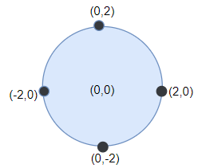
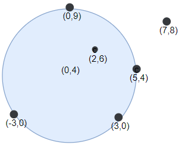

# [1453. Maximum Number of Darts Inside of a Circular Dartboard](https://leetcode.com/problems/maximum-number-of-darts-inside-of-a-circular-dartboard/)

| Category | Difficulty | Likes | Dislikes |
| :------: | :--------: | :---: | :------: |
| Algorithms | Hard | 158 | 276 |

**Tags:** [`array`](https://leetcode.com/tag/array), [`math`](https://leetcode.com/tag/math), [`geometry`](https://leetcode.com/tag/geometry)

**Companies:** `facebook`

## Description

Alice is throwing `n` darts on a very large wall. You are given an array `darts` where `darts[i] = [x_i, y_i]` is the position of the `i^th` dart that Alice threw on the wall.

Bob knows the positions of the `n` darts on the wall. He wants to place a dartboard of radius `r` on the wall so that the maximum number of darts that Alice throws lie on the dartboard.

Given the integer `r`, return *the maximum number of darts that can lie on the dartboard*.

 

**Example 1:**


```

Input: darts = [[-2,0],[2,0],[0,2],[0,-2]], r = 2
Output: 4
Explanation: Circle dartboard with center in (0,0) and radius = 2 contain all points.

```

**Example 2:**


```

Input: darts = [[-3,0],[3,0],[2,6],[5,4],[0,9],[7,8]], r = 5
Output: 5
Explanation: Circle dartboard with center in (0,4) and radius = 5 contain all points except the point (7,8).

```

 

**Constraints:**

	- `1 <= darts.length <= 100`

	- `darts[i].length == 2`

	- `-10^4 <= x_i, y_i <= 10^4`

	- All the `darts` are unique

	- `1 <= r <= 5000`

---

**Links:** [Submissions](https://leetcode.com/problems/maximum-number-of-darts-inside-of-a-circular-dartboard/) | [Solutions](https://leetcode.com/problems/maximum-number-of-darts-inside-of-a-circular-dartboard/)
