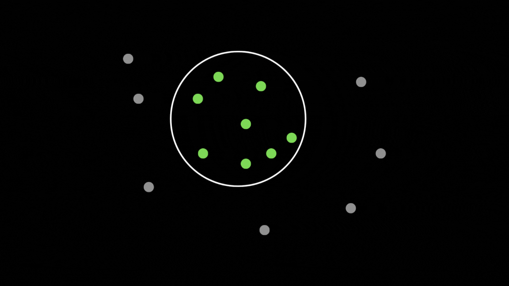
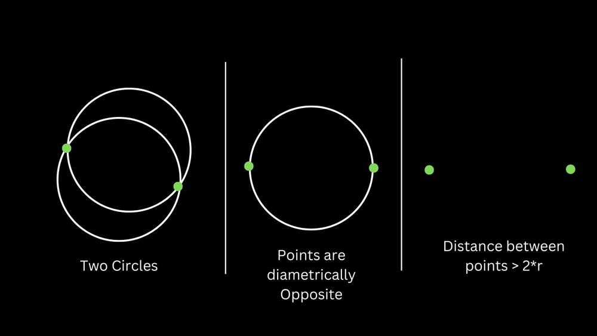
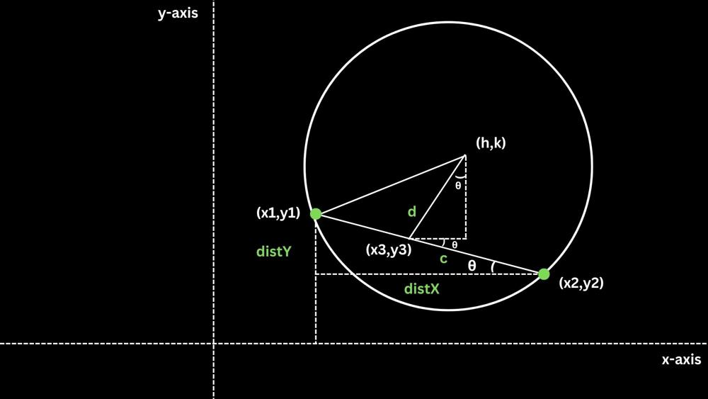
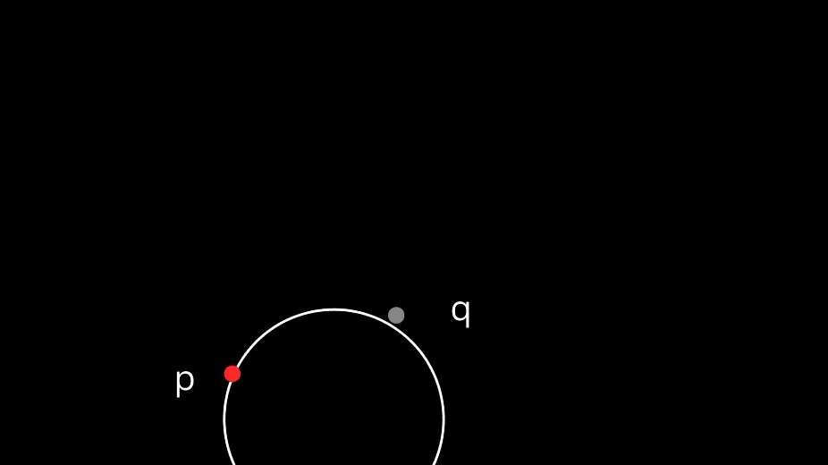
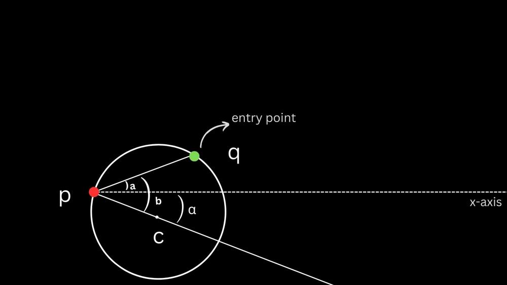
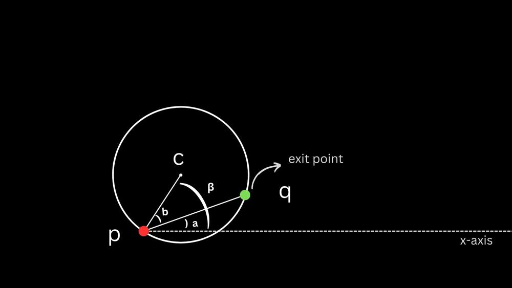

# Solution: 3 Methods and Implementations | Good Visualizations for Understanding

**Author:** jaintle
**Votes:** 4
**Link:** [https://leetcode.com/problems/maximum-number-of-darts-inside-of-a-circular-dartboard/solutions/4388272/](https://leetcode.com/problems/maximum-number-of-darts-inside-of-a-circular-dartboard/solutions/4388272/)

---

In order to understand all approaches, it is better to tick off some prerequites, starting off with the following lemma:
# Discrete Rotating Caliper Lemma
This lemma states that given a circle of radius `r` containing at least two points in its interior, you can rotate the circle such that two points lie on the boundary of the circle without losing any points inside.
In simpler terms, in a circle containing `n` points, it is always possible to shift the circle(keeping the radius same) in such a way that two points lie on the circumference of this circle while still keeping `n` points inside it for all `n>=2`.
Here's an animation to help visualize this property:


*Note of caution: This property only applies to having two points on the periphery and may not always apply to having more than two points on the periphery.*

# Approach 1: Circumcenter Method

### Intuition
The intiution is a fairly basic one. We know that all triangles have a circumcircle. We can obtain a circumcircle for every unique three-point-pair and find out the number of points that this circle contains.

### Algorithm
1. Apply three `for` loops and get three distinct points.
2. You get the circumcenter from the following formula:
    $$O_x = \\frac{{(x_1^2 + y_1^2)(y_2 - y_3) + (x_2^2 + y_2^2)(y_3 - y_1) + (x_3^2 + y_3^2)(y_1 - y_2)}}{{2(x_1(y_2 - y_3) + x_2(y_3 - y_1) + x_3(y_1 - y_2))}}$$
$$O_y = \\frac{{(x_1^2 + y_1^2)(x_3 - x_2) + (x_2^2 + y_2^2)(x_1 - x_3) + (x_3^2 + y_3^2)(x_2 - x_1)}}{{2(x_1(y_2 - y_3) + x_2(y_3 - y_1) + x_3(y_1 - y_2))}}
$$
3. Calculate the distance of this circumcenter from every other point in the given vector.
4. if `distance<=2*radius` then add to the running count, else continue.
5. Finally return the maximum running count for any 3 points.

### Code
```
class Solution {
public:
    int numPoints(vector<vector<int>>& darts, int r) {
        int maximum = 1;
        //finding all three-unique points combinations
        for(int i = 0; i<darts.size(); i++){
            for(int j = i+1; j<darts.size(); j++){
                for(int k = j+1; k<darts.size(); k++){
                    double x1 = darts[i][0];
                    double y1 = darts[i][1];
                    double x2 = darts[j][0];
                    double y2 = darts[j][1];
                    double x3 = darts[k][0];
                    double y3 = darts[k][1];
                    double ox, oy;
                    
                    //obtaining the circumcenter from the formula mentioned before
                    double denominator = 2 * ((x1 * (y2 - y3)) + (x2 * (y3 - y1)) + (x3 * (y1 - y2)));
                    ox = ((x1 * x1 + y1 * y1) * (y2 - y3) + (x2 * x2 + y2 * y2) * (y3 - y1) + (x3 * x3 + y3 * y3) * (y1 - y2)) / denominator;
                    oy = ((x1 * x1 + y1 * y1) * (x3 - x2) + (x2 * x2 + y2 * y2) * (x1 - x3) + (x3 * x3 + y3 * y3) * (x2 - x1)) / denominator;

                    //counter for the number of circles contained by this circle
                    int runningCount = 0;
                    for(int t = 0; t<darts.size(); t++){
                        //using distance formula
                        if((double)sqrt((double)pow(ox-darts[t][0],2)+(double)pow(oy-darts[t][1],2))<=(double)r)runningCount++;
                    }
                    //maximising the final result
                    maximum  = max(maximum,runningCount);
                }
            }
        }
        return maximum;
    }
};


```
### Complexity Analysis
- Time complexity: $$O(n^4)$$ since four nested `for-loops` are running.

- Space complexity:$$O(1)$$ since no extra space is required.

### Why does this solution not work?
Even barring the time complexity, this method won't work, can you think why?
[Hint] Check the note of caution again :)

Answer: This doesn't work because it's not necessary that the circle which contains the maximum number of points has three points on its periphery. As was discussed in the note after our lemma, while there will always be a way to shift a circle such that it contains the same number of points as before while also having two points on its periphery, the same cannot be said about 3 points.

---


# Approach 2: Two points, how many circles?

Given two points, a maximum of two circles of a given radius `r` can pass through them. The following image illustrates all the three cases possible:



### Intuition
- The intiution of this method comes from the fact that we need to reduce the time complexity of our previous algorithm and build on it so that all edge cases are also considered(and not only those which have three points on the circumference of the circle). 
- Since we are thinking of reducing the time complexity, we may think on the lines of reducing one `for-loop` in the previous approach.
- Once we reach to the idea of trying to get all circles passing through two points having radius `r`, then we may apply the knowledge previously discussed (three cases) and then compute the number of points contained by each circle.

### Approach
Here, another tricky thing would be to calculate the centers of the two(atmost) circles obtained. This requires some trigonometry. Refer to the following illustration and explanation for a clear understanding of how the coordinates of the centers are calculated:



- This is the distance between the two points.
 $$c = \\sqrt{(x_2 - x_1)^2 + (y_2 - y_1)^2}$$
- The coordianates of the mid-points (since we know that the perpendicular bisector of any chord of a circle passes through its center)
$$x_3 = \\frac{x_1 + x_2}{2}, \\quad y_3 = \\frac{y_1 + y_2}{2}$$
- Distance `d` between the center of the circle and the chord joining the two points
$$d = \\sqrt{r^2 - \\left(\\frac{c}{2}\\right)^2}$$
- Now to calculate the coordinates of the center of the circle, we have to use some properties of geometry(corresponding angles, triangles etc) and some trigonometry.
- If you look at the figure, first we get the angle $$\	heta$$ and then we calculate the x-offset and y-offset of the center of the circle from the mid-point coordinates. We do so by taking projections of the previously calculated distance `d`. More formally:
$$\\cos \	heta = \\frac{y_2 - y_1}{c}, \\quad \\sin \	heta = \\frac{x_2 - x_1}{c}$$
$$(h_0, k_0) = (x_3 - d \\cos \	heta, y_3 + d \\sin \	heta), \\quad (h_1, k_1) = (x_3 + d \\cos \	heta, y_3 - d \\sin \	heta)$$

### Code
```
class Solution {
public:
    int numPoints(vector<vector<int>>& darts, int r) {
        int res = 1;
        for(int i = 0; i<darts.size(); i++){
            for(int j = i+1; j<darts.size(); j++){
                double x1=darts[i][0], y1=darts[i][1], x2=darts[j][0], y2=darts[j][1];
                
                //difference between x and y coordinates of the two points (ref figure)
                double distX = x2 - x1;
                double distY = y2 - y1;
                double c = sqrt(pow(distX, 2) + pow(distY, 2));
                //if distance between the two points is greater than twice the radius, we ignore this. Reminder that the longest chord in a circle is its diameter.
                if (c > 2.0*r) {
                    continue;
                }
                
                //mid point
                double x3 = (x1 + x2) / 2, y3 = (y1 + y2) / 2;
                double d = sqrt(pow(r, 2) - pow(c / 2, 2));

                //getting theta
                double cosTheta = distY/c;
                double sinTheta = distX/c;
                
                //adding projections of d to the mid point
                double h0 = x3 - d * cosTheta;
                double k0 = y3 + d * sinTheta;

                double h1 = x3 + d * cosTheta;
                double k1 = y3 - d * sinTheta;

                //two counts for two circles (both will be same for case 2)
                int count1 = 0;
                int count2 = 0;

                for(auto&t:darts){
                    //adding 1e-6 to counter precision errors in c++
                    if((double)pow(h0-t[0],2)+(double)pow(k0-t[1],2)<=(double)pow(r,2) + 1e-6)count1++;
                    if((double)pow(h1-t[0],2)+(double)pow(k1-t[1],2)<=(double)pow(r,2) + 1e-6)count2++;
                }
                res=max({res,count1,count2});
            }
        }
        return res;
    }
};

```

### Complexity Analysis

- Time complexity: $$O(n^3)$$ since three nested `for-loops` are running.

- Space complexity:$$O(1)$$ since no extra space is required.

---


# Approach 3: Angular Sweep

In the angular sweep alogorithm, rather than having a pair of points to draw cirlces, a single point is taken. How can one make a unique circle with just one point and a radius you may ask? Well, you can't. But that's the point. You dont need to make any unique circles! The idea is that you take a single point and rotate a circle of radius r through that point in the entire plane. Then you just need to check the number of points in each circle. But won't ther be infinite such circles? Yes. Hence, rather than checking the number of points contained by each cirlce, we keep a running log of entry and exit angles for each point. In the end, we get the maximum number of points contained by any circle passing through the point we started with.
*Note of caution: Please keep in mind that the circle is merely passing through our chosen point and that our chosen point isn't the center of this circle.*

I know its hard to understand this algorithm by merely reading about the approach, so here's a visualisation of just one point `q` entering and leaving a circle pivoted at point `p`:

The above visualization gives a good idea about how the circles is rotated on a point and how another point in the space enters and leaves the circle.

## Approach
- In order to keep this method computationally efficient, we have to keep a running log of the angles at which a point enters and leaves the circle.
- Following two images will give a clear idea about what we mean by these "angles":



- A few points to pay attention to in the above figures are a) the angle between the line pq and the x-axis never changes (since both points are stationary) and b) the angle between pc and pq also remains the same during the time of entry and exit (since both are congruent triangles).
- Once we have these entry and exit points we can store these angles and then finally greedily choose the window wherein the maximum number of points were included in the circle. In this way, we can do this part of the problem in $$O(nlog(n))$$ time complexity as we have done multiple times in other standard problems.

## Code
```
class Solution {
public:
    double distance(int i, int j, vector<vector<int>>& darts){
        //function to calculate distance between two points
        return (double)sqrt((double)pow(darts[i][0]-darts[j][0],2)+(double)pow(darts[i][1]-darts[j][1],2));
    }
    int helper(int index, vector<vector<int>>& darts, double r){
        vector<pair<double,double>> v;
        for(int i = 0; i<darts.size(); i++){
            if(i!=index&&distance(i,index,darts)<=(2.0*r)){
                // angle a being calculated using inverse tan function
                double a = atan2(((double)darts[i][1]-darts[index][1]),(double)(darts[i][0]-darts[index][0]));
                // angle b being calculated using inverse cos function
                double b = acos(distance(i,index,darts)/(2.0*r));
                double alpha = a-b;
                double beta = a+b;
                //here we are pushing in pairs due to the greedy observation that the maximised window shall first count an entering point before subtracting a leaving point
                v.push_back({alpha,0.0}); //0.0 for entering
                v.push_back({beta,1.0});  //1.0 for leaving
            }
        }
        sort(v.begin(),v.end());
        int res = 1;
        int curr = 1;
        for(auto&i:v){
            //add entering point
            if(i.second==0.0){curr++;}
            //subtract leaving point
            else{ curr--;}
            //maximise the instance where maximum points are included
            res=max(res,curr);
        }
        return res;
    }
    int numPoints(vector<vector<int>>& darts, int r) {
        int maxi = 0;
        for(int i = 0; i<darts.size(); i++){
            //for each point 'i' which pivots the circle of radius 'r'
            maxi = max(maxi,helper(i,darts,(double)r));
        }
        return maxi;
    }
};

```
- Some final notes on implementation:
`atan2` function is used instead of atan because this gives result only in two quadrants rather than all four.
We always subtract `b` from `a`, even if b is greater than a, as the angle is with respect to the x-axis.

## Complexity Analysis


- Time complexity: $$O(n^2log(n))$$ since three nested `for-loops` are running.

- Space complexity:$$O(n)$$ since we are storing the entry and exit points of each point in the vector provided.
