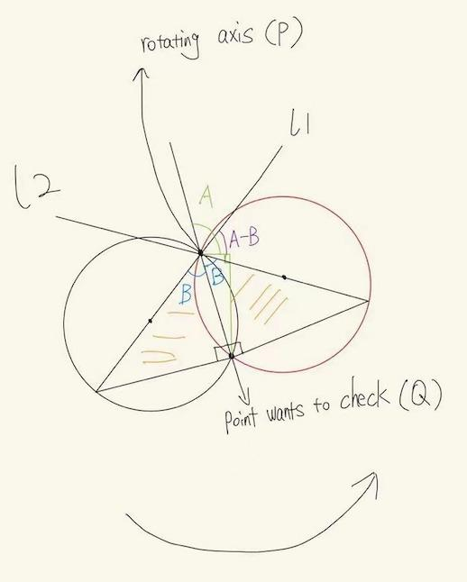

# [Python] The most clear interpretation for Lee's 3rd answer

**Author:** surface09
**Votes:** 1
**Link:** [https://leetcode.com/problems/maximum-number-of-darts-inside-of-a-circular-dartboard/solutions/2041530/](https://leetcode.com/problems/maximum-number-of-darts-inside-of-a-circular-dartboard/solutions/2041530/)

---

1, first, please read the first answer in this page
quora.com/What-is-an-algorithm-for-enclosing-the-maximum-number-of-points-in-a-2-D-plane-with-a-fixed-radius-circle
Then you will have a confusion, what the alpha and beta is.




2, See the picture. At the position of P and Q, when we calculate

					tan A = (y1 - y2) / (x1 - x2)

The result will be a negative value. So the angle will be 

                    pi + A. For example, tan (-45) = -1. The angle is pi + (-45) = 135 degree.

Then you can understand why the angle A is there.

Now we know that the rotating angle starts at A-B. 
Now The question 

					Rotating from left circle to right circle, how much angle does it rotate? 

is equivalently transfering to:

					From l1 rotating to l2, how much angle does it rotate?

The answer is simply 2B. Check the picuture directly to observe the symmetry of two yellow shadow triangles. 
Or you can check the strict proof below.


	"""
	Claim:  two yellow shadow triangles are symmetric.

	Proof.  Indeed, two yellow shadow triangles have a common side, 
	and the same 2r length hypotenuse, and they are all right triangle. 
	
	So the length of another side of two triangles are also equal. Now 
	treat this two triangles as one big triangle, so the common side is a 
	an angle bisector (also median line, perpendicular line, so three lines in one). 
	"""

By the symmetry, we immediately know the angle from l1 to l2 is 2B. Thus,

					alpha = A - B, and beta = A - B + 2B = A + B.

Then you can understand the code easily. After sort(), at one moment, we try to find
the maxmum points count that are in one circle. And we do this point by point by fixing each rotating center.

-------------
**Code**:

```
class Solution:
    def numPoints(self, points: List[List[int]], r: int) -> int:
        
        def getPointsInside(i, r, n):
            # This vector stores alpha and beta and flag
            # is marked true for alpha and false for beta
            angles = []

            for j in range(n):
                
                if i != j and distance[i][j] <= 2 * r:
                    # acos returns the arc cosine of the complex
                    # used for cosine inverse
                    B = math.acos(distance[i][j] / (2 * r))

                    # arg returns the phase angle of the complex
                    x1, y1 = points[i]
                    x2, y2 = points[j]
                    
                    A = math.atan2(y1 - y2, x1 - x2)
                    
                    alpha = A - B
                    
                    beta = A + B
                    
                    angles.append((alpha, False))
                    
                    angles.append((beta, True))

            # angles vector is sorted and traversed
            angles.sort()
            # count maintains the number of points inside
            # the circle at certain value of theta
            # res maintains the maximum of all count
            cnt, res = 1, 1
            for angle in angles:
                # entry angle
                if angle[1] == False: 
                    cnt += 1
                # exit angle
                else: 
                    cnt -= 1

                res = max(cnt, res)

            return res

        # Returns count of maximum points that can lie
        # in a circle of radius r.
        # dis array stores the distance between every
        # pair of points
        n = len(points)
        max_pts = n
        distance = [[0 for _ in range(max_pts)] for _ in range(max_pts)]
        for i in range(n - 1):
            for j in range(i + 1, n):
                # abs gives the magnitude of the complex
                # number and hence the distance between
                # i and j
                x1, y1 = points[i]
                x2, y2 = points[j]
                distance[i][j] = distance[j][i] = sqrt((x1 - x2)**2 + (y1 - y2)**2)

        # This loop picks a point p
        ans = 0
        # maximum number of points for point arr[i]
        for i in range(n):
            ans = max(ans, getPointsInside(i, r, n))

        return ans
        
```