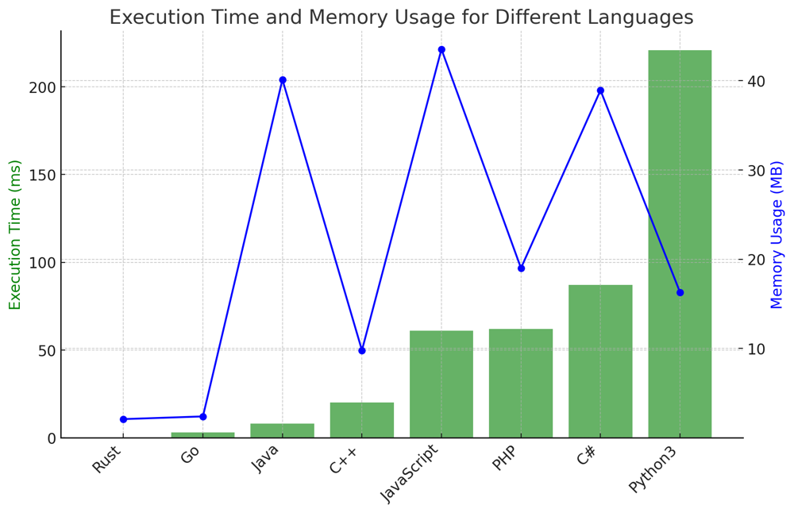

# ✅ 90.14% Dynamic Programming Optimized

**Author:** vanAmsen
**Votes:** 46
**Link:** [https://leetcode.com/problems/max-dot-product-of-two-subsequences/solutions/4143612/](https://leetcode.com/problems/max-dot-product-of-two-subsequences/solutions/4143612/)

---

# Intuition
When faced with two sequences and asked to find the maximum dot product, it becomes evident that we might have to consider various combinations of subsequences to determine the maximum value. This naturally hints towards the possibility of using dynamic programming, as there are overlapping subproblems.

## Live Coding & Explain
https://youtu.be/h1RAw1gEx5A?si=6zJ77Y2f9X5JLaZL

# Approach

1. **Dynamic Programming Approach**: 
    - We can use a 2D array `dp` where `dp[i][j]` represents the maximum dot product between the first `i` elements of `nums1` and the first `j` elements of `nums2`.
    - If we decide to pick the elements `nums1[i]` and `nums2[j]`, the dot product added to the result is `nums1[i] * nums2[j]`.
    - We can also decide not to pick any element from `nums1` or `nums2`, so we will consider `dp[i-1][j]` and `dp[i][j-1]`.
    - The recurrence relation is: 
      $$ dp[i][j] = \\max(dp[i-1][j], dp[i][j-1], nums1[i-1] \	imes nums2[j-1] + \\max(0, dp[i-1][j-1]) $$

2. **Space Optimized Approach**:
    - Instead of using a 2D array, we observe that we only need values from the current and previous row to compute the next row. Thus, two 1D arrays (current and previous) suffice.
    - At the end of processing each row, we swap the two arrays, thus making the current array act as the previous array for the next iteration.

# Complexity
- **Time complexity**: $$O(m \	imes n)$$ - We have to fill up the `dp` matrix which is of size $$m \	imes n$$.
- **Space complexity**:
    - For the **DP approach**: $$O(m \	imes n)$$ - The size of the `dp` matrix.
    - For the **Optimized approach**: $$O(n)$$ - We are using two 1D arrays.


# Code Dynamic Programming
``` Python []
class Solution:
    def maxDotProduct(self, nums1: List[int], nums2: List[int]) -> int:
        m, n = len(nums1), len(nums2)
        
        dp = [[float('-inf')] * (n + 1) for _ in range(m + 1)]
        
        for i in range(1, m + 1):
            for j in range(1, n + 1):
                curr_product = nums1[i-1] * nums2[j-1]
                
                dp[i][j] = max(dp[i][j], curr_product, dp[i-1][j], dp[i][j-1], curr_product + dp[i-1][j-1])
        
        return dp[m][n]

```

# Code Optimized
``` Python []
class Solution:
    def maxDotProduct(self, nums1: List[int], nums2: List[int]) -> int:
        m, n = len(nums1), len(nums2)
        
        current = [float('-inf')] * (n + 1)
        previous = [float('-inf')] * (n + 1)
        
        for i in range(1, m + 1):
            for j in range(1, n + 1):
                curr_product = nums1[i-1] * nums2[j-1]
                
                current[j] = max(curr_product, previous[j], current[j-1], curr_product + max(0, previous[j-1]))
            
            current, previous = previous, current
        
        return previous[n]

```
``` Go []
func maxDotProduct(nums1 []int, nums2 []int) int {
    m, n := len(nums1), len(nums2)
    current := make([]int, n+1)
    previous := make([]int, n+1)
    for i := range current {
        current[i] = math.MinInt32
        previous[i] = math.MinInt32
    }

    for i := 1; i <= m; i++ {
        for j := 1; j <= n; j++ {
            currProduct := nums1[i-1] * nums2[j-1]
            current[j] = max(max(max(currProduct, previous[j]), current[j-1]), currProduct + max(0, previous[j-1]))
        }
        current, previous = previous, current
    }
    return previous[n]
}

func max(a, b int) int {
    if a > b {
        return a
    }
    return b
}
```
``` Rust []
impl Solution {
    pub fn max_dot_product(nums1: Vec<i32>, nums2: Vec<i32>) -> i32 {
        let m = nums1.len();
        let n = nums2.len();
        let mut current = vec![i32::MIN; n + 1];
        let mut previous = vec![i32::MIN; n + 1];

        for i in 1..=m {
            for j in 1..=n {
                let curr_product = nums1[i - 1] * nums2[j - 1];
                current[j] = std::cmp::max(curr_product, std::cmp::max(previous[j], std::cmp::max(current[j - 1], curr_product + std::cmp::max(0, previous[j - 1]))));
            }
            std::mem::swap(&mut current, &mut previous);
        }
        previous[n]
    }
}
```
``` C++ []
class Solution {
public:
    int maxDotProduct(std::vector<int>& nums1, std::vector<int>& nums2) {
        int m = nums1.size(), n = nums2.size();
        std::vector<int> current(n + 1, INT_MIN), previous(n + 1, INT_MIN);

        for (int i = 1; i <= m; ++i) {
            for (int j = 1; j <= n; ++j) {
                int curr_product = nums1[i-1] * nums2[j-1];
                current[j] = std::max({curr_product, previous[j], current[j-1], curr_product + std::max(0, previous[j-1])});
            }
            std::swap(current, previous);
        }
        return previous[n];
    }
};
```
``` Java []
public class Solution {
    public int maxDotProduct(int[] nums1, int[] nums2) {
        int m = nums1.length, n = nums2.length;
        int[] current = new int[n + 1], previous = new int[n + 1];
        Arrays.fill(current, Integer.MIN_VALUE);
        Arrays.fill(previous, Integer.MIN_VALUE);

        for (int i = 1; i <= m; i++) {
            for (int j = 1; j <= n; j++) {
                int curr_product = nums1[i - 1] * nums2[j - 1];
                current[j] = Math.max(Math.max(Math.max(curr_product, previous[j]), current[j - 1]), curr_product + Math.max(0, previous[j - 1]));
            }
            int[] temp = current;
            current = previous;
            previous = temp;
        }
        return previous[n];
    }
}
```
``` JavaScript []
var maxDotProduct = function(nums1, nums2) {
    let m = nums1.length, n = nums2.length;
    let current = new Array(n + 1).fill(Number.MIN_SAFE_INTEGER);
    let previous = new Array(n + 1).fill(Number.MIN_SAFE_INTEGER);

    for (let i = 1; i <= m; i++) {
        for (let j = 1; j <= n; j++) {
            let curr_product = nums1[i - 1] * nums2[j - 1];
            current[j] = Math.max(curr_product, previous[j], current[j - 1], curr_product + Math.max(0, previous[j - 1]));
        }
        [current, previous] = [previous, current];
    }
    return previous[n];
};
```
``` PHP []
class Solution {
    function maxDotProduct($nums1, $nums2) {
        $m = count($nums1);
        $n = count($nums2);
        $current = array_fill(0, $n + 1, PHP_INT_MIN);
        $previous = array_fill(0, $n + 1, PHP_INT_MIN);

        for ($i = 1; $i <= $m; $i++) {
            for ($j = 1; $j <= $n; $j++) {
                $curr_product = $nums1[$i - 1] * $nums2[$j - 1];
                $current[$j] = max($curr_product, $previous[$j], $current[$j - 1], $curr_product + max(0, $previous[$j - 1]));
            }
            list($current, $previous) = array($previous, $current);
        }
        return $previous[$n];
    }
}
```
``` C# []
public class Solution {
    public int MaxDotProduct(int[] nums1, int[] nums2) {
        int m = nums1.Length, n = nums2.Length;
        int[] current = new int[n + 1], previous = new int[n + 1];
        Array.Fill(current, int.MinValue);
        Array.Fill(previous, int.MinValue);

        for (int i = 1; i <= m; i++) {
            for (int j = 1; j <= n; j++) {
                int curr_product = nums1[i - 1] * nums2[j - 1];
                current[j] = Math.Max(Math.Max(Math.Max(curr_product, previous[j]), current[j - 1]), curr_product + Math.Max(0, previous[j - 1]));
            }
            (current, previous) = (previous, current);
        }
        return previous[n];
    }
}
```

# Performance
| Language   | Execution Time (ms) | Memory Usage (MB) |
|------------|---------------------|-------------------|
| Rust       | 0                   | 2.1               |
| Go         | 3                   | 2.4               |
| Java       | 8                   | 40.1              |
| C++        | 20                  | 9.8               |
| JavaScript | 61                  | 43.5              |
| PHP        | 62                  | 19                |
| C#         | 87                  | 38.9              |
| Python3    | 221                 | 16.3              |




# Why It Works?
The reason this solution works is that dynamic programming allows us to break the problem down into smaller subproblems. By considering all possibilities for each pair of indices `(i, j)`, we ensure that we find the maximum dot product. At each step, we make decisions based on the best possible outcome seen so far, which ensures the global maximum is achieved at the end.

# What We Have Learned?
The problem teaches us to break a seemingly complicated problem into smaller manageable subproblems. It also emphasizes the importance of space optimization in dynamic programming problems, showcasing that often we don't need to store all the states.

# Logic Behind the Solution
At every step, we consider two elements, one from each sequence. We have the choice to either consider them in the dot product or not. This decision is based on which choice yields the maximum dot product. By building our solution in this step-by-step manner, we ensure that at the end, our `dp` table's last cell contains the maximum dot product of any subsequence.

# Why Optimized Version Works?
The optimized version leverages the observation that to compute the value at `dp[i][j]`, we only need values from the `i-1`th row and the `i`th row. Therefore, instead of maintaining a 2D array, we can keep track of just two rows. This significantly reduces our space requirements without affecting the logic or the outcome.