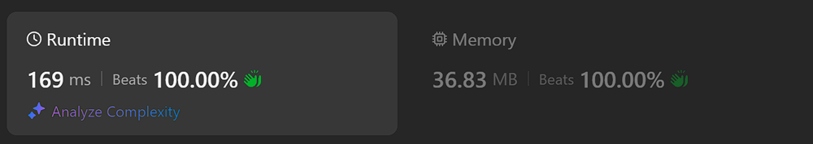
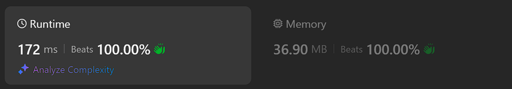
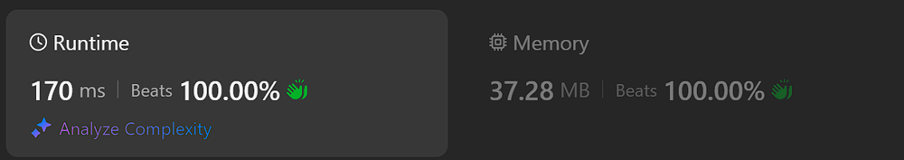
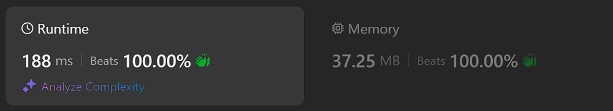
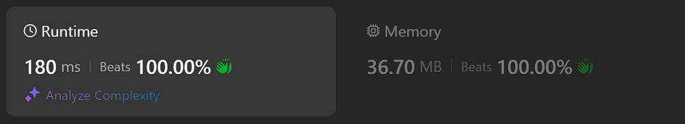
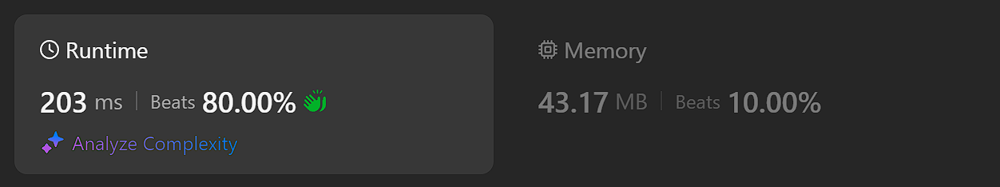
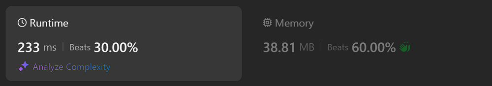
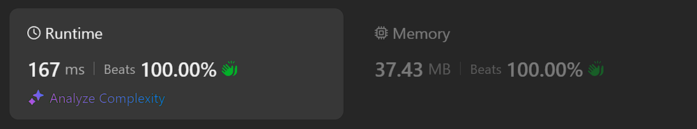

# Kotlin. Beats 100% (169). Xoring then using static IntArray to count numbers

**Author:** mobdev778
**Votes:** 3
**Link:** [https://leetcode.com/problems/make-two-arrays-equal-by-reversing-subarrays/solutions/5578901/](https://leetcode.com/problems/make-two-arrays-equal-by-reversing-subarrays/solutions/5578901/)

---



# Code
```
class Solution {
    fun canBeEqual(target: IntArray, arr: IntArray): Boolean {
        if (xored(target) != xored(arr)) return false

        var min = 1000
        var max = 0
        for (t in target) {
            counters[t]++
            min = Math.min(min, t)
            max = Math.max(max, t)
        }
        for (a in arr) {
            counters[a]--
            min = Math.min(min, a)
            max = Math.max(max, a)
        }

        var result = true
        for (i in min..max) {
            if (counters[i] != 0) {
                result = false
                counters[i] = 0
            }
        }
        return result
    }

    private fun xored(arr: IntArray): Int {
        var xored = 0
        for (a in arr) {
            xored = xored xor a
        }
        return xored
    }

    companion object {
        val counters = IntArray(1001)
    }
}
```

# Alternative approaches

1. Static IntArray



```
class Solution {
    fun canBeEqual(target: IntArray, arr: IntArray): Boolean {
        var min = 1000
        var max = 0
        for (t in target) {
            counters[t]++
            min = Math.min(min, t)
            max = Math.max(max, t)
        }
        for (a in arr) {
            counters[a]--
            min = Math.min(min, a)
            max = Math.max(max, a)
        }

        var result = true
        for (i in min..max) {
            if (counters[i] != 0) {
                result = false
                counters[i] = 0
            }
        }
        return result
    }

    companion object {
        val counters = IntArray(1001)
    }
}
```

2. Fast check then radix sort



```
class Solution {
    fun canBeEqual(target: IntArray, arr: IntArray): Boolean {
        if (xored(target) != xored(arr)) return false

        radixSort(target, 100)
        radixSort(arr, 100)
        return Arrays.equals(target, arr)
    }

    private fun xored(arr: IntArray): Int {
        var xored = 0
        for (a in arr) {
            xored = xored xor a
        }
        return xored
    }

    private fun radixSort(nums: IntArray, max: Int) {
        var exp = 1
        while (exp <= max) {
            for (n in nums) {
                array[(n / exp) % 10].add(n)
            }
            var ti = 0
            for (bucket in array) {
                ti += bucket.dropTo(ti, nums)
            }
            exp *= 10
        }
    }

    class Bucket {
        private val array = IntArray(1001)
        private var i = 0

        fun add(number: Int) {
            array[i++] = number
        }

        fun dropTo(offset: Int, target: IntArray): Int {
            System.arraycopy(array, 0, target, offset, i)
            return i.also { i = 0 }
        }
    }

    companion object {
        private val array = Array(10) { Bucket() }
    }
}
```

3. Radix sort



```
class Solution {
    fun canBeEqual(target: IntArray, arr: IntArray): Boolean {
        radixSort(target, 100)
        radixSort(arr, 100)
        return Arrays.equals(target, arr)
    }

    private fun radixSort(nums: IntArray, max: Int) {
        var exp = 1
        while (exp <= max) {
            for (n in nums) {
                array[(n / exp) % 10].add(n)
            }
            var ti = 0
            for (bucket in array) {
                ti += bucket.dropTo(ti, nums)
            }
            exp *= 10
        }
    }

    class Bucket {
        private val array = IntArray(1001)
        private var i = 0

        fun add(number: Int) {
            array[i++] = number
        }

        fun dropTo(offset: Int, target: IntArray): Int {
            System.arraycopy(array, 0, target, offset, i)
            return i.also { i = 0 }
        }
    }

    companion object {
        private val array = Array(10) { Bucket() }
    }
}
```

4. Fast check then "quick" sort



```
class Solution {
    fun canBeEqual(target: IntArray, arr: IntArray): Boolean {
        if (xored(target) != xored(arr)) return false
        Arrays.sort(target)
        Arrays.sort(arr)
        return Arrays.equals(target, arr)
    }

    private fun xored(arr: IntArray): Int {
        var xored = 0
        for (a in arr) {
            xored = xored xor a
        }
        return xored
    }
}
```

5. "Quick" sort



```
class Solution {
    fun canBeEqual(target: IntArray, arr: IntArray): Boolean {
        Arrays.sort(target)
        Arrays.sort(arr)
        return Arrays.equals(target, arr)
    }
}
```

6. Fast check + two PQs


```
class Solution {
    fun canBeEqual(target: IntArray, arr: IntArray): Boolean {
        if (target.size != arr.size || xored(target) != xored(arr)) return false

        val t = makePQ(target)
        val a = makePQ(arr)
        while (t.isNotEmpty()) {
            if (t.poll() != a.poll()) return false
        }
        return true
    }

    private fun xored(arr: IntArray): Int {
        var xored = 0
        for (a in arr) {
            xored = xored xor a
        }
        return xored
    }

    private fun makePQ(arr: IntArray): PriorityQueue<Int> {
        val pq = PriorityQueue<Int>()
        for (a in arr) {
            pq.offer(a)
        }
        return pq
    }
}
```

7. Two PQs



```
class Solution {
    fun canBeEqual(target: IntArray, arr: IntArray): Boolean {
        if (target.size != arr.size) return false

        val t = makePQ(target)
        val a = makePQ(arr)
        while (t.isNotEmpty()) {
            if (t.poll() != a.poll()) return false
        }
        return true
    }

    private fun makePQ(arr: IntArray): PriorityQueue<Int> {
        val pq = PriorityQueue<Int>()
        for (a in arr) {
            pq.offer(a)
        }
        return pq
    }
}
```

In the last two measurements, by the way, we can see that the priority queue has an advantage only in situations where you need to get only a part of the sorted elements. And the queue, on average, works worse when you need to get all the sorted elements in their entirety.

In general, it can be seen that optimization with preliminary fast checking of arrays via XOR gives an advantage over other solutions.

UPD:

8. One more attempt (custom class "Counter")



```
class Solution {
    fun canBeEqual(target: IntArray, arr: IntArray): Boolean {
        if (xored(target) != xored(arr)) return false

        var min = 1000
        var max = 0
        for (t in target) {
            counters[t].count++
            min = Math.min(min, t)
            max = Math.max(max, t)
        }
        for (a in arr) {
            counters[a].count--
            min = Math.min(min, a)
            max = Math.max(max, a)
        }

        var result = true
        for (i in min..max) {
            val c = counters[i]
            if (c.count != 0) {
                result = false
                c.count = 0
            }
        }
        return result
    }

    private fun xored(arr: IntArray): Int {
        var xored = 0
        for (a in arr) {
            xored = xored xor a
        }
        return xored
    }

    class Counter {
        var count: Int = 0
    }

    companion object {
        val counters = Array(1001) { Counter() }
    }
}
```