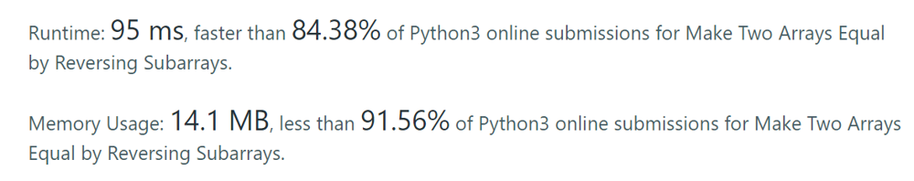

# Easy solution using dictionary in python

**Author:** ankurbhambri
**Votes:** 45
**Link:** [https://leetcode.com/problems/make-two-arrays-equal-by-reversing-subarrays/solutions/2730962/](https://leetcode.com/problems/make-two-arrays-equal-by-reversing-subarrays/solutions/2730962/)

---


```
class Solution:
    def canBeEqual(self, target: List[int], arr: List[int]) -> bool:
        n, m = len(target), len(arr)
        if m > n:
            return False
        t = Counter(target)
        a = Counter(arr)
        for k, v in a.items():
            if k in t and v == t[k]:
                continue
            else:
                return False
        return True
```