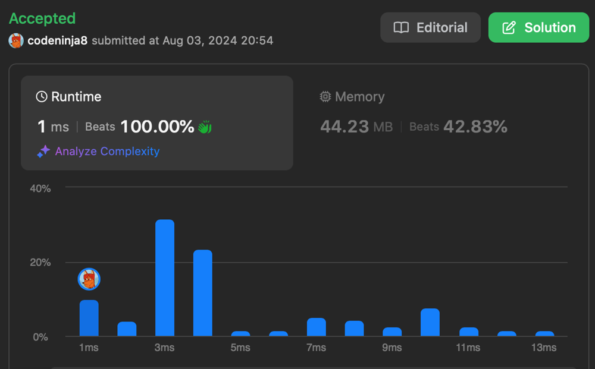

# ✅ super fast O(n) beats 100% in java

**Author:** codeninja8
**Votes:** 0
**Link:** [https://leetcode.com/problems/make-two-arrays-equal-by-reversing-subarrays/solutions/5581975/](https://leetcode.com/problems/make-two-arrays-equal-by-reversing-subarrays/solutions/5581975/)

---

# Intuition
We can get one array from another is all elements are the same. They can be in a different order.

The constraints are `1 <= target[i] <= 1000`. It's asking us to use an array instead of a HashMap

Let's count numbers in `target` and `arr` and compare them. The `count` array should have all zeros. Or we can use `sum` to not check all elements in `count`. In the fest loop, we sum up the elements. In the second, we subtract them down. Check if the sum is zero and `count` doesn't have negative elements.

This code beats 100% in java




In c and go I used a bit different algorithm.
Also we can just sort both of the arrays and compare them. (It's that I did in the Racket code. It has $$O(n*long(n))$$ complexity)

# Complexity
- Time complexity:
$$O(n)$$

- Space complexity:
$$O(n)$$

# Code
``` java []
class Solution {
    public boolean canBeEqual(int[] target, int[] arr) {
        int[] count = new int[1001];
        int sum = 0;
        for (int val : target) {
            sum += val;
            count[val]++;
        }

        for (int val : arr) {
            sum -= val;
            count[val]--;
            if (count[val] < 0) return false;
        }

        return sum == 0;
    }
}
```
``` python []
class Solution(object):
    def canBeEqual(self, target, arr):
        count = [0] * 1001
        sum = 0
        for val in target:
            sum += val
            count[val] += 1
        for val in arr:
            sum -= val
            count[val] -= 1
            if count[val] < 0:
                return False
        return sum == 0
```
``` javascript []
var canBeEqual = function(target, arr) {
    var count = Array(1001).fill(0);
    var sum = 0;
    for (var i = 0; i < target.length; i++) {
        sum += target[i];
        count[target[i]]++;
    }
    for (var i = 0; i < arr.length; i++) {
        sum -= arr[i];
        count[arr[i]]--;
        if (count[arr[i]] < 0) return false;
    }

    return sum == 0;
};
```
``` c []
bool canBeEqual(int* target, int targetSize, int* arr, int arrSize) {
    int count[1001] = {0};
    for (int i = 0; i < targetSize; i++) {
        count[target[i]]++;
        count[arr[i]]--;
    }
    for (int i = 0; i < 1001; i++) {
        if (count[i] != 0) return false;
    }

    return true;
}
```
``` golang []
func canBeEqual(target []int, arr []int) bool {
    count := make([]int, 1001)
    for i := 0; i < len(target); i++ {
        count[target[i]]++
        count[arr[i]]--
    }
    for _, val := range count {
        if val != 0 {
            return false
        }
    }

    return true
}
```
``` racket []
(define (can-be-equal target arr)
    (let ([t (sort target <)]
          [a (sort arr <)])
        (equal? a t)))
```
