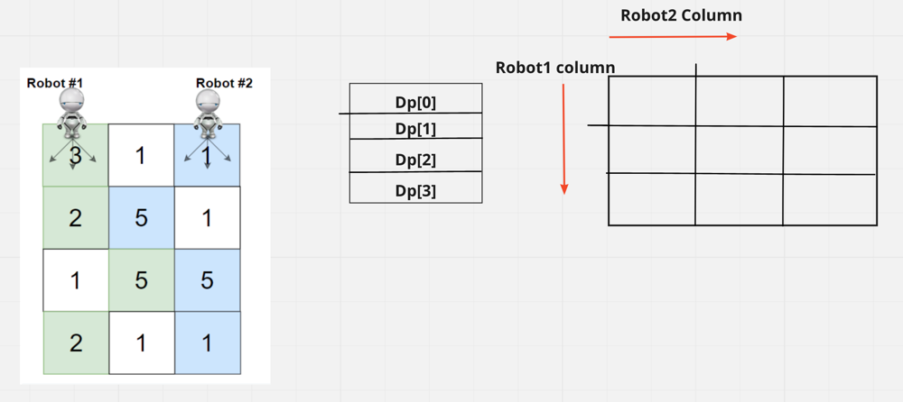
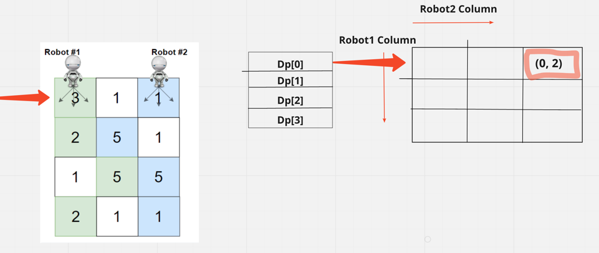
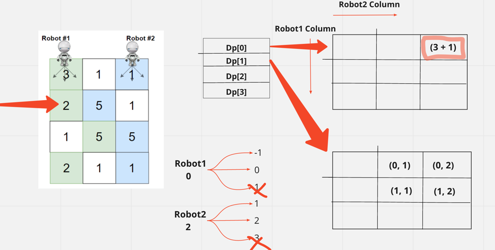

# 🚀 Well Detailed Explaination [JAVA , C++] || Easy for mind to Accept it

**Author:** hi-malik
**Votes:** 170
**Link:** [https://leetcode.com/problems/cherry-pickup-ii/solutions/1674112/](https://leetcode.com/problems/cherry-pickup-ii/solutions/1674112/)

---

Guy's if you find this **solution helpful \uD83D\uDE0A**, `PLEASE` do `UPVOTE` It tooks me a `whole 3.30 hours` \uD83E\uDD15 to create this post. By doing that it motivate's me to create more better post like this \u270D\uFE0F

**So, without any further due let's start,**
*`The idea is to use dynamic programming because this is an optimization problem (ie. finding the maximum or minimum of something) and there are quite clearly overlapping sub-problems.`*


**Approach Explanation :-**
*`Overall Summary:`*
1. Move both robots at a time **row by row**. Note we just need to keep track of columns where 2 of the robots were earlier.
2. At each row: If we looked at robot moves **(i + 1, j - 1), (i + 1, j), or (i + 1, j + 1)**, robot moves have 3 choices for column **{-1, 0, +1}**
3. Now, if we consider moving 2 robots to maximize cherry count - we total have **maximum 3 (1st robot) * 3 (2nd robot)** = 9 choices
4. If both robots **land in the same cube** - we have to just take that cherry count once. Case is handled by looking at **column value of robot1 and robot2**

*`Detailed Explanation:`*
In this problem, we will assume that both robots will move to the next row at the same so both of them will keep in the same row. This will be the first insight to solve this problem.
As descriped in the problem statement, we can move into **3 directions (i+1, j-1) , (i+1, j) or (i+1, j+1)**. All of them in the next row but with different column.

Since we have **3 directions** for each robot so at each row there are **9 (3 x 3) states** that we can move to. (3 states for the first robot and 3 states for the second robot so it's 3 x 3).

And as the hint states we need to have a **DP array of 4 row's**. As, it is a 3 dimensional array, there will be a 2 dimensional array which will be **n * m** i.e. no. of column * no. of column. Where **row** will befine **Robot1 column position** & **column** will decide **Robot2 column position** 
`Let me show you this by a diagram what i mean is:`


Intially we know, that **robot1** is at position **"0"** & **robot2** is at position **column - 1** i.e last column.

We need to fill **dp[0]** i.e. 1st row and in that 1st row, the column position for both the robot will be **(0, 2)** as **0** signify the column position for robot1 and **2** signify the column position for robot2 in the grid. 


When we fill the space we get the value **3 + 1** i.e **4**
Now we need to fill the 2nd row. And in 2nd row as well there will be a n * m matrix. If we take the **previous position of robot1 to be 0** then we have 3 column that it can go in the next row i.e. col **{-1, 0, 1}**
As col1 is out of bound we reject that **"-1"** and only keep **"0, 1"**

And similar the **robot2 is at 2**, we can either reach col **{1, 2, 3}**
As col3 is out of bound we reject it **"3"** and only keep **"1, 2"**

Now when we create the combination of all the column that robot1 & robot2 can be, **we get 4 values and when we fill it will be:**


So, how we will be filling these values and what values will be reciding in each cell.
So, if we see for **(0, 1)** the value reciding will be `grid[0][1] + grid[1][1] + prev` But for **(1,1)** it will be `grid[1][1] + prev`

*Now let's see how we code this and achieve this result:*

**Code Each and every step of line explained : Similar for C++ & Java**
* Step1:
```
int dir[] = new int[]{-1, 0, 1}; // a matrix to store the directions that i can move to
        // let's define array size
        int row = grid.length;
        int col = grid[0].length;
        int dp[][][] = new int[row][col][col]; // we need to have a 3D array
        
        for(int i = 0; i < row; i++){
            for(int j = 0; j < col; j++){
                for(int k = 0; k < col; k++){
                    dp[i][j][k] = -1;
                }
            }
        }
```
* Step2:
```
int col1 = 0; // first robot position
        int col2 = col - 1; // second robot position
        
        dp[0][col1][col2] = grid[0][col1] + grid[0][col2]; // we have the value of 0th row from where we will be starting;
        
        int max = dp[0][col1][col2]; // intially we have the max value of the column that we will be started with;
        
```
* Step3:
```
// now comes a part where we need to iterate over each row;
        for(int i = 1; i < row; i++){ // each row starting with 1
            // In this each row of dp, we need to excise our logic picking that particular column, as the starting position
            // we need to loop on all the columns precise in this row
            // as i told there will be n * m column
            for(int c1 = 0; c1 < col; c1++){ 
                for(int c2 = 0; c2 < col; c2++){
                    // now from every column we need to fill the cube; for all the combinations or all the cell we can reach; with respective robot1 & robot2
                    // now we need to 1st take the previous value, that we disucssed
                    int prev = dp[i - 1][c1][c2]; 
                    if(prev >= 0){ // if that the case, we need to perform our operation, if it is a -ve value it means that we haven't reach yet that particular cell. And above that's why we intialize the whole array with -1
                        // Now we need to iterate over all the combinations of column that c1 & c2 can be in. For that we had define a direction array at the top
                        for(int d1: dir){ // for c1 we have the direction "d1" and we iterate over it
                            col1 = d1 + c1; // and column1 will be d1 + c1
                            for(int d2: dir){ // for c2 we have the direction "d2" and we iterate over it
                                col2 = d2 + c2; // and column2 will be d2 + c2
                            // Now we need to check is the new col1 & col2 are in the range of 0 & col. And for that we need to create a new method, which will check is the new col1 & col2 are in the range
                                if(inRange(col1, col) && inRange(col2, col)){
                                    dp[i][col1][col2] = Math.max(dp[i][col1][col2], prev+(col1 == col2 ? grid[i][col1] : (grid[i][col1] + grid[i][col2]))); // if the value are int this range, we need to update the col1 & col2 position in the i'th row
                                    max = Math.max(max, dp[i][col1][col2]); // we need to update the maximum at each step. Taking max of max value & also the new column that we have filled
                                }
                            }
                        }
                    }
                    
                }
            }
        }
        return max; // return max at the end
```
* Final Step:
```
// inRange function call to check the values are in limit
     boolean inRange(int val, int limit){
        return 0 <= val && val < limit;
    }
```
**Java**
```
class Solution {
    public int cherryPickup(int[][] grid) {
        int dir[] = new int[]{-1, 0, 1};

        int row = grid.length;
        int col = grid[0].length;
        int dp[][][] = new int[row][col][col]; 
        
        for(int i = 0; i < row; i++){
            for(int j = 0; j < col; j++){
                for(int k = 0; k < col; k++){
                    dp[i][j][k] = -1;
                }
            }
        }
        int col1 = 0; 
        int col2 = col - 1; 
        
        dp[0][col1][col2] = grid[0][col1] + grid[0][col2]; 
        int max = dp[0][col1][col2]; 
        
        for(int i = 1; i < row; i++){ 
            for(int c1 = 0; c1 < col; c1++){ 
                for(int c2 = 0; c2 < col; c2++){
                    int prev = dp[i - 1][c1][c2]; 
                    if(prev >= 0){ 
                        for(int d1: dir){ 
                            col1 = d1 + c1;
                            for(int d2: dir){ 
                                col2 = d2 + c2;
                                if(inRange(col1, col) && inRange(col2, col)){
                                    dp[i][col1][col2] = Math.max(dp[i][col1][col2], prev+(col1 == col2 ? grid[i][col1] : (grid[i][col1] + grid[i][col2]))); 
                                    max = Math.max(max, dp[i][col1][col2]); 
                                }
                            }
                        }
                    }
                    
                }
            }
        }
        return max;
    }

    public boolean inRange(int val, int limit){
        return 0 <= val && val < limit;
    }
}
```
**C++**
```
class Solution {
public:
    int cherryPickup(vector<vector<int>>& grid) {
        vector<int> dir={-1,0,1};
        int row = grid.size();
        int col = grid[0].size();
        int dp[row][col][col]; 
        
        for(int i = 0; i < row; i++){
            for(int j = 0; j < col; j++){
                for(int k = 0; k < col; k++){
                    dp[i][j][k] = -1;
                }
            }
        }
        int col1 = 0;
        int col2 = col - 1; 
        
        dp[0][col1][col2] = grid[0][col1] + grid[0][col2];
        
        int ans = dp[0][col1][col2]; 
        
        for(int i = 1; i < row; i++){ 
            for(int c1 = 0; c1 < col; c1++){ 
                for(int c2 = 0; c2 < col; c2++){
                    int prev = dp[i - 1][c1][c2];
                    if(prev >= 0){
                        for(int d1: dir){ 
                            col1 = d1 + c1; 
                            for(int d2: dir){ 
                                col2 = d2 + c2; 
                                if(inRange(col1, col) && inRange(col2, col)){
                                    dp[i][col1][col2] = max(dp[i][col1][col2], prev+(col1 == col2 ? grid[i][col1] : (grid[i][col1] + grid[i][col2])));
                                    
                                    ans = max(ans, dp[i][col1][col2]); 
                                }
                            }
                        }
                    }
                    
                }
            }
        }
        return ans; 
    }
    bool inRange(int val, int limit){
        return 0 <= val && val < limit;
    }
};
```
ANALYSIS :
* **Time Complexity :-** BigO(M * N ^ 2); where M is no of rows and N is no of cols
* **Space Complexity :-** BigO(M * N ^ 2)


If you have some \uD83E\uDD14 doubts feel free to bug me anytime or If you understood than don't forget to upvote \uD83D\uDC4D