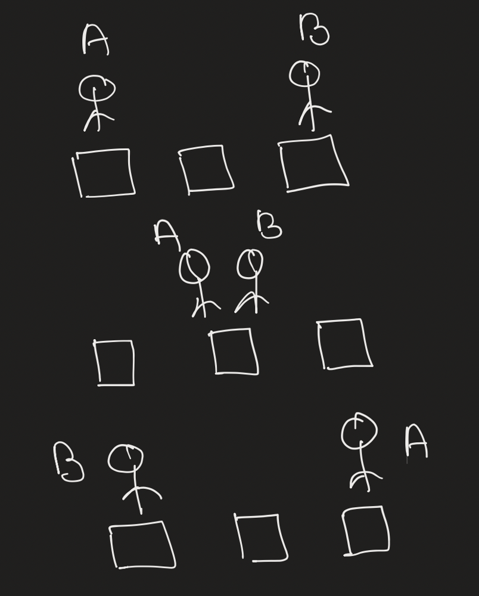
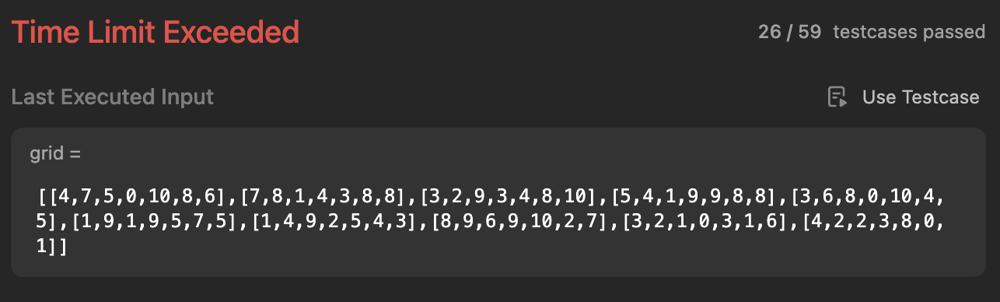
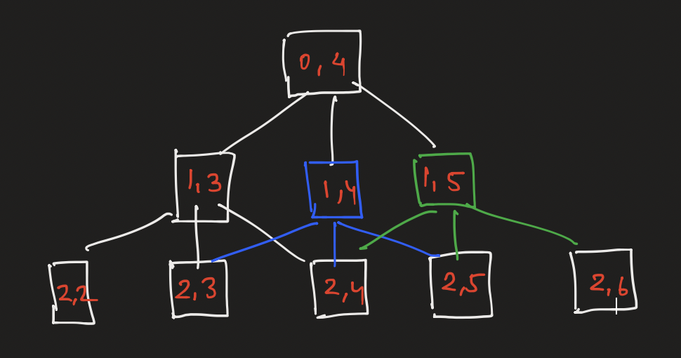

# Interview Approach - DFS Brute Force, Top Down, Bottom Up, Bottom UP Space Optimisation DP

**Author:** cs_iitian
**Votes:** 460
**Link:** [https://leetcode.com/problems/cherry-pickup-ii/solutions/4708405/](https://leetcode.com/problems/cherry-pickup-ii/solutions/4708405/)

---

### Video Solution ( In Hindi Language )
Will be uploading soon !
https://youtu.be/UrathtInxXg

Just read the blog till end, I know it's long but it will worth it.

# Approach
`You` : Is there any cells have negative value ?
`Interviewer` : No
`You` : If both are on same place, only it would be counted once. if I am not wrong ?
`Interviewer` : Yes



So Basically they should never cross each other, when they go into next row I will traverse all 3 possible column ( j-1, j, j+1 ) and will make sure they are in boundary as well as robot don't colide with each other. ( Simple means if x is robotA position and y is robotB position then x < y always )

One more thing in diagram you can see B has come to the A and A went B, do we really need that ?
No, Because the position B is holding A itself can reach that if it is optimal without intersecting with B. ( So they is no point of crossing each other )

So Basically I will use DFS here, starting from both robot and in each iteration I will go to next row with all possible columns.

`You` : Can we code for this approach. It would be simple DFS.
`Interviewer` : Sure go head, later we can see if we can do any improvements.

Let's code
```Java []
class Solution {
    
    public int cherryPickup(int[][] grid) {
        int rows = grid.length;
        int cols = grid[0].length;
        return helper(grid, 0, 0, cols-1);
    }
    
    public int helper(int[][] grid, int currRow, int robotACol, int robotBCol) {
        
        if(robotACol < 0 || robotBCol < 0 || robotACol >= grid[0].length || robotBCol >= grid[0].length) return 0;
        
        if(currRow == grid.length) return 0; // last row
        
        int result = 0;
        result += grid[currRow][robotACol];
        result += grid[currRow][robotBCol];
        
        int max = 0; // DFS for next row
        for(int x=robotACol-1;x<=robotACol+1;x++) {
            for(int y=robotBCol-1;y<=robotBCol+1;y++) {
                if(x < y) {
                    max = Math.max(max, helper(grid, currRow+1, x, y));
                }
            }
        }
        
        result += max; // add maximum result
        return result;
    }
}
```

I'm excited to submit this , are you ?
Let's submit then



`You` : Oh my god ! It got TLE.
`Interviewer`: LOL !
`You` : I know you know it would get TLE ( MF )
`Interviewer` : Can you optimise it ?
`You` : Sure ( MF )

So here we can see that ( Remember that whenever you have recursion with more than 1 recursive function in it, It's always possible that some of the recursive function we are re-calculating )



Here in above diagram you can clearly see, [2,3] already calculated when I was on [1,3] and it will be calculating again from [1,4] so I will store my result in an array.

Now here we have 3 things that are changing,
1. current row
2. robotA col
3. robotB col
So we will use 3D array to store our result.

So let's code


# Code
```Java []
class Solution {
    
    Integer memo[][][];
    
    public int cherryPickup(int[][] grid) {
        int rows = grid.length;
        int cols = grid[0].length;
        memo = new Integer[rows+1][cols+1][cols+1];
        return helper(grid, 0, 0, cols-1);
    }
    
    public int helper(int[][] grid, int currRow, int robotACol, int robotBCol) {
        
        if(robotACol < 0 || robotBCol < 0 || robotACol >= grid[0].length || robotBCol >= grid[0].length) return 0;
        
        if(currRow == grid.length) return 0;
        
        if(memo[currRow][robotACol][robotBCol] != null)
            return memo[currRow][robotACol][robotBCol];
        
        int result = 0;
        result += grid[currRow][robotACol];
        result += grid[currRow][robotBCol];
        
        int max = 0;
        for(int x=robotACol-1;x<=robotACol+1;x++) {
            for(int y=robotBCol-1;y<=robotBCol+1;y++) {
                if(x < y) { // they should not cross
                    max = Math.max(max, helper(grid, currRow+1, x, y));
                }
            }
        }
        
        result += max;
        return memo[currRow][robotACol][robotBCol] = result;
    }
}
```

And it got passed.
`Interviewer` : Can we discuss time and space complexity for this approach.
`You` : Sure, so space complexity would be O(m*n^2) for memoization. where m is row and n is col. Time Complexity would also be the same here because we will fill this array, while traversing all possible columns.

`Interviewer` : we have some time left, do you know about dynamic programming ?
`You` : Ya ! This solution is TOP DOWN DP approach.
`Interviewer` : Good, you know then can you convert this in bottom up approach.
`You` : Sure, I can try I mostly use TOP DOWN approach, let me change the code.

Le Keyboard - ( TAPA TAPA TAPA .. )
here is the code
```Java []
class Solution {
    public int cherryPickup(int[][] grid) {
        int m = grid.length;
        int n = grid[0].length;

        int[][][] dp = new int[m][n][n];
        int ans = 0;

        for(int i=0;i<m;i++)
            for(int j=0;j<n;j++)
                Arrays.fill(dp[i][j], -1);

        dp[0][0][n-1] = grid[0][0] + grid[0][n-1];

        for(int i=1;i<m;i++) {
            for(int j=0;j<n;j++) { // robotA
                for(int k=j+1;k<n;k++) { // robotB
                    int max = -1;
                    for(int x=-1;x<=1;x++) { // we will have total 9 combinations
                        for(int y=-1;y<=1;y++) {
                            if(j+x >= 0 && j+x < n && k+y >= 0 && k+y < n)
                                max = Math.max(
                                    max,
                                    dp[i-1][j+x][k+y]
                                );
                        }
                    }
                    if(max != -1)
                        dp[i][j][k] = max + grid[i][j] + grid[i][k];
                    if(ans < dp[i][j][k]) ans = dp[i][j][k];
                }
            }
        }

        return ans;
    }
}
```
```C++ []
class Solution {
public:
    int cherryPickup(vector<vector<int>>& grid) {
        int m = grid.size(), n = grid[0].size();
        vector<vector<vector<int>>> dp(m, vector<vector<int>>(n, vector<int>(n, -1)));
        dp[0][0][n-1] = grid[0][0] + grid[0][n-1];

        int ans = 0;
        for(int i = 1; i < m; ++i) {
            for(int j = 0; j < n; ++j) { // robotA
                for(int k = j+1; k < n; ++k) { // robotB
                    for(int x = -1; x <= 1; ++x) { // x and y all possible combinations
                        for(int y = -1; y <= 1; ++y) {
                            int nj = j + x, nk = k + y;
                            if(nj >= 0 && nj < n && nk >= 0 && nk < n) {
                                int prev = dp[i-1][nj][nk];
                                if(prev != -1) {
                                    dp[i][j][k] = max(dp[i][j][k], prev + grid[i][j] + (j != k ? grid[i][k] : 0));
                                }
                            }
                        }
                    }
                    if(ans < dp[i][j][k]) ans = dp[i][j][k];
                }
            }
        }
        
        return ans;
    }
};
```
```Python []
class Solution:
    def cherryPickup(self, grid: List[List[int]]) -> int:
        m, n = len(grid), len(grid[0])
        dp = [[[-1] * n for _ in range(n)] for _ in range(m)]
        dp[0][0][n-1] = grid[0][0] + grid[0][n-1]

        for i in range(1, m):
            for j in range(n):
                for k in range(j+1, n):
                    for x in range(-1, 2):
                        for y in range(-1, 2):
                            if 0 <= j+x < n and 0 <= k+y < n:
                                prev = dp[i-1][j+x][k+y]
                                if prev != -1:
                                    dp[i][j][k] = max(dp[i][j][k], prev + grid[i][j] + (grid[i][k] if j != k else 0))

        ans = max(max(row) for row in dp[m-1])
        return ans if ans != -1 else 0
```

`Interviewer` : will it have the same time and space complexity as top down.
`You` : Yes, we still have to fill all those states.
`Interviewer` : Can you optimise it more ?
`You` : Ok, let me think. ( Thinking .. ) As of now I am not able to think of any approach which can have better time complexity than this.
`Interviwer` : Ok, What about space ?
`You` : Space Complexity. Yes yes I got it. ( Because MF I already knew you would ask me this question. ) As we can see that for any current row we are just dependent on previous row and all other rows are of no use. So we just need two rows.
Let's say I can have two array, prev and curr. And every time when I go to new row this curr would become prev.
But I can do this using array of length 2.
where for previous row, I can do (i+1)%2 means if I am at 0th row my previous would be at 1 and when I am at 1 my previous would be 0.
`Interviewer` : Can you modify you previous approach with this.
`You` : Sure.

```Java []
class Solution {
    public int cherryPickup(int[][] grid) {
        int m = grid.length;
        int n = grid[0].length;

        int[][][] dp = new int[2][n][n];
        int ans = 0;

        for(int i=0;i<2;i++)
            for(int j=0;j<n;j++)
                Arrays.fill(dp[i][j], -1);

        dp[0][0][n-1] = grid[0][0] + grid[0][n-1];

        for(int i=1;i<m;i++) {
            for(int j=0;j<n;j++) { // robotA
                for(int k=j+1;k<n;k++) { // robotB
                    int max = -1;
                    for(int x=-1;x<=1;x++) { // we will have total 9 combinations
                        for(int y=-1;y<=1;y++) {
                            if(j+x >= 0 && j+x < n && k+y >= 0 && k+y < n)
                                max = Math.max(
                                    max,
                                    dp[(i+1)%2][j+x][k+y]
                                );
                        }
                    }
                    if(max != -1)
                        dp[i%2][j][k] = max + grid[i][j] + grid[i][k];
                    if(ans < dp[i%2][j][k]) ans = dp[i%2][j][k];
                }
            }
        }

        return ans;
    }
}
```

`Interviewer` : Ok ! We still have some time left. Do you have any questions for me ?
`You` : Yes ( MF , JSUT HIRE ME ) , What motivates you to work at this XYZ company ?
`Interviwer` : ( Blaah , Blaah , Blaah !!! )
`You` : Thanks !!! ( Hang Up )

( Calling Mother ... Ring Ring Ring , 
Dear Mama You Son will be fulfilling your all wishes ! )

---

If you understand this blog, try these questions ( Please , It's my humble request if you also want to fulfill you parent's wishes like me )
1. [62. Unique Paths](https://leetcode.com/problems/unique-paths/description/)
2. [63. Unique Paths II](https://leetcode.com/problems/unique-paths-ii/description/)
3. [980. Unique Paths III](https://leetcode.com/problems/unique-paths-iii/description/)
4. [2304. Minimum Path Cost in a Grid](https://leetcode.com/problems/minimum-path-cost-in-a-grid/description/)
5. [174. Dungeon Game](https://leetcode.com/problems/dungeon-game/description/) `This one is tough to crack but you can try at least and It's most likely to be asked in an interview. )`
6. [741. Cherry Pickup](https://leetcode.com/problems/cherry-pickup/description/)

---

If you have came so far, upvote it !!!


---
### Connect via
#### [1. Instagram](https://www.instagram.com/cs_iitian/) ( Follow )
#### [2. Facebook Page](https://www.facebook.com/cs.iitian)
#### [3. Twitter](https://twitter.com/cs_iitian)
#### [4. Blog](https://csiitian.blog/) ( Subscribe to news letter )
#### [5. Medium](https://medium.com/@csiitian)
#### [6. Youtube](https://www.youtube.com/channel/UCuxmikkhqbmBOUVxf-61hxw) ( Like, Share & Subscribe )
#### [7. Leetcode](https://leetcode.com/cs_iitian/)
