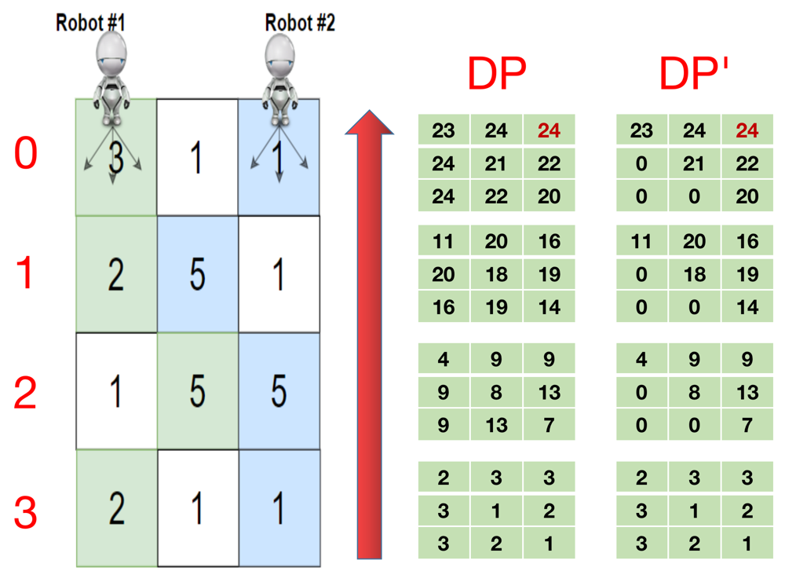

# ✅ [C++/Java/Python] Simple DP || Detailed Explanation

**Author:** linfq
**Votes:** 39
**Link:** [https://leetcode.com/problems/cherry-pickup-ii/solutions/1674523/](https://leetcode.com/problems/cherry-pickup-ii/solutions/1674523/)

---

**PLEASE UPVOTE if you like** \uD83D\uDE01 **If you have any question, feel free to ask.** 
* We define the `dp` first
	* `dp[k][i][j]` donotes if the two robots start from `grid[k][i]` and `grid[k][j]` the maximum total cherries they can pickup at last. Note they can only move downstairs.
		* After we fulfill `dp`, the final answer is `dp[0][0][COL_NUM - 1]`
* For the last row of grid, we have
	* `dp[-1][i][j] = grid[-1][i] if i == j else grid[-1][i] + grid[-1][j]`
	* Note if 2 robots stay at the same place, they can only pickup once.
* For other rows, we need to traverse all `3 * 3` direction combinations they may choose in next layer and find the maximum, because for each robot there are 3 directions that they can move.

 

```
Time  Complexity: O(N^3)
Space Complexity: O(N^3)
```

**C++**
```
class Solution {
public:
    int cherryPickup(vector<vector<int>>& grid) {
        const int ROW_NUM = grid.size(), COL_NUM = grid[0].size();
        const int D[] = {-1, 0, 1};
        int dp[ROW_NUM][COL_NUM][COL_NUM];
        
        for (int k = 0; k < ROW_NUM; k ++) 
            for (int i = 0; i < COL_NUM; i ++)  
                for (int j = 0; j < COL_NUM; j ++) 
                    dp[k][i][j] = 0;
        
        for (int i = 0; i < COL_NUM; i ++) // ulfill dp of the last row
            for (int j = i; j < COL_NUM; j ++) {
                if (i == j)
                    dp[ROW_NUM - 1][i][j] = grid[ROW_NUM - 1][i];
                else
                    dp[ROW_NUM - 1][i][j] = grid[ROW_NUM - 1][i] + grid[ROW_NUM - 1][j];
            }
        
        for (int k = ROW_NUM - 2; k >= 0; k --) { // from the second last row to the first row
            vector<int> row = grid[k];
            for (int i = 0; i < COL_NUM; i ++)
                // for every (i, j, k), dp[k][i][j] == dp[k][j][i]
                // so we only need to find the answer for j >= i
                // for (int j = 0; j < COL_NUM; j ++) { // we will get DP in the picture
                for (int j = i; j < COL_NUM; j ++) // we will get DP' in the picture
                    for (int di = 0; di < 3; di ++)
                        for (int dj = 0; dj < 3; dj ++) {
                            if (i + D[di] < 0 || i + D[di] >= COL_NUM || j + D[dj] < 0 || j + D[dj] >= COL_NUM) continue;
                            if (i == j) 
                                dp[k][i][j] = max(dp[k][i][j], dp[k + 1][i + D[di]][j + D[dj]] + row[i]);
                            else
                                dp[k][i][j] = max(dp[k][i][j], dp[k + 1][i + D[di]][j + D[dj]] + row[i] + row[j]);
                        }
        }
        return dp[0][0][COL_NUM - 1];
    }
};
```

**Python**
```
class Solution(object):
    def cherryPickup(self, grid):
        ROW_NUM = len(grid)
        COL_NUM = len(grid[0])

        dp = [[[0] * COL_NUM for _ in grid[0]] for _ in grid]
        # fulfill dp of the last row
        for i in range(COL_NUM):
            for j in range(COL_NUM):
                dp[-1][i][j] = grid[-1][i] if i == j else grid[-1][i] + grid[-1][j]

        # from the second last row to the first row
        for k in range(ROW_NUM - 2, -1, -1):
            row = grid[k]
            for i in range(COL_NUM):
                # for every (i, j, k), dp[k][i][j] == dp[k][j][i]
                # so we only need to find the answer for j >= i
                for j in range(i, COL_NUM):
                    for di in [-1, 0, 1]:
                        for dj in [-1, 0, 1]:
                            if 0 <= i + di < COL_NUM and 0 <= j + dj < COL_NUM:
                                if i == j:  # they can only pickup once
                                    dp[k][i][j] = max(dp[k][i][j], dp[k + 1][i + di][j + dj] + row[i])
                                else:
                                    dp[k][i][j] = max(dp[k][i][j], dp[k + 1][i + di][j + dj] + row[i] + row[j])
        return dp[0][0][COL_NUM - 1]
```

```
class Solution(object):
    def cherryPickup(self, grid):
        def dp(k):
            if k == ROW_NUM - 1:  # the last row
                return [[grid[-1][i] if i == j else grid[-1][i] + grid[-1][j] for j in range(COL_NUM)]
                        for i in range(COL_NUM)]

            row = grid[k]
            ans = [[0] * COL_NUM for i in range(COL_NUM)]
            next_dp = dp(k + 1)  # get result if next row
            for i in range(COL_NUM):
                for j in range(i, COL_NUM):
                    for di in [-1, 0, 1]:
                        for dj in [-1, 0, 1]:
                            if 0 <= i + di < COL_NUM and 0 <= j + dj < COL_NUM:
                                if i == j:  # they can only pickup once
                                    ans[i][j] = max(ans[i][j], next_dp[i + di][j + dj] + row[i])
                                else:
                                    ans[i][j] = max(ans[i][j], next_dp[i + di][j + dj] + row[i] + row[j])
            return ans

        ROW_NUM = len(grid)
        COL_NUM = len(grid[0])
        return dp(0)[0][COL_NUM - 1]
```

**Java**
```
class Solution {
    public int cherryPickup(int[][] grid) {
        int ROW_NUM = grid.length, COL_NUM = grid[0].length;
        int D[] = {-1, 0, 1};
        int[][][] dp = new int[ROW_NUM][COL_NUM][COL_NUM];
        
        for (int i = 0; i < COL_NUM; i ++) // ulfill dp of the last row
            for (int j = i; j < COL_NUM; j ++)
                if (i == j)
                    dp[ROW_NUM - 1][i][j] = grid[ROW_NUM - 1][i];
                else
                    dp[ROW_NUM - 1][i][j] = grid[ROW_NUM - 1][i] + grid[ROW_NUM - 1][j];
        
        for (int k = ROW_NUM - 2; k >= 0; k --) { // from the second last row to the first row
            int row[] = grid[k];
            for (int i = 0; i < COL_NUM; i ++)
                // for every (i, j, k), dp[k][i][j] == dp[k][j][i]
                // so we only need to find the answer for j >= i
                // for (int j = 0; j < COL_NUM; j ++) { // we will get DP in the picture
                for (int j = i; j < COL_NUM; j ++) // we will get DP' in the picture
                    for (int di = 0; di < 3; di ++)
                        for (int dj = 0; dj < 3; dj ++) {
                            if (i + D[di] < 0 || i + D[di] >= COL_NUM || j + D[dj] < 0 || j + D[dj] >= COL_NUM) continue;
                            if (i == j) 
                                dp[k][i][j] = Math.max(dp[k][i][j], dp[k + 1][i + D[di]][j + D[dj]] + row[i]);
                            else
                                dp[k][i][j] = Math.max(dp[k][i][j], dp[k + 1][i + D[di]][j + D[dj]] + row[i] + row[j]);
                        }
        }
        return dp[0][0][COL_NUM - 1];
    }
}
```

**PLEASE UPVOTE if you like** \uD83D\uDE01 **If you have any question, feel free to ask.**