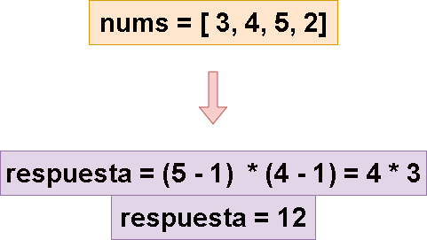
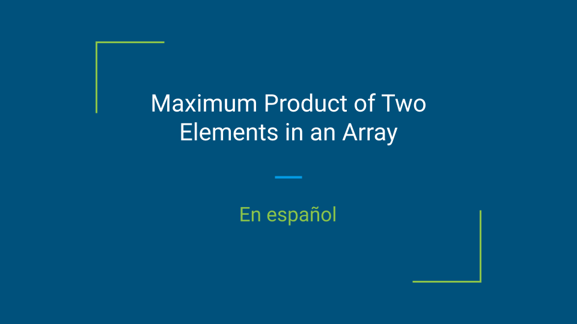
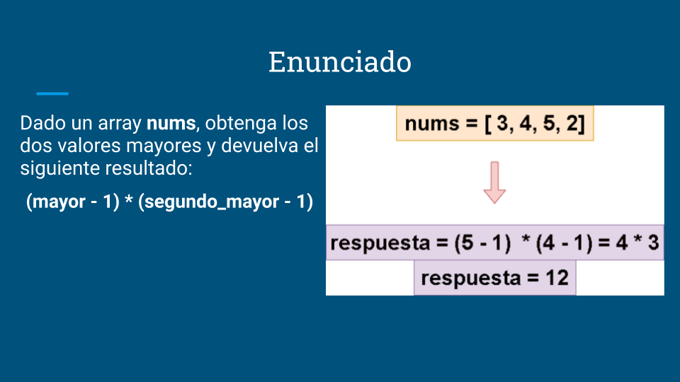
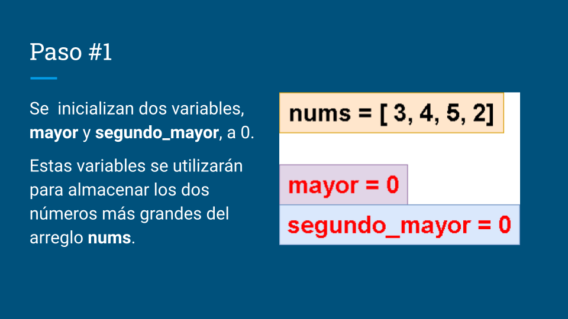
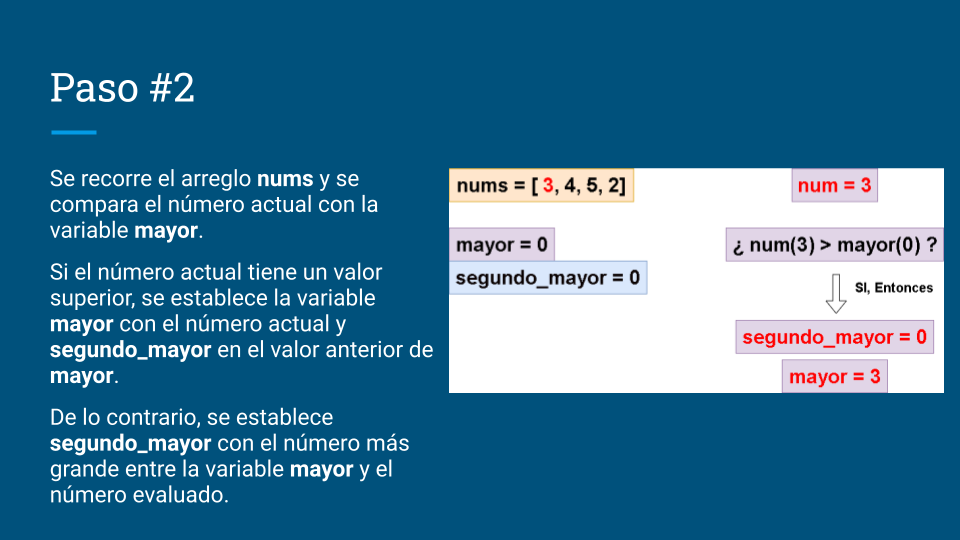
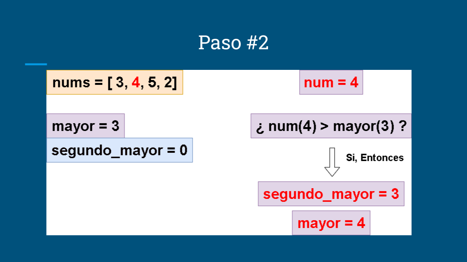
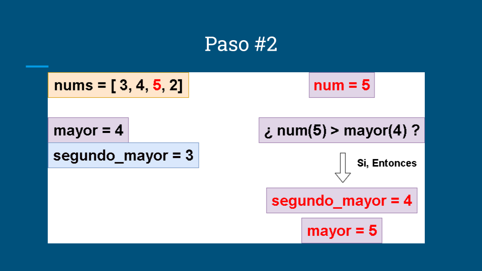
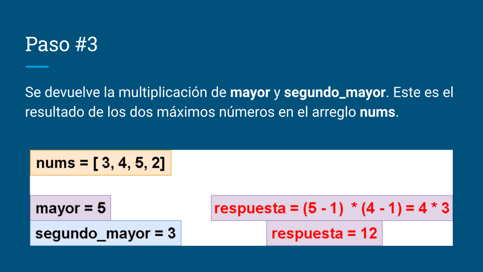

# 🔥🔥 Explicación y Resolución Del Ejercicio En Español Java | Python | PHP | JavaScript | C++  🔥🔥

**Author:** hermescoder02
**Votes:** 4
**Link:** [https://leetcode.com/problems/maximum-product-of-two-elements-in-an-array/solutions/4406583/](https://leetcode.com/problems/maximum-product-of-two-elements-in-an-array/solutions/4406583/)

---

# Lectura
*Producto m\xE1ximo de dos elementos en un array(Java, Python, PHP, C++, Javascript)*

Dado un array nums, obtenga los 2 valores mayores y devuelva el siguiente resultado :

        (mayor - 1) * (segundo_mayor - 1)



# Video

https://youtu.be/J8qwWF67x-E

Si te gust\xF3 el contenido \xA1te invito a suscribirte!:
\u2705https://www.youtube.com/@hermescoder?sub_confirmation=1

# Pasos para realizar el algoritmo:

**1.-** Se  inicializan dos variables, **mayor** y **segundo_mayor**, a 0. 

Estas variables se utilizar\xE1n para almacenar los dos n\xFAmeros m\xE1s grandes del arreglo nums.
        
**2.**- Se recorre el arreglo nums y se compara el n\xFAmero actual con la variable mayor.

Si el n\xFAmero actual tiene un valor superior, se establece la variable mayor con el n\xFAmero actual y segundo_mayor en el valor anterior de mayor.

De lo contrario, se establece segundo_mayor con el n\xFAmero m\xE1s grande entre la variable mayor y el n\xFAmero evaluado.

**3.-** Se devuelve la multiplicaci\xF3n de mayor y segundo_mayor. Este es el resultado de los dos m\xE1ximos n\xFAmeros en el arreglo nums.
# C\xF3digo 

```Java []
class Solution {
    public int maxProduct(int[] nums) {
 
        //paso#1
        int mayor  = 0;
        int segundo_mayor  = 0;
 
        for (int num : nums) {
            //paso#2
            if (num > mayor) {
                segundo_mayor  = mayor ;
                mayor  = num;
                continue;
            } 
            else segundo_mayor = Math.max(segundo_mayor , num);
        }
 
        //paso#3
        return (mayor  - 1) * (segundo_mayor - 1);
    }
}
```
```Python []
class Solution(object):
    def maxProduct(self, nums):
         # Paso #1
        mayor = 0
        segundo_mayor = 0
 
        for num in nums:
            # Paso #2
            if num > mayor:
                segundo_mayor = mayor
                mayor = num
                continue
            else:
                segundo_mayor = max(segundo_mayor, num)
 
        # Paso #3
        return (mayor - 1) * (segundo_mayor - 1)
```
```PHP []
class Solution {
     
        /**
         * @param Integer[] $nums
         * @return Integer
         */
        function maxProduct(array $nums): int {
        // Paso #1
            $mayor = 0;
            $segundo_mayor = 0;
     
            foreach ($nums as $num) {
                // Paso #2
                if ($num > $mayor) {
                    $segundo_mayor = $mayor;
                    $mayor = $num;
                    continue;
                } else {
                    $segundo_mayor = max($segundo_mayor, $num);
                }
            }
     
            // Paso #3
            return ($mayor - 1) * ($segundo_mayor - 1);
        }
    }
```
```JavaScript []
function maxProduct(nums) {
    // Paso #1
    let mayor = 0;
    let segundoMayor = 0;
 
    for (let num of nums) {
        // Paso #2
        if (num > mayor) {
            segundoMayor = mayor;
            mayor = num;
            continue;
        } else {
            segundoMayor = Math.max(segundoMayor, num);
        }
    }
 
    // Paso #3
    return (mayor - 1) * (segundoMayor - 1);
}
```
```C++ []
class Solution {
    public:
        int maxProduct(vector<int>& nums) {
            // Paso #1
            int mayor = 0;
            int segundoMayor = 0;
     
            for (int num : nums) {
                // Paso #2
                if (num > mayor) {
                    segundoMayor = mayor;
                    mayor = num;
                    continue;
                } else {
                    segundoMayor = max(segundoMayor, num);
                }
            }
     
            // Paso #3
            return (mayor - 1) * (segundoMayor - 1);
        }
    };
```


# Imagenes de la Explicaci\xF3n















