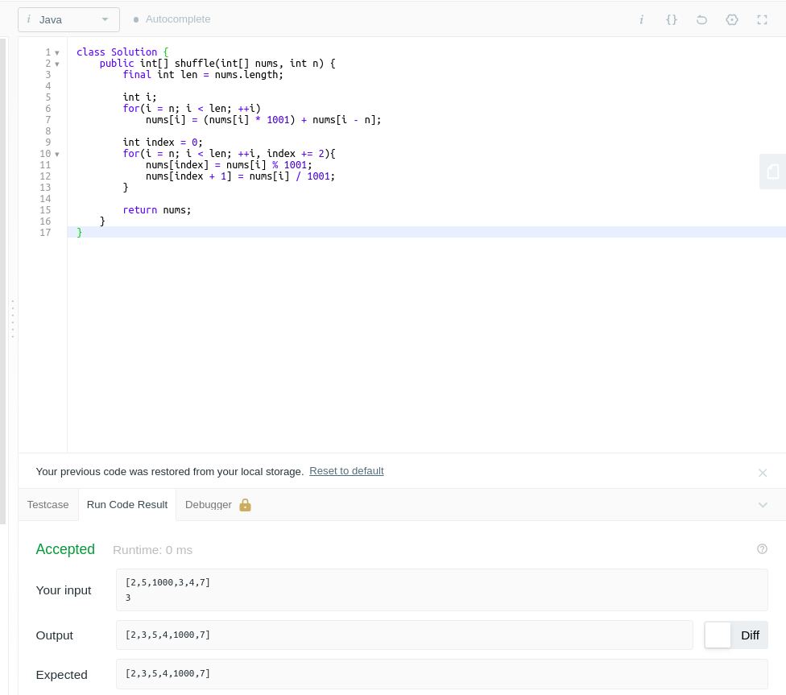
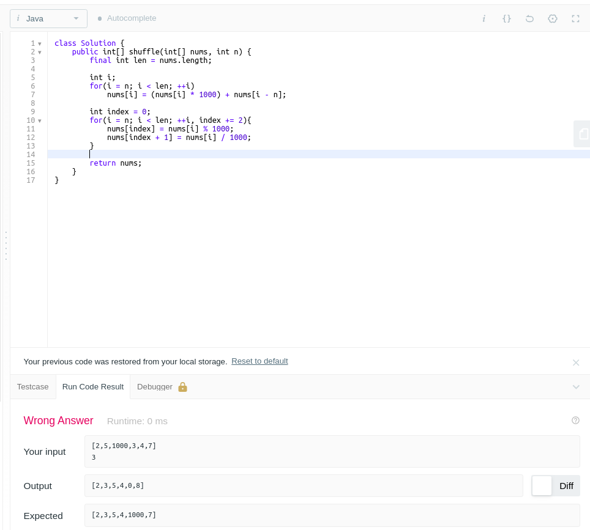

# ✅ [JAVA / C++] : Simple | O(1) Space In-Place | 100% Faster | Efficient | Explained

**Author:** akshayaamar05
**Votes:** 460
**Link:** [https://leetcode.com/problems/shuffle-the-array/solutions/1314638/](https://leetcode.com/problems/shuffle-the-array/solutions/1314638/)

---

<u>**BASIC IDEA:**</u>
1. **Store the pair of numbers** and then
2. **Retreive each number,** from that pair where they were stored, **one by one** and place them at their desired positions.

<u>**GENERAL EXAMPLE:**</u>
*Suppose, you are performing a task and someone gives you another task, in order to avoid disturbance in the flow of previous task, you can keep both the tasks on one side and complete the task one by one according to the requirement.*

<u>**SAME CONCEPT FOR ARRAYS:**</u>
*In order to avoid overwriting values, store the "pair of numbers" in the right half of the array and retrieve the numbers by one according to the requirement.*

**#  <u>DETAILED EXPLANATION IS GIVEN BELOW THE CODE</u> #**

<u>**NOTE:**</u>  --> Runtime Fluctuates a lot in case of C++(0ms to 4ms)

<u>**C++ / JAVA CODE**</u>

<iframe src="https://leetcode.com/playground/arHM8WHa/shared" frameBorder="0" width="100%" height="400"></iframe>

<hr>

**Using Bitwise Operator to make it a bit faster**<br>

<u>**NOTE:**</u>  --> Runtime Fluctuates a lot in case of C++(0ms to 4ms)

<u>**C++ / JAVA CODE**</u>

<iframe src="https://leetcode.com/playground/QHAeabD9/shared" frameBorder="0" width="100%" height="350"></iframe>

<hr>

<u>**EXPLANATION:**</u>

**Let's understand in general term:**

Suppose we have 2 numbers `num1 = 4` and `num2 = 9` and `maxValue = 10`
**Formula:**
**to store** -> pair = (num2 &times; maxValue) + num1
**to retrieve** -> pair % maxValue and pair / maxValue

1. **Storing the pair of numbers**

	(9 &times; 10) + 4 = 94 --> from above formula (num2 &times; maxValue) + num1
	**94 is stored**

2. **Retrieving each number one by one**

	94 % 10 = 4
	**we got first number as 4**

	94 / 10 = 9
	**we got second number as 9**

Same idea goes for large cases and array as well but instead of 10, we will take 1024 to store pairs and retrieve each number
**<u>NOTE:</u> Here, we will take 1024 because of the given constraints `1 <= nums[i] <= 10^3` i.e. the largest number in the array will be 1000**

Now, 
**Binary representation** of **1000** is **1111101000**, consisting of total **10 bits**
**Binary representation** of **1024** is **10000000000**, consisting of total **11 bits**
and if we multiply 1000 with 1024 i.e. **(1000 * 1024)**, we will get **1024000**
**Binary representation** of **1024000** is **11111010000000000000**, consisting of total **20 bits** which is less than the number of bits **(32bits)** of int data type, so we can store the number pairs(by multiplying one number with 1024 and adding another number to it) to retrieve each indivisual number later on(by taking out the remainder and the quotient).
eg: suppose we have an **`array of length 4`** and **`n is 2`**
`nums = [5, 2, 1000, 3]` and `n = 2`

1. **We will store the pair of numbers first**

	According to algorithm
	
	```
	// to store the pair of numbers in right half of the original array
	for(int i = n; i < len; i++)
	nums[i] = (nums[i] * 1024) + nums[i - n];
	```
	* 	**Iteration 1:**
		when i = 2, (i = 2 because value of n is 2)
		nums[2] = (1000 &times; 1024) + 5 
		so, nums[2] = 1024005

	* 	**Iteration 2:**
		when i = 3,
		nums[3] = (3 &times; 1024) + 2
		so, nums[3] = 3074

	**Now, the original array**
	[5, 2, 1000, 3]
	&nbsp;0&nbsp;&nbsp;1&nbsp;&nbsp;&nbsp;&nbsp;&nbsp;2&nbsp;&nbsp;&nbsp;&nbsp;&nbsp;3 &nbsp;&nbsp;<-- Indexes
	**becomes**
	[5, 2, 1024005, 3074]
	&nbsp;0&nbsp;&nbsp;1&nbsp;&nbsp;&nbsp;&nbsp;&nbsp;&nbsp;&nbsp;&nbsp;2&nbsp;&nbsp;&nbsp;&nbsp;&nbsp;&nbsp;&nbsp;&nbsp;&nbsp;&nbsp;3 &nbsp;&nbsp;<-- Indexes

2. **We will retrieve the numbers one by one from the pairs which we have stored at 2nd and 3rd index**

	According to algorithm
	```
	// to retrive values from the pair of numbers and placing those retrieved value at their desired position
	int index = 0;
	for(int i = n; i < len; i++, index += 2){
		nums[index] = nums[i] % 1024;
		nums[index + 1] = nums[i] / 1024;
	}
	```

	* 	**Iteration 1:**
		when index = 0 and i = 2, (i = 2 because value of n is 2)
		nums[0] = 1024005 % 1024 = 5
		nums[1] = 1024005 / 1024 = 1000
		now, index = 2 (from index += 2)

	* 	**Iteration 2:**
		when index = 2, i = 3,
		nums[2] = 3074 % 1024 = 2
		nums[3] = 3074 / 1024 = 3

	Iteration will be stopped now as the condition become false and we got the array as following
	**[5, 1000, 2, 3]  <-- Desired Output**
	&nbsp;0&nbsp;&nbsp;&nbsp;&nbsp;&nbsp;1&nbsp;&nbsp;&nbsp;&nbsp;&nbsp;2&nbsp;&nbsp;3&nbsp;&nbsp;<-- Indexes
<hr>

<u>**COMPLEXITY:**</u>
* **Time: O(n)**, where n is the given number, which is half of the length of the array
* **Space: O(1)**, in-place<br>

Since we need to solve it in 0(1) space or **in-place**, we will use the original array.
<hr>

**You might be wondering why I took** `1024`
Let's understand why

**One Line answer**
Multiply by number which is greater than both of num1 and num2(max num1 or num2 can be 1000 or 10 ^ 3)

**Long answer**
Let's understand in general term i.e. 1 <= num1,  num2 <= 10 i.e. min value of num1 and num2 can be 1 and max value can be 10

Now, suppose 2 numbers num1 = 10 and num2 = 4 and maxValue = 10
**Formula:**
**to store** -> pair = (num2 * maxValue) + num1
**to retrieve** -> pair % maxValue and pair / maxValue

1. **Storing the pair of numbers**

	4 * 10 + 10 = 50 --> from above formula (num2 * maxValue) + num1
	**50 is stored**

2. **Retrieving each number one by one**

	50 % 10 = 0 
	**we got first number as 0** -- > not what we wanted

	50 / 10 = 5 
	**we got second number as 5** -- > not what we wanted

Now, suppose 2 numbers num1 = 10 and num2 = 4 and maxValue = 11(here max value is different from above)
1. **Storing the pair of numbers**

	4 * 11 + 10 = 54 --> from above formula (num2 * maxValue) + num1
	**54 is stored**

2. **Retrieving each number one by one**

	54 % 11 = 10
	**we got first number as 10** -- > what we wanted

	54 / 11 = 4
	**we got second number as 4** -- > what we wanted

So, we can conclude that **multiply by number which is greater than both of num1 and num2.**
eg:
for(0 to 9) take 10(i.e. greater than 0 and 9)
for(0 to 19) take 20(i.e. greater than 0 and 19)
for(0 to 29) take 30(i.e. greater than 0 and 29) and so on

Same idea goes for large cases and array as well but instead of 10, we will take 1024(as max value can be 1000 according to constraints) to store pairs and retrieve each number.

Here, we are taking 1024 because of the given constraints **1 <= nums[i] <= 10^3** i.e. the largest number in the array will be `1000`.
**NOTE: we could have taken `1001`(according to constraints) instead of `1024` but took `1024` because 2<sup>10</sup> will give 1024 and will be easier to use this value(1024) while performing bitwise operation as 1024 is a power of 2 and multiplying 1024 * 1000(max value according to constraint) fits in 32 bits of int and there will be no overflow.**

<strong>Try taking 1001 (will give desired output)</strong>

<hr>
<br>

<strong>And now try taking 1000 (will not give desired output)</strong>


<strong>Multiplying with 1000 and retrieving values by nums[i] % 1000 and nums[i] / 1000 will not give you the desired output</strong>
<hr>

<u><strong>Refer to the following github repsitory for more leetcode solutions<strong></u>
https://github.com/Akshaya-Amar/LeetCodeSolutions

<hr>

# **Please Upvote If you got any help from the provided solution!!!**
