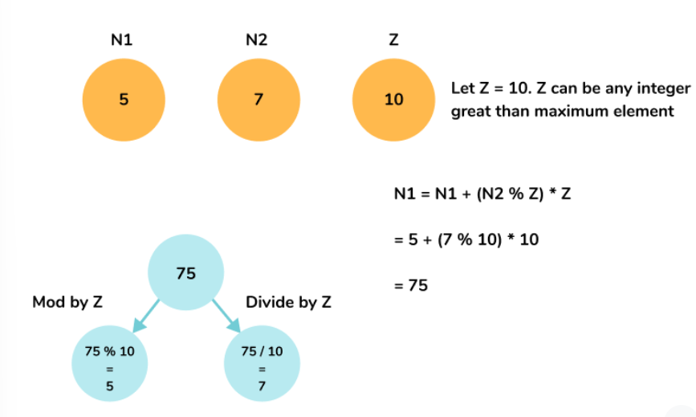

# O(1) SC || O(N) TC || C++ Easy || Multiplication and Modular tricks ||

**Author:** Hemant_1451
**Votes:** 77
**Link:** [https://leetcode.com/problems/shuffle-the-array/solutions/3127426/](https://leetcode.com/problems/shuffle-the-array/solutions/3127426/)

---

# Intuition
The idea is to use multiplication and modular tricks to store two elements at the same index. 
Observe the below example :



We will use the same approach to solve the problem.

# Approach
- Initialize two pointers first = 0 and second = n , where N is the size of the array.
- Initialise an element max equal to 1 + maximum element of the array and since it is given that maximum value can be 10^3 so we can use 1001. 
- Note: You can initialise max to any integer greater than 1000. 
- Iterate over the array and perform the following operations:
- - If the current index is even:
- - - Update A[i] = A[i] + (A[first] % mx) * mx
- - - Increment first by 1.
- - If the current index is odd:
- - - Update A[i] = A[i] + (A[second] % mx) * mx
- - - Increment second by 1.
- To update the array element back to its original form, divide A[i] by max.

# Complexity
- Time complexity : O(N)
<!-- Add your time complexity here, e.g. $$O(n)$$ -->

- Space complexity : O(1)
<!-- Add your space complexity here, e.g. $$O(n)$$ -->

# Code
```
class Solution {
public:
    vector<int> shuffle(vector<int>& nums, int n) {
        int first = 0, second = n, max = 1001;
        for(int i=0;i<2*n;i++)
        {
            if(i%2==0)
            nums[i]=(nums[first++]%max)*max + nums[i];
            else
            nums[i]=(nums[second++]%max)*max + nums[i];
        }
        for(int i=0;i<2*n;i++)
        nums[i]/=max;
        return nums;
    }
};
```