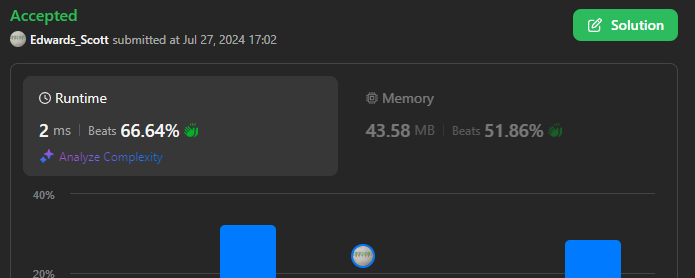

# 💢☠💫Easiest👾Faster✅💯 Lesser🧠 🎯 C++✅Python3🐍✅Java✅C✅Python🐍✅C#✅💥🔥💫Explained☠💥🔥 Beats 💯

**Author:** Edwards310
**Votes:** 4
**Link:** [https://leetcode.com/problems/final-prices-with-a-special-discount-in-a-shop/solutions/5543595/](https://leetcode.com/problems/final-prices-with-a-special-discount-in-a-shop/solutions/5543595/)

---

# Intuition


```C++ []
// Start Of Anuj Bhati aka Edwards310's Template...
#include <bits/stdc++.h>
using namespace std;
typedef long long LL;
#define FOR(a, b, c) for (int a = b; a < c; a++)
#define FOR1(a, b, c) for (int a = b; a <= c; ++a)
#define Rep(i, n) FOR(i, 0, n)
#define Rep1(i, n) FOR1(i, 1, n)
#define pb push_back
// end of Anuj Bhati's aka Edwards310's Template
class Solution {
public:
    vector<int> finalPrices(vector<int>& prices) {
        int n = prices.size();
        vi discount;
        Rep(i, n - 1){
            int dis = prices[i];
            FOR(j, i + 1, n){
                if(prices[j] <= prices[i]){
                    dis = prices[i] - prices[j];
                    break;
                }
            }
            discount.pb(dis);
        }
        discount.pb(prices[n - 1]);
        return discount;
    }
};
```
```python3 []
class Solution:
    def finalPrices(self, prices: List[int]) -> List[int]:
        n = len(prices)
        res = []
        
        for i in range(n - 1):
            dis = prices[i]
            for j in range(i + 1, n):
                if prices[j] <= prices[i]:
                    dis = prices[i] - prices[j]
                    break
            res.append(dis)

        res.append(prices[n - 1])
        return res
```
```C []
/**
 * Note: The returned array must be malloced, assume caller calls free().
 */
int* finalPrices(int* prices, int pricesSize, int* returnSize) {
    int n = pricesSize;
    int *dis = (int*)calloc(n, sizeof(int));
    *returnSize = 0;
    for(int i = 0; i < n - 1; ++i){
        int discount = prices[i];
        for(int j = i + 1; j < n ; ++j){
            if(prices[j] <= prices[i]){
                discount = prices[i] - prices[j];
                break;
            }
        }
        dis[(*returnSize)++] = discount;
    }
    dis[(*returnSize)++] = prices[n - 1];
    return dis;
}
```
```Java []
class Solution {
    public int[] finalPrices(int[] prices) {
        int n = prices.length;
        int[] help = new int[n];
        int x = 0;
        for (int i = 0; i < n - 1; i++) {
            int dis = prices[i];
            for (int j = i + 1; j < n; j++) {
                if (prices[j] <= prices[i]) {
                    dis = prices[i] - prices[j];
                    break;
                }
            }
            help[x++] = dis;
        }
        help[x] = prices[n - 1];
        return help;
    }
}
```
```python []
class Solution(object):
    def finalPrices(self, prices):
        """
        :type prices: List[int]
        :rtype: List[int]
        """
        n = len(prices)
        res = []
        for i in range(n - 1):
            dis = prices[i]
            for j in range (i + 1, n):
                if prices[j] <= prices [i]:
                    dis = prices[i] - prices[j]
                    break
            res.append(dis)
            
        res.append(prices[n - 1])
        return res

        
        
```
```C# []
public class Solution {
    public int[] FinalPrices(int[] prices) {
        int n = prices.Length;
        int[] help = new int[n];
        int x = 0;
        for (int i = 0; i < n - 1; i++) {
            int dis = prices[i];
            for (int j = i + 1; j < n; j++) {
                if (prices[j] <= prices[i]) {
                    dis = prices[i] - prices[j];
                    break;
                }
            }
            help[x++] = dis;
        }
        help[x] = prices[n - 1];
        return help;
    }
}
```
<!-- Describe your first thoughts on how to solve this problem. -->

# Approach
<!-- Describe your approach to solving the problem. -->

# Complexity
- Time complexity:
<!-- Add your time complexity here, e.g. $$O(n)$$ -->
      O(N^2)
- Space complexity:
<!-- Add your space complexity here, e.g. $$O(n)$$ -->
      O(n)
# Code
```
class Solution {
    public int[] finalPrices(int[] prices) {
        int n = prices.length;
        int[] help = new int[n];
        int x = 0;
        for (int i = 0; i < n - 1; i++) {
            int dis = prices[i];
            for (int j = i + 1; j < n; j++) {
                if (prices[j] <= prices[i]) {
                    dis = prices[i] - prices[j];
                    break;
                }
            }
            help[x++] = dis;
        }
        help[x] = prices[n - 1];
        return help;
    }
}
```

