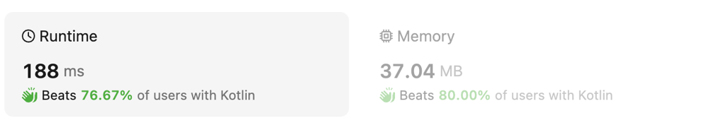

# Kotlin solution with stack beating 76% runtime and 80% memory

**Author:** vitamaxDH
**Votes:** 1
**Link:** [https://leetcode.com/problems/final-prices-with-a-special-discount-in-a-shop/solutions/4633146/](https://leetcode.com/problems/final-prices-with-a-special-discount-in-a-shop/solutions/4633146/)

---

# Intuition
<!-- Describe your first thoughts on how to solve this problem. -->

# Approach
<!-- Describe your approach to solving the problem. -->

# Complexity


# Code
```
class Solution {
    fun finalPrices(prices: IntArray): IntArray {
        val stack = Stack<Int>()
        val result = IntArray(prices.size) { prices[it] }
        for (i in prices.indices) {
            while (stack.isNotEmpty() && prices[i] <= prices[stack.peek()]) {
                val prevIdx = stack.pop()
                result[prevIdx] = prices[prevIdx] - prices[i]
            }
            stack.push(i)
        }
        return result
    }
}
```