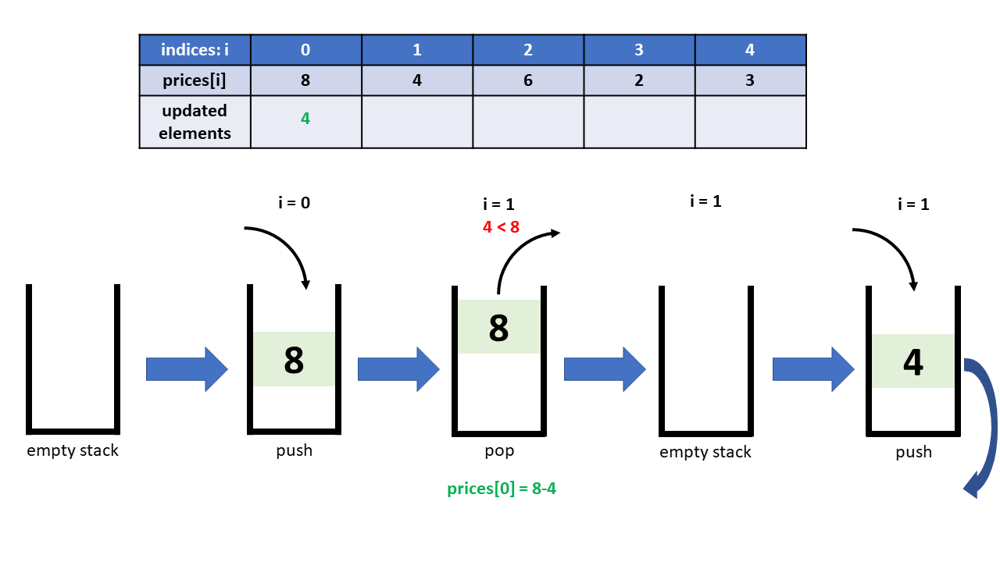
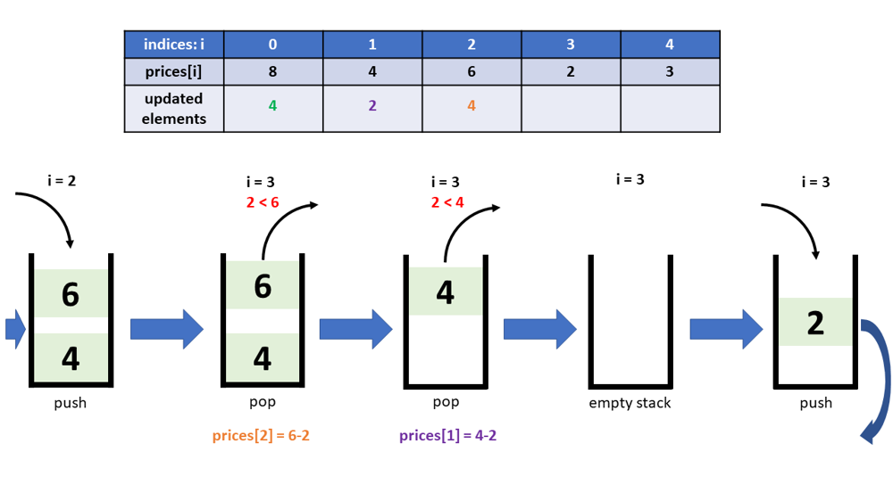
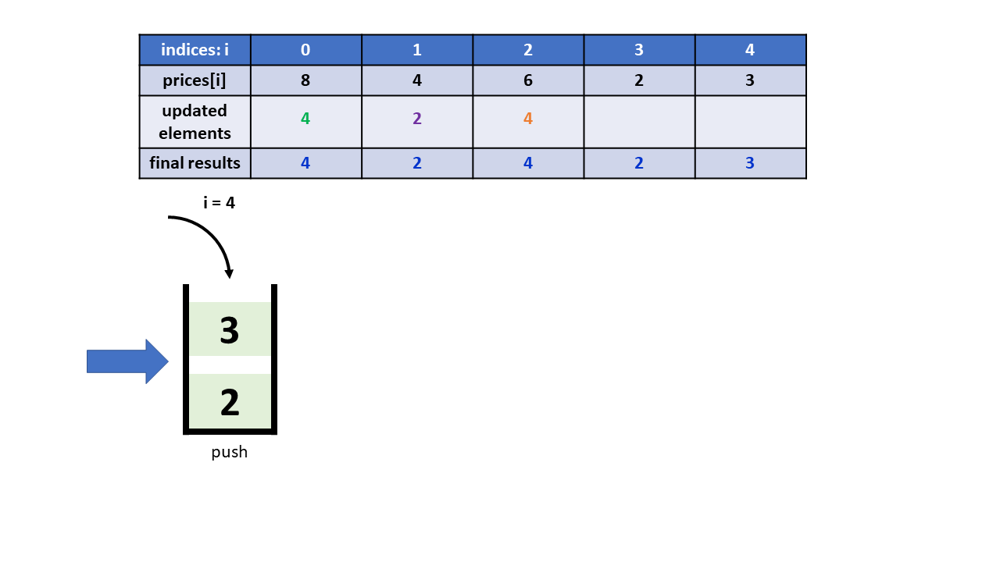

# Python 3, One-pass, Visual explain, Monotonous stack

**Author:** lucliu
**Votes:** 57
**Link:** [https://leetcode.com/problems/final-prices-with-a-special-discount-in-a-shop/solutions/966403/](https://leetcode.com/problems/final-prices-with-a-special-discount-in-a-shop/solutions/966403/)

---

At this point, when you see this post, you may have already know how to code using the Monotonous Increasing Stack stragegy. This post has the same code as you saw from other posts. However, as an engineer like me, I'd like to actually see how the Monotonous Stack works visually. So here you go, below are some diagrams to illustrate it thruough the example *prices = [8,4,6,2,3]*. You will see the stack status changes, and how the elements are updated accordingly.
A couple of highlights about the below code though:
* Implementing the Monotonous Increasing Stack stragegy
* The stack stores indices

~~~
class Solution:
    def finalPrices(self, prices: List[int]) -> List[int]:
        stack = []
        for i in range(len(prices)):
            while stack and (prices[stack[-1]] >= prices[i]):
                prices[stack.pop()] -= prices[i]
            stack.append(i)
        return prices
~~~

#Runtime: 36 ms, faster than 100.00% of Python3 online submissions for Final Prices With a Special Discount in a Shop.
#Memory Usage: 14.3 MB, less than 59.61% of Python3 online submissions for Final Prices With a Special Discount in a Shop.