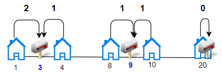
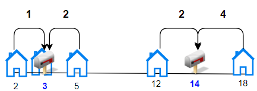

# [1478. Allocate Mailboxes](https://leetcode.com/problems/allocate-mailboxes/)

| Category | Difficulty | Likes | Dislikes |
| :------: | :--------: | :---: | :------: |
| Algorithms | Hard | 1165 | 23 |

**Tags:** [`array`](https://leetcode.com/tag/array), [`math`](https://leetcode.com/tag/math), [`dynamic-programming`](https://leetcode.com/tag/dynamic-programming), [`sorting`](https://leetcode.com/tag/sorting)

**Companies:** `goldman-sachs`, `amazon`, `bloomberg`

## Description

Given the array `houses` where `houses[i]` is the location of the `i^th` house along a street and an integer `k`, allocate `k` mailboxes in the street.

Return *the **minimum** total distance between each house and its nearest mailbox*.

The test cases are generated so that the answer fits in a 32-bit integer.

 

**Example 1:**


```

Input: houses = [1,4,8,10,20], k = 3
Output: 5
Explanation: Allocate mailboxes in position 3, 9 and 20.
Minimum total distance from each houses to nearest mailboxes is |3-1| + |4-3| + |9-8| + |10-9| + |20-20| = 5 

```

**Example 2:**


```

Input: houses = [2,3,5,12,18], k = 2
Output: 9
Explanation: Allocate mailboxes in position 3 and 14.
Minimum total distance from each houses to nearest mailboxes is |2-3| + |3-3| + |5-3| + |12-14| + |18-14| = 9.

```

 

**Constraints:**

	- `1 <= k <= houses.length <= 100`

	- `1 <= houses[i] <= 10^4`

	- All the integers of `houses` are **unique**.

---

**Links:** [Submissions](https://leetcode.com/problems/allocate-mailboxes/) | [Solutions](https://leetcode.com/problems/allocate-mailboxes/)
