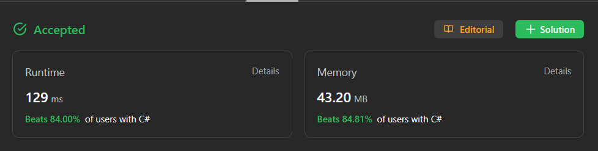

# ✔️ Java / C# / C++ / Rust solutions with easy explanation | 0 ms runtime

**Author:** Muhammad-Diyor
**Votes:** 26
**Link:** [https://leetcode.com/problems/running-sum-of-1d-array/solutions/3925525/](https://leetcode.com/problems/running-sum-of-1d-array/solutions/3925525/)

---

# Approach
To calculate the running sum of the given array nums, we can iterate through the array and update each element with the sum of all elements up to that point. This way, each element of the modified array will represent the running sum from the beginning of the original array.

In this solution we start iterating with 1st index, because running sum of 0th is equal to nothing else but itself. So, it doesn't need change.

# Complexity

## Java solution complexity
Got 0 ms runtime in Java


## C# solution complexity


## Rust solution complexity


# Code
```C# []
public class Solution {
    public int[] RunningSum(int[] nums) {
        for (int i = 1; i < nums.Length; i++)
        {
            nums[i] = nums[i - 1] + nums[i];
        }

        return nums;
    }
}
```
```Java []
public class Solution {
    public int[] runningSum(int[] nums) {
        for (int i = 1; i < nums.length; i++) {
            nums[i] = nums[i - 1] + nums[i];
        }
        
        return nums;
    }
}
```
```C++ []
class Solution {
public:
    vector<int> runningSum(vector<int>& nums) {
        for (int i = 1; i < nums.size(); i++) {
            nums[i] = nums[i - 1] + nums[i];
        }
        
        return nums;
    }
};
```
```Rust []
impl Solution {
    pub fn running_sum(nums: Vec<i32>) -> Vec<i32> {
        // Create a mutable copy of the input vector
        let mut nums = nums;
        
        for i in 1..nums.len() {
            nums[i] = nums[i - 1] + nums[i];
        }
        
        nums
    }
}
```

## If you found my solution helpful, please consider giving it an upvote. Happy coding!