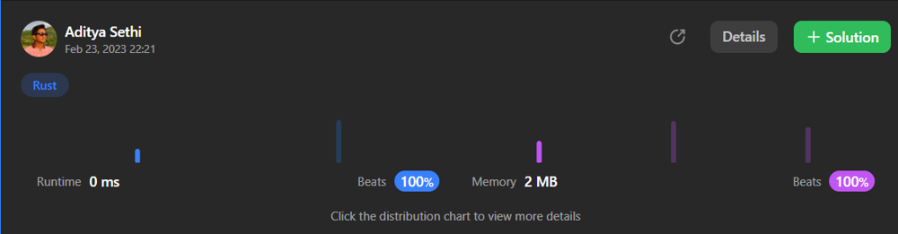

# Simple and nice approach, 0 ms runtime, beats 100%

**Author:** techyguyaditya
**Votes:** 39
**Link:** [https://leetcode.com/problems/running-sum-of-1d-array/solutions/3222530/](https://leetcode.com/problems/running-sum-of-1d-array/solutions/3222530/)

---

# Intuition
<!-- Describe your first thoughts on how to solve this problem. -->
I thought of just keep on adding sum and return. That gave me error, because I didn't read the question properly xD. I just added 2 extra lines of code to it. 

# Approach
<!-- Describe your approach to solving the problem. -->
- First initialize total sum and return vector. 
- Then, iterate each element in nums vector. 
- Keep on adding sum to the iterative value and keep on pushing new sum value to return array
- Return the array. WOW!!! Profit!!! Nice :)

##### Pls upvote this multilingual solution

# Code
### C++
```c++
class Solution {
public:
    vector<int> runningSum(vector<int>& nums) {
        int sums = 0;
        vector<int> retSums;
        for(auto i : nums) {
            sums += i;
            retSums.push_back(sums);
        }
        return retSums;
    }
};
```
### Python
```python
class Solution:
    def runningSum(self, nums: List[int]) -> List[int]:
        sums=0
        retSum=[]
        for i in nums:
            sums+=i
            retSum.append(sums)
        return retSum
```
### Rust
```rust
impl Solution {
    pub fn running_sum(nums: Vec<i32>) -> Vec<i32> {
        let mut sum = 0;
        let mut retValue:Vec<i32> = Vec::new();
        for num in nums {
            sum += num;
            retValue.push(sum);
        }
        retValue
    }
}
```
### Javascript
```js
var runningSum = function(nums) {
    let sums = 0;
    let retSums = [];
    for(let i of nums) {
        sums += i;
        retSums.push(sums);
    }
    return retSums;
}
```
### Java
```java
class Solution {
    public int[] runningSum(int[] nums) {
        int sums = 0;
        int[] retSums = new int[nums.length];
        for(int i = 0; i < nums.length; i++) {
            sums += nums[i];
            retSums[i] = sums;
        }
        return retSums;
    }
}
```


