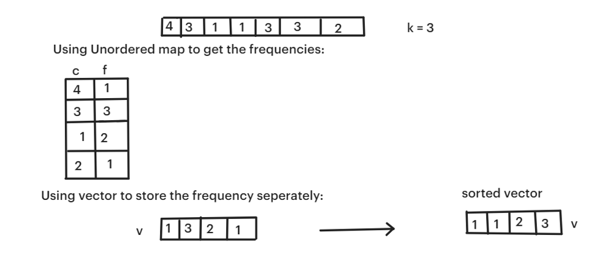
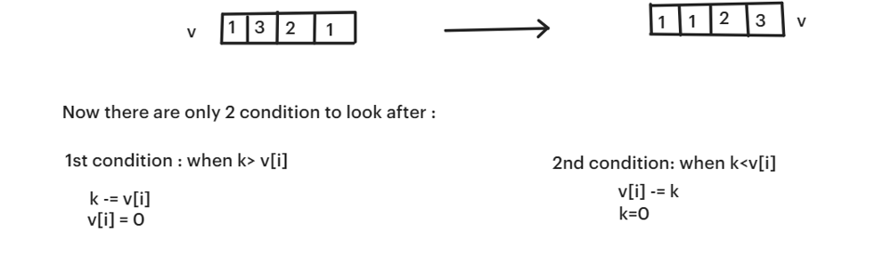
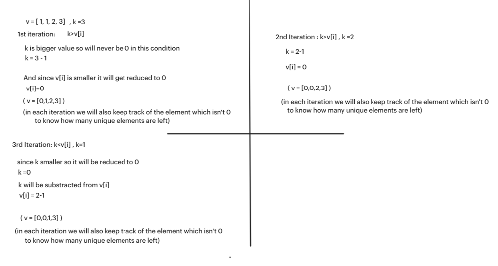

# ✅☑Beats 99% Users || [C++/Java/Python/JavaScript] || EXPLAINED🔥

**Author:** MarkSPhilip31
**Votes:** 115
**Link:** [https://leetcode.com/problems/least-number-of-unique-integers-after-k-removals/solutions/4734460/](https://leetcode.com/problems/least-number-of-unique-integers-after-k-removals/solutions/4734460/)

---

# DO GIVE IT A LIKE IF THAT WAS HELPFUL\uD83E\uDEE1\uD83D\uDC47\r
\r
\r
\r
---\r
\r
\r
\r
\r
---\r
\r
\r
# Approaches\r
\r
1. Used a unordered map `mp` to keep  track of the frequencies.\r
2. Seperately stored frequencies in a vector `v` and sort them.\r
\r
\r
\r
3. To get the array of minimum unique elements, there will be only 2 condition which we have to look after:\r
\r
\r
\r
\r
- **First Condition (k > v[i]):**\r
\r
    - If the remaining removal count `k` is greater than the current frequency `v[i]`, it implies that we can completely remove all occurrences of the current element represented by `v[i]` from the array without exhausting `k`.\r
    - In this case, we subtract `v[i]` from `k` (indicating that we have accounted for removing `v[i]` occurrences of the current element) and set `v[i]` to 0 (indicating that this element is fully removed).\r
    - We do not increment the counter 'cnt' because the element `v[i]` has been fully removed.\r
    \r
- **Second Condition (k <= v[i]):**\r
\r
    - If the remaining removal count `k` is less than or equal to the current frequency `v[i]`, it means that we can only partially remove the occurrences of the current element represented by `v[i]` from the array without exhausting `k`.\r
    - In this case, we subtract `k` from `v[i]` (indicating that we have partially removed `k` occurrences of the current element) and set `k` to 0 (indicating that we have exhausted our removal count `k`).\r
    - We increment the counter `cnt` because even though the element `v[i]` remains partially, it still contributes to the count of unique integers that need to be removed.\r
    \r
\r
\r
\r
# Complexity\r
- Time complexity:\r
   $$O(nlogn)$$\r
    \r
\r
- Space complexity:\r
   $$O(n)$$\r
    \r
\r
\r
# Code\r
```C++ []\r
class Solution {\r
public:\r
\r
    \r
    int findLeastNumOfUniqueInts(vector<int>& arr, int k) {\r
        unordered_map<int,int>mp;\r
        for(auto a : arr)mp[a]++;\r
        \r
        vector<int>v;\r
        int cnt=0;\r
        for(auto a :mp){\r
            v.push_back(a.second);\r
        }\r
        sort(v.begin(),v.end());\r
        for(int i =0;i<v.size();i++){\r
            if(k > v[i]){\r
                k-=v[i];\r
                v[i]=0;\r
            }else{\r
                v[i] -= k;\r
                k =0;\r
            }\r
            if(v[i]!=0)cnt++;\r
        }\r
\r
        return cnt;\r
\r
    }\r
};\r
\r
\r
\r
\r
\r
```\r
```Java []\r
\r
\r
class Solution {\r
    public int findLeastNumOfUniqueInts(int[] arr, int k) {\r
        Map<Integer, Integer> mp = new HashMap<>();\r
        for (int a : arr) mp.put(a, mp.getOrDefault(a, 0) + 1);\r
        \r
        List<Integer> v = new ArrayList<>();\r
        int cnt = 0;\r
        for (int a : mp.values()) {\r
            v.add(a);\r
        }\r
        \r
        Collections.sort(v);\r
        for (int i = 0; i < v.size(); i++) {\r
            if (k > v.get(i)) {\r
                k -= v.get(i);\r
                v.set(i, 0);\r
            } else {\r
                v.set(i, v.get(i) - k);\r
                k = 0;\r
            }\r
            if (v.get(i) != 0) cnt++;\r
        }\r
        return cnt;\r
    }\r
}\r
\r
\r
```\r
```python3 []\r
class Solution:\r
    def findLeastNumOfUniqueInts(self, arr: List[int], k: int) -> int:\r
        mp = collections.Counter(arr)\r
        v = list(mp.values())\r
        cnt = 0\r
        v.sort()\r
        for i in range(len(v)):\r
            if k > v[i]:\r
                k -= v[i]\r
                v[i] = 0\r
            else:\r
                v[i] -= k\r
                k = 0\r
            if v[i] != 0:\r
                cnt += 1\r
        return cnt\r
\r
\r
```\r
```javascript []\r
var findLeastNumOfUniqueInts = function(arr, k) {\r
    let mp = new Map();\r
    for (let a of arr) {\r
        mp.set(a, (mp.get(a) || 0) + 1);\r
    }\r
    \r
    let v = Array.from(mp.values());\r
    let cnt = 0;\r
    v.sort((a, b) => a - b);\r
    for (let i = 0; i < v.length; i++) {\r
        if (k > v[i]) {\r
            k -= v[i];\r
            v[i] = 0;\r
        } else {\r
            v[i] -= k;\r
            k = 0;\r
        }\r
        if (v[i] !== 0) cnt++;\r
    }\r
    return cnt;\r
};\r
\r
\r
\r
```\r
---\r
\r
\r
\r
\r
\r
# DO GIVE IT A LIKE IF THAT WAS HELPFUL\uD83E\uDEE1\uD83D\uDC47\r
\r
---\r
---\r
\r
\r
---