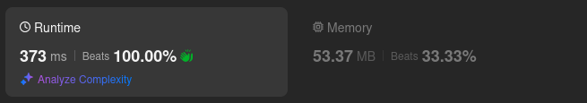

# Kotlin. Beats 100% (373 ms). Single pass solution

**Author:** mobdev778
**Votes:** 2
**Link:** [https://leetcode.com/problems/check-if-array-pairs-are-divisible-by-k/solutions/5855468/](https://leetcode.com/problems/check-if-array-pairs-are-divisible-by-k/solutions/5855468/)

---



# Code
```kotlin [] 
class Solution {
    fun canArrange(arr: IntArray, k: Int): Boolean {
        var unpaired = 0
        val mod = IntArray(k)

        for (i in arr.size - 1 downTo 0) {
            var a = arr[i] % k
            if (a < 0) a += k
            var pairIndex = k - a
            if (pairIndex == k) pairIndex = 0
            if (mod[pairIndex] > 0) {
                mod[pairIndex]--
                unpaired--
            } else {
                mod[a]++
                unpaired++
                if (unpaired > i) return false
            }
        }

        return true
    }
}
```

# Approach

The basic idea is to create a "mod" array of "k" possible remainders of division modulo "k".

We move along the original array and try to check each time whether the current element has a paired element. If there is a paired element, we decrease the number of unpaired elements by 1 and remove the paired element from the "mod" table.

If there is no paired element, we add the current element to the "mod" table and increase the number of unpaired elements. 

There is a nice optimization here - if we see that there are not enough elements in the remaining part of the array to ensure "pairing", then we can immediately interrupt the traversal and return a negative result.

# Alternative approach

1. Double pass


```
class Solution {

    fun canArrange(arr: IntArray, k: Int): Boolean {
        val mod = IntArray(k)

        for (ai in arr) {
            val a = ai % k
            if (a >= 0) mod[a]++ else mod[a + k]++
        }

        if (mod[0] and 1 == 1) return false
        for (i in 1..(k shr 1)) if (mod[i] != mod[k - i]) return false
        return true
    }
}
```

An alternative to the one-pass solution is the "two-pass" solution. This solution is simpler (in my opinion).

We also create a "mod" array. In the first pass, we simply add all the modules found to the "mod" table:
```
for (ai in arr) {
    val a = ai % k
    if (a >= 0) mod[a]++ else mod[a + k]++
}
```

Next, we need to check the case with elements that are completely divisible by "k". These elements are special because they do not have a pair of mod elements - they are paired with themselves.

For mod[0], we only check that the number of elements in mod[0] is even. I don't like division operations, so I check parity using bitwise arithmetic:
```
if (mod[0] and 1 == 1) return false
```

In the second pass, we simply divide the array of modules into 2 halves - left and right, and make a pass through the left half.
Each time, we check that the modules from the left half have exactly the same number of modules from the right half. If this condition is not met, then the distribution into pairs does not exist.
```
for (i in 1..(k shr 1)) if (mod[i] != mod[k - i]) return false
```