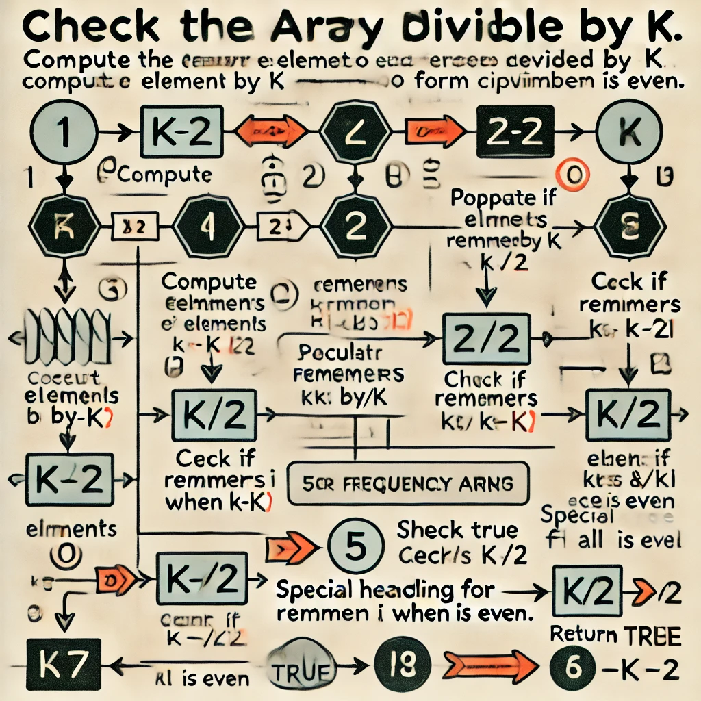

# 🔢 Pairing Array Elements Divisible by K: Optimal Solution in Multiple Languages 🌍|| 100% 🚀🎯

**Author:** MaheshSavant
**Votes:** 0
**Link:** [https://leetcode.com/problems/check-if-array-pairs-are-divisible-by-k/solutions/5854869/](https://leetcode.com/problems/check-if-array-pairs-are-divisible-by-k/solutions/5854869/)

---

# \uD83D\uDE80 Intuition
<!-- Describe your first thoughts on how to solve this problem. -->
To determine if the array can be divided into pairs such that the sum of each pair is divisible by `k`, I initially thought of calculating the remainder of each element when divided by `k`. Then, I could try to match the remainders in complementary pairs.

# \uD83D\uDEE0\uFE0F Approach
<!-- Describe your approach to solving the problem. -->
1. First, compute the remainder of each element when divided by `k` and store the frequency of these remainders.
2. For elements with a remainder of `0`, there must be an even number of them to form valid pairs.
3. For elements with remainder `i`, they must be paired with elements with remainder `k - i`.
4. Special handling is required when `i == k/2` (if `k` is even), where pairs must be formed within this group.

# \uD83D\uDCCFFlow images 


# \u23F1\uFE0F Complexity

- **Time complexity**:  
  The time complexity is **$$O(n + k)$$**, where `n` is the size of the array and `k` is the divisor. 
    - Computing the remainder for each element and updating the frequency array takes **O(n)**.
    - Checking the frequency array for valid pairs takes **O(k)**.

- **Space complexity**:  
  The space complexity is **$$O(k)$$** due to the frequency array storing counts for each remainder.

# \uD83D\uDCBB Code
```java []
class Solution {
    public boolean canArrange(int[] arr, int k) {
        int size = arr.length;
        if (size % 2 != 0) {
            return false;
        }
        int[] freq = new int[k];

        for (int i = 0; i < size; i++) {
            int remainder = arr[i] % k;
            if (remainder < 0) { 
                remainder += k;
            }
            freq[remainder]++;
        }

        if (freq[0] % 2 != 0) {
            return false; 
        }

        for (int i = 1; i <= k / 2; i++) {
            if (i == k - i) { 
                if (freq[i] % 2 != 0) {
                    return false; 
                }
            } else {
                if (freq[i] != freq[k - i]) {
                    return false; 
                }
            }
        }

        return true;
    }
}
```
```C []
#include <stdio.h>
#include <stdbool.h>

bool canArrange(int arr[], int size, int k) {
    if (size % 2 != 0) return false;

    int freq[k];
    for (int i = 0; i < k; i++) freq[i] = 0;

    for (int i = 0; i < size; i++) {
        int remainder = arr[i] % k;
        if (remainder < 0) remainder += k;
        freq[remainder]++;
    }

    if (freq[0] % 2 != 0) return false;

    for (int i = 1; i <= k / 2; i++) {
        if (i == k - i) {
            if (freq[i] % 2 != 0) return false;
        } else {
            if (freq[i] != freq[k - i]) return false;
        }
    }

    return true;
}

int main() {
    int arr[] = {1, 2, 3, 4, 5, 10, 6, 7, 8, 9};
    int k = 5;
    int size = sizeof(arr) / sizeof(arr[0]);

    if (canArrange(arr, size, k)) {
        printf("True\
");
    } else {
        printf("False\
");
    }
    
    return 0;
}

```
```CPP []
#include <iostream>
#include <vector>
using namespace std;

bool canArrange(vector<int>& arr, int k) {
    int size = arr.size();
    if (size % 2 != 0) return false;

    vector<int> freq(k, 0);

    for (int i = 0; i < size; i++) {
        int remainder = arr[i] % k;
        if (remainder < 0) remainder += k;
        freq[remainder]++;
    }

    if (freq[0] % 2 != 0) return false;

    for (int i = 1; i <= k / 2; i++) {
        if (i == k - i) {
            if (freq[i] % 2 != 0) return false;
        } else {
            if (freq[i] != freq[k - i]) return false;
        }
    }

    return true;
}

int main() {
    vector<int> arr = {1, 2, 3, 4, 5, 10, 6, 7, 8, 9};
    int k = 5;

    if (canArrange(arr, k)) {
        cout << "True" << endl;
    } else {
        cout << "False" << endl;
    }
    
    return 0;
}

```
```C# []
using System;

class Solution {
    public static bool CanArrange(int[] arr, int k) {
        int size = arr.Length;
        if (size % 2 != 0) return false;

        int[] freq = new int[k];

        foreach (int num in arr) {
            int remainder = num % k;
            if (remainder < 0) remainder += k;
            freq[remainder]++;
        }

        if (freq[0] % 2 != 0) return false;

        for (int i = 1; i <= k / 2; i++) {
            if (i == k - i) {
                if (freq[i] % 2 != 0) return false;
            } else {
                if (freq[i] != freq[k - i]) return false;
            }
        }

        return true;
    }

    public static void Main() {
        int[] arr = {1, 2, 3, 4, 5, 10, 6, 7, 8, 9};
        int k = 5;

        Console.WriteLine(CanArrange(arr, k) ? "True" : "False");
    }
}

```
```Python []
def canArrange(arr, k):
    size = len(arr)
    if size % 2 != 0:
        return False

    freq = [0] * k

    for num in arr:
        remainder = num % k
        if remainder < 0:
            remainder += k
        freq[remainder] += 1

    if freq[0] % 2 != 0:
        return False

    for i in range(1, k // 2 + 1):
        if i == k - i:
            if freq[i] % 2 != 0:
                return False
        else:
            if freq[i] != freq[k - i]:
                return False

    return True

arr = [1, 2, 3, 4, 5, 10, 6, 7, 8, 9]
k = 5
print(canArrange(arr, k))  # Output: True

```
```JavaScript []
function canArrange(arr, k) {
    const size = arr.length;
    if (size % 2 !== 0) return false;

    const freq = new Array(k).fill(0);

    arr.forEach(num => {
        let remainder = num % k;
        if (remainder < 0) remainder += k;
        freq[remainder]++;
    });

    if (freq[0] % 2 !== 0) return false;

    for (let i = 1; i <= k / 2; i++) {
        if (i === k - i) {
            if (freq[i] % 2 !== 0) return false;
        } else {
            if (freq[i] !== freq[k - i]) return false;
        }
    }

    return true;
}

const arr = [1, 2, 3, 4, 5, 10, 6, 7, 8, 9];
const k = 5;
console.log(canArrange(arr, k));  // Output: true

```
```Rust []
fn can_arrange(arr: Vec<i32>, k: i32) -> bool {
    let size = arr.len();
    if size % 2 != 0 {
        return false;
    }

    let mut freq = vec![0; k as usize];

    for &num in arr.iter() {
        let mut remainder = num % k;
        if remainder < 0 {
            remainder += k;
        }
        freq[remainder as usize] += 1;
    }

    if freq[0] % 2 != 0 {
        return false;
    }

    for i in 1..=k / 2 {
        if i == k - i {
            if freq[i as usize] % 2 != 0 {
                return false;
            }
        } else {
            if freq[i as usize] != freq[(k - i) as usize] {
                return false;
            }
        }
    }

    true
}

fn main() {
    let arr = vec![1, 2, 3, 4, 5, 10, 6, 7, 8, 9];
    let k = 5;
    println!("{}", can_arrange(arr, k));  // Output: true
}

```
```Ruby []
def can_arrange(arr, k)
    size = arr.length
    return false if size.odd?

    freq = Array.new(k, 0)

    arr.each do |num|
        remainder = num % k
        remainder += k if remainder < 0
        freq[remainder] += 1
    end

    return false if freq[0] % 2 != 0

    (1..k/2).each do |i|
        if i == k - i
            return false if freq[i] % 2 != 0
        else
            return false if freq[i] != freq[k - i]
        end
    end

    true
end

arr = [1, 2, 3, 4, 5, 10, 6, 7, 8, 9]
k = 5
puts can_arrange(arr, k)  # Output: true

```
```Go []
package main

import (
	"fmt"
)

func canArrange(arr []int, k int) bool {
	size := len(arr)
	if size%2 != 0 {
		return false
	}

	freq := make([]int, k)

	for _, num := range arr {
		remainder := num % k
		if remainder < 0 {
			remainder += k
		}
		freq[remainder]++
	}

	if freq[0]%2 != 0 {
		return false
	}

	for i := 1; i <= k/2; i++ {
		if i == k-i {
			if freq[i]%2 != 0 {
				return false
			}
		} else {
			if freq[i] != freq[k-i] {
				return false
			}
		}
	}

	return true
}

func main() {
	arr := []int{1, 2, 3, 4, 5, 10, 6, 7, 8, 9}
	k := 5
	fmt.Println(canArrange(arr, k)) // Output: true
}

```
```Kotlin []
fun canArrange(arr: IntArray, k: Int): Boolean {
    val size = arr.size
    if (size % 2 != 0) return false

    val freq = IntArray(k)

    for (num in arr) {
        var remainder = num % k
        if (remainder < 0) remainder += k
        freq[remainder]++
    }

    if (freq[0] % 2 != 0) return false

    for (i in 1..k / 2) {
        if (i == k - i) {
            if (freq[i] % 2 != 0) return false
        } else {
            if (freq[i] != freq[k - i]) return false
        }
    }

    return true
}

fun main() {
    val arr = intArrayOf(1, 2, 3, 4, 5, 10, 6, 7, 8, 9)
    val k = 5
    println(canArrange(arr, k))  // Output: true
}

```
