# Image Explanation🏆- [Binary Exponentiation || Two Pointers || Pre-Computation] - C++/Java/Python

**Author:** aryan_0077
**Votes:** 161
**Link:** [https://leetcode.com/problems/number-of-subsequences-that-satisfy-the-given-sum-condition/solutions/3491280/](https://leetcode.com/problems/number-of-subsequences-that-satisfy-the-given-sum-condition/solutions/3491280/)

---

# Video Solution (`Aryan Mittal`) - Link in LeetCode Profile
`Number of Subsequences That Satisfy the Given Sum Condition` by `Aryan Mittal`


# Approach & Intution
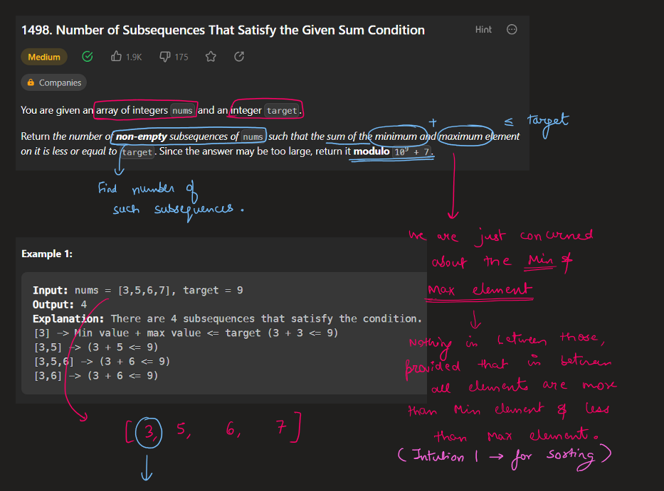
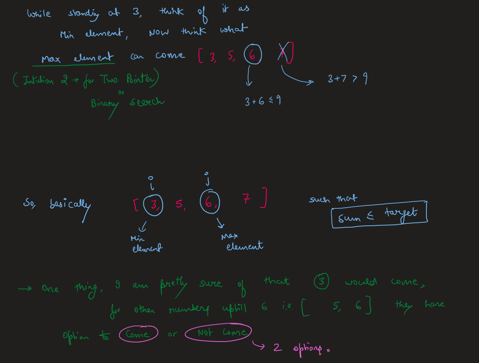
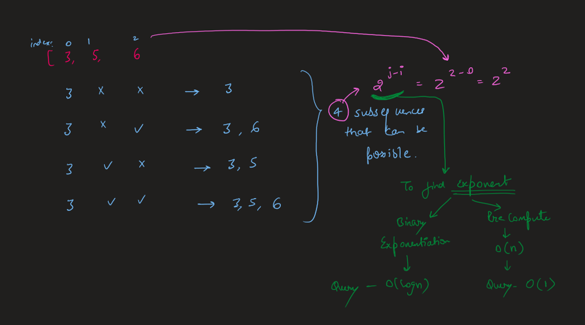
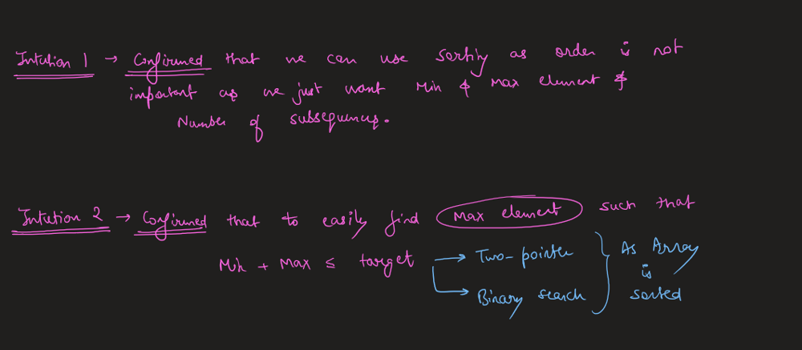


# How to Code in Different ways
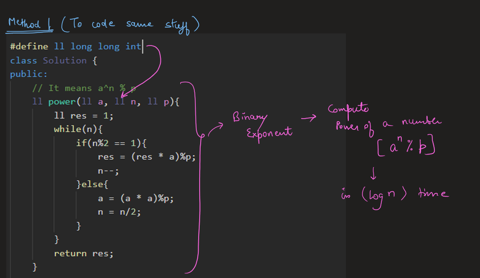
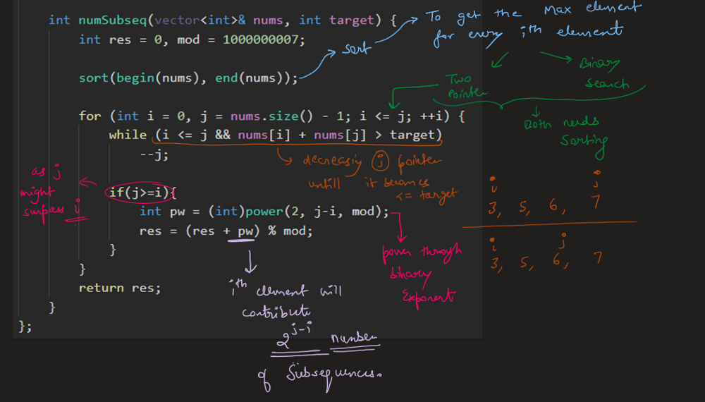
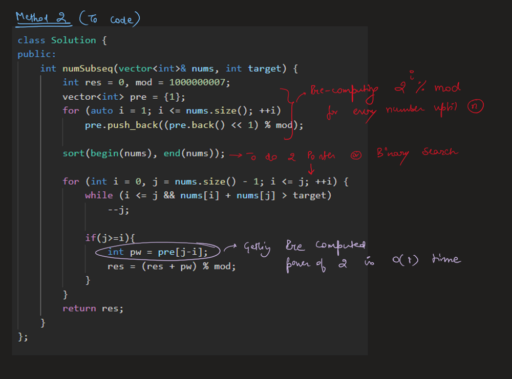
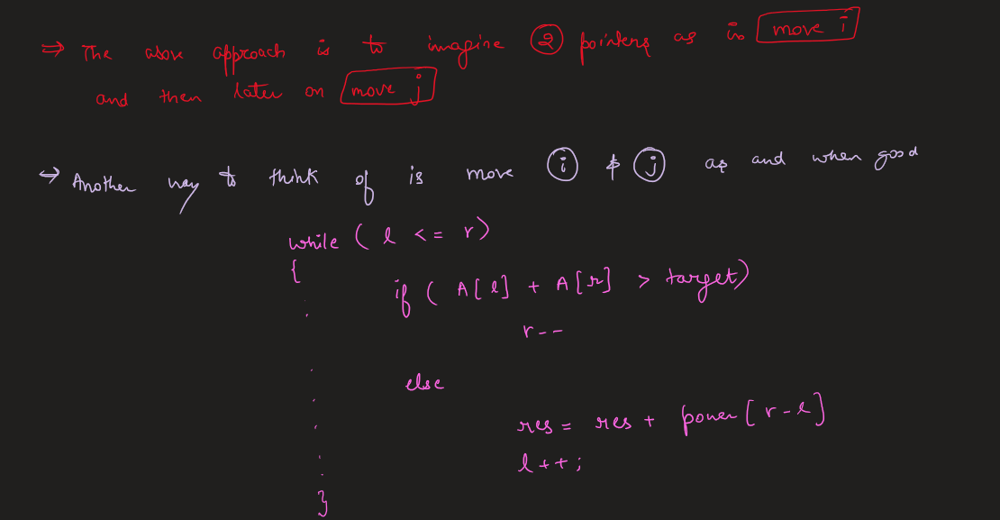
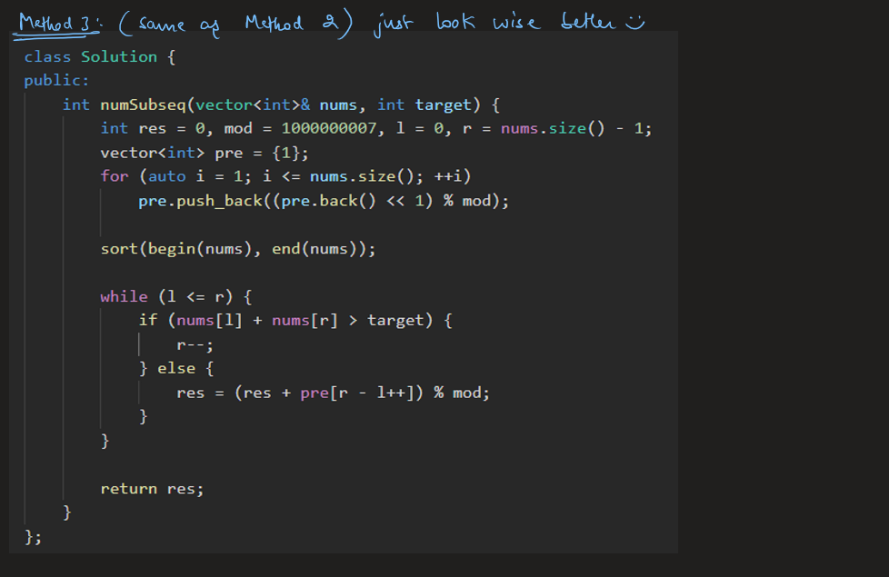
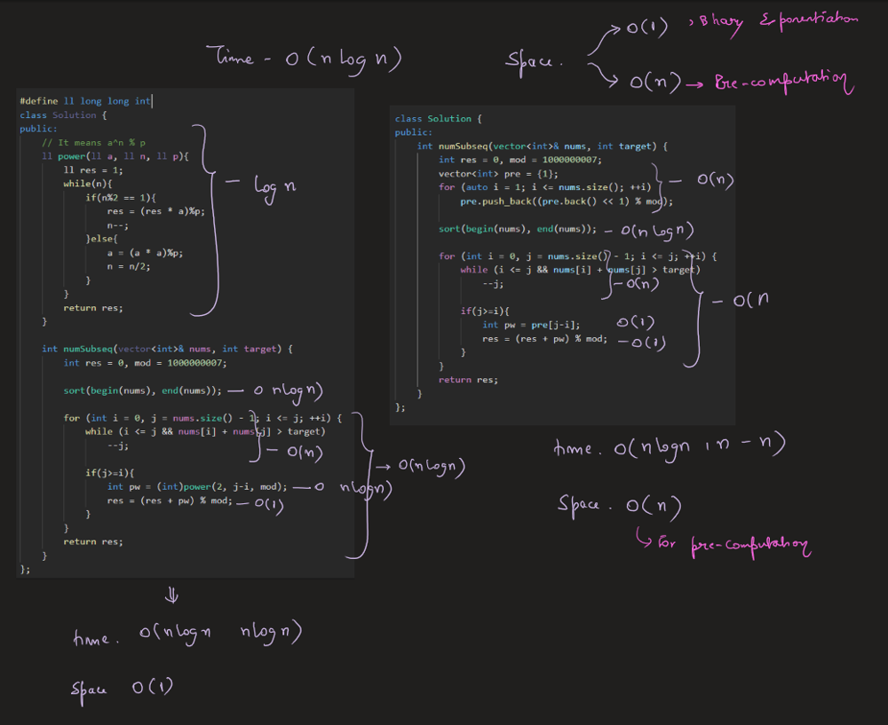
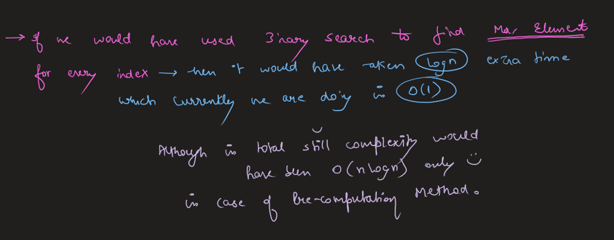


# Code
```C++ []
class Solution {
public:
    int numSubseq(vector<int>& nums, int target) {
        int res = 0, mod = 1000000007, l = 0, r = nums.size() - 1;
        vector<int> pre = {1};
        for (auto i = 1; i <= nums.size(); ++i)
            pre.push_back((pre.back() << 1) % mod);   
                
        sort(begin(nums), end(nums));
        
        while (l <= r) {
            if (nums[l] + nums[r] > target) {
                r--;
            } else {
                res = (res + pre[r - l++]) % mod;
            }
        }

        return res;
    }
};
```
```Java []
class Solution {
    public int numSubseq(int[] nums, int target) {
        int res = 0, mod = 1000000007, l = 0, r = nums.length - 1;
        List<Integer> pre = new ArrayList<>();
        pre.add(1);
        for (int i = 1; i <= nums.length; ++i) {
            pre.add((pre.get(i - 1) << 1) % mod);
        }

        Arrays.sort(nums);

        while (l <= r) {
            if (nums[l] + nums[r] > target) {
                r--;
            } else {
                res = (res + pre.get(r - l++)) % mod;
            }
        }

        return res;
    }
}
```
```Python []
class Solution:
    def numSubseq(self, nums: List[int], target: int) -> int:
        res, mod = 0, 1000000007
        l, r = 0, len(nums) - 1
        pre = [1]
        for i in range(1, len(nums) + 1):
            pre.append((pre[-1] << 1) % mod)
                
        nums.sort()
        
        while l <= r:
            if nums[l] + nums[r] > target:
                r -= 1
            else:
                res = (res + pre[r - l]) % mod
                l += 1

        return res
```