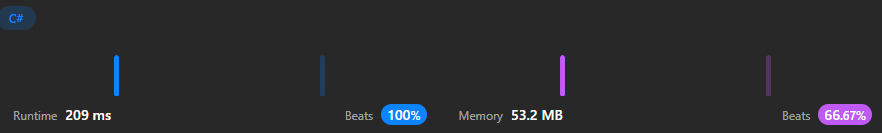

# C#, and TypeScript Solution 🔥🚀 with approach. ❇️✅

**Author:** ArafatSabbir
**Votes:** 7
**Link:** [https://leetcode.com/problems/number-of-subsequences-that-satisfy-the-given-sum-condition/solutions/3491796/](https://leetcode.com/problems/number-of-subsequences-that-satisfy-the-given-sum-condition/solutions/3491796/)

---

# \u2B06\uFE0FLike|\uD83C\uDFAFShare|\u2B50Favourite



# Complexity
- Time complexity:
O(n log n)

- Space complexity:
 O(n)

```csharp []
public class Solution {
    public int NumSubseq(int[] nums, int target) {
        // Sort the array in non-decreasing order
        Array.Sort(nums);

        // Initialize variables
        int mod = 1000000007;
        int n = nums.Length;
        int ans = 0;

        // Calculate powers of 2 modulo mod
        int[] pow2 = new int[n];
        pow2[0] = 1;
        for (int i = 1; i < n; i++) {
            pow2[i] = (pow2[i - 1] * 2) % mod;
        }

        // Use two pointers to find subsequences
        int left = 0, right = n - 1;
        while (left <= right) {
            // If the sum of the minimum and maximum values is less than or equal to target,
            // add the number of subsequences of length (right - left) to the answer
            if (nums[left] + nums[right] <= target) {
                ans = (ans + pow2[right - left]) % mod;
                left++;
            }
            // Otherwise, move the right pointer to the left
            else {
                right--;
            }
        }

        return ans;
    }
}
```
```typescript []
function numSubseq(nums: number[], target: number): number {
    nums.sort((a, b) => a - b); // sort array in non-decreasing order

    const mod = 1e9 + 7;
    const n = nums.length;
    let ans = 0;

    // calculate powers of 2 modulo mod
    const pow2: number[] = new Array(n);
    pow2[0] = 1;
    for (let i = 1; i < n; i++) {
        pow2[i] = (pow2[i - 1] * 2) % mod;
    }

    // use two pointers to find subsequences
    let left = 0, right = n - 1;
    while (left <= right) {
        // if the sum of the minimum and maximum values is less than or equal to target,
        // add the number of subsequences of length (right - left) to the answer
        if (nums[left] + nums[right] <= target) {
            ans = (ans + pow2[right - left]) % mod;
            left++;
        }
        // otherwise, move the right pointer to the left
        else {
            right--;
        }
    }

    return ans;
};
```