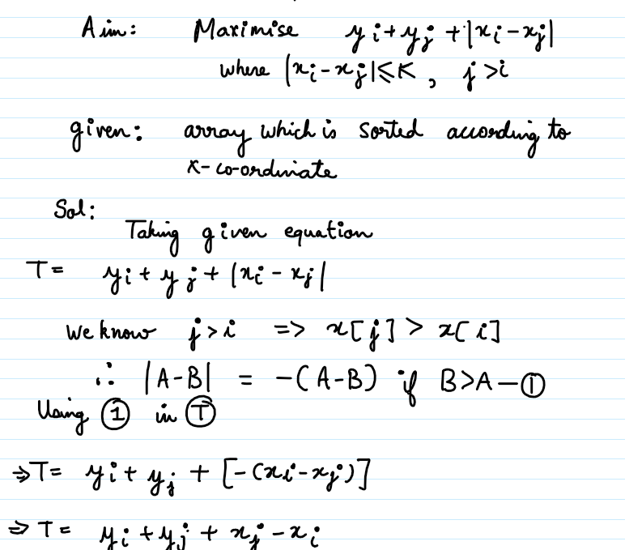
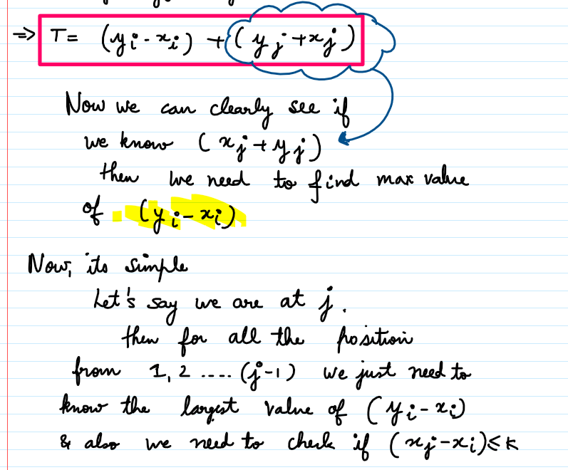
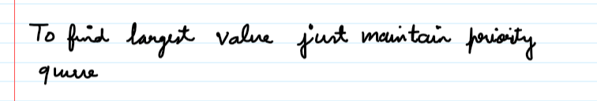

# ✔ Hand Written with Mathematics and C++ code

**Author:** _helios
**Votes:** 51
**Link:** [https://leetcode.com/problems/max-value-of-equation/solutions/2218644/](https://leetcode.com/problems/max-value-of-equation/solutions/2218644/)

---




```
class Solution {
public:
    int findMaxValueOfEquation(vector<vector<int>>& points, int k) {
        priority_queue<pair<int,int>>p;
        int ans=INT_MIN;
        for(int i=0;i<points.size();i++){
			// if  xj - xi > k then we have to remove that from the queue as it can not longer 
			// contribute to the answer which is given in the question itself
            while(!p.empty() && (points[i][0]-p.top().second)>k){
                p.pop();
            }
			
			// now if the queue is not empty then the top of the queue is having 
			// maximum value of  ( yi-xi) so we update our answer with  (top of the queue) + currvalue
            if(!p.empty()){
                ans=max(ans,points[i][0]+points[i][1]+p.top().first);
            }
			
			// inserting ( yi-xi ) into the queue 
            p.push({points[i][1]-points[i][0],points[i][0]});
        }
        return ans;
    }
};
```

**Upvote if you liked the solution**
