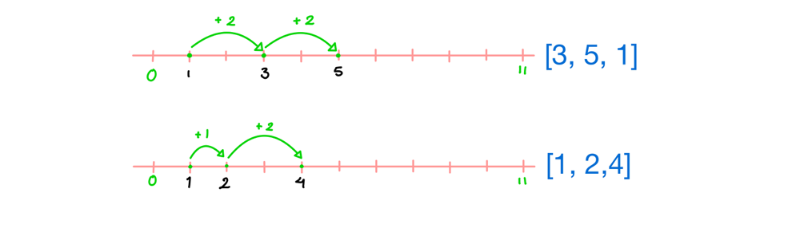

# Golang solution faster than 100% with explanation

**Author:** nathannaveen
**Votes:** 10
**Link:** [https://leetcode.com/problems/can-make-arithmetic-progression-from-sequence/solutions/1065502/](https://leetcode.com/problems/can-make-arithmetic-progression-from-sequence/solutions/1065502/)

---

An Arithmetic Progression is if all the values were plotted on a graph the distance between a point and the next closest point. That distance should be between all points. 

If you didn't understand the explaination just look at the picture:



* *Example one is an arithmetic sequence because the distance between `3` and `1` is `3 - 1 = 2` and the distance between `5` and `3` is `5 - 3 = 2`.*
* *Example two is not an arithmetic sequence because the distance between `2` and `1` is `2 - 1 = 1` while the distance between `4` and `2` is `4 - 2 = 2`. The result `1` is not equal to `2` so it is not an arithmetic sequence.*

When the points are ploted on the graph we can see that the points are basicly sorted, and since we are only comparing two elements at a time, we can use a sliding window.

```
func canMakeArithmeticProgression(arr []int) bool {
	sort.Ints(arr)
	difference := arr[1] - arr[0] // starting difference

	for i := 1; i < len(arr) - 1; i++ {
		if arr[i + 1] - arr[i] != difference { // sliding window
			return false
		}
	}
	return true
}
```