# 🚀 100% || Easy Iterative Approach || Explained Intuition 🚀

**Author:** MohamedMamdouh20
**Votes:** 28
**Link:** [https://leetcode.com/problems/last-moment-before-all-ants-fall-out-of-a-plank/solutions/4246597/](https://leetcode.com/problems/last-moment-before-all-ants-fall-out-of-a-plank/solutions/4246597/)

---

# Problem Description
You have a wooden plank of a **specific** length, measured in **units**. On this plank, there are a group of ants moving in **two opposite** directions. Each ant moves at a constant speed of `1 unit per second`. When ants traveling in opposite directions **meet**, they instantaneously **reverse** their direction and continue moving `collide`.

The following information are provided:
1. The **length** of the wooden plank, denoted as `n` units.
2. Two integer arrays:
   - `left`: An array containing the initial positions of ants moving to the left.
   - `right`: An array containing the initial positions of ants moving to the right.
   
The task is to determine the exact moment at which the last ant falls off the plank.

- Constraints:
    - $1 <= n <= 10^4$
    - $0 <= left.length <= n + 1$
    - $0 <= left[i] <= n$
    - $0 <= right.length <= n + 1$
    - $0 <= right[i] <= n$
    - $1 <= left.length + right.length <= n + 1$
    - All values of left and right are **unique**, and each value can appear only **in one** of the two arrays.

---

# Intuition

Hi there, \uD83D\uDE04

Let's dive\uD83E\uDD3F deep into our today's problem.

The task today is to **examine** the behaviour of a group of friendly ants. Given that they are on a wooden board and each ant is going **left** or **right**, we want to calculate the time it takes them to fell of the board.
But what happens when two ants hit eachother ?\uD83E\uDD14
in this case, they reverse their direction in **no time** -they collide-.
Noting that collision doesn't take time.

Let's take a look at these examples 
Given wooden board of length 10 :
At t = 0
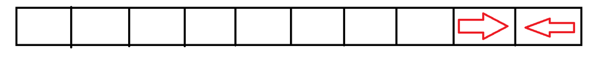
At t = 1
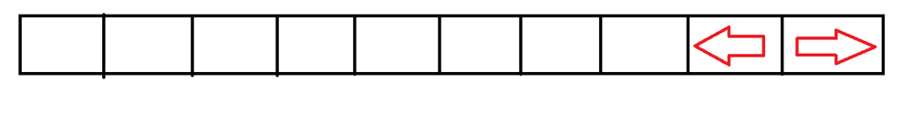

At t = 2


At t = 9


---


Let's take a look at this example also 
At t = 0
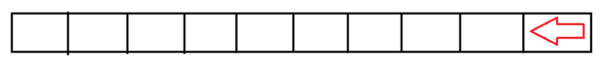

At t = 1
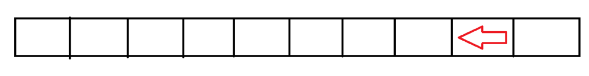

At t = 2
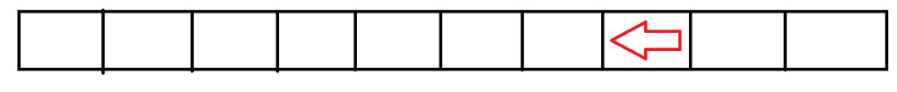

At t = 9
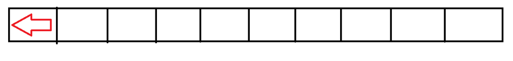


---


Let's take a look at this complex example also 
At t = 0
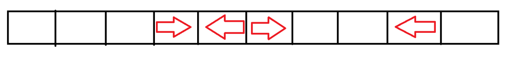

At t = 1
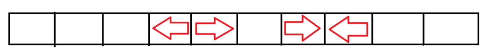

At t = 2
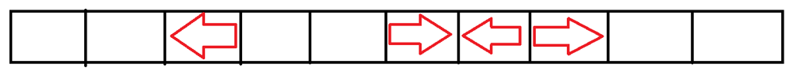

At t = 3
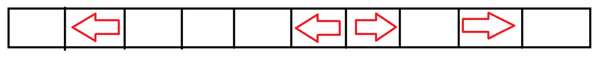

At t = 8
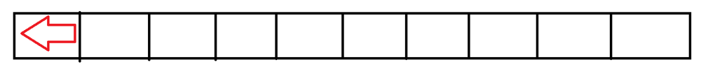


Did you noticed something ?\uD83E\uDD14
YES, from the **first** and **second** examples, the collision **doesn't matter** since it doesn't affect the total time.

But why ?\uD83E\uDD14 ......\uD83E\uDD28
Because it is like **swapping** places. When two ants are about to collide they act like they are **swapping** places.
And if there are **many** collisions like the example in the description of the problem they will swap places **many** times.

So the final solution is pretty **easy**.\uD83E\uDD29
Only see the position of each ant and take the **maximum** of the time for any ant to reach the end of the board if it was **alone** on the board.

And this is the solution for our today'S problem I hope that you understood it\uD83D\uDE80\uD83D\uDE80


---


# Approach
1. Initialize `lastFallTime` to `0`, which will store the time when the **last** ant falls off the plank.
2. **Iterate** through the positions of ants moving to the **left** (`left` vector) and update `lastFallTime` to the **maximum** value of the current `leftPosition` and the current `lastFallTime`. This step finds the farthest position reached by ants moving **left**.
3. Next, **iterate** through the positions of ants moving to the **right** (`right` vector). Calculate the effective position by subtracting `rightPosition` from the total length of the plank (`n`), which accounts for ants starting from the right end. Update `lastFallTime` to the **maximum** value of this calculated position and the current `lastFallTime`. This step finds the farthest position reached by ants moving **right**.
4. **Return** the value of `lastFallTime` as the result.


# Complexity
- **Time complexity:** $O(N)$
Since we are only using two **for** **loops** to traverse over the arrays and the lengths of the two arrays are maximum `N` then time complexity is `O(N)`.
- **Space complexity:** $O(1)$
Since we are using **constant** variables.


---


# Code
```C++ []
class Solution {
public:
    
    int getLastMoment(int n, vector<int>& left, vector<int>& right) {
        int lastFallTime = 0;
        
        // Determine the farthest position reached by ants moving to the left.
        for (int leftPosition : left) {
            lastFallTime = max(lastFallTime, leftPosition);
        }
        
        // Determine the farthest position reached by ants moving to the right,
        // considering they start from the right end of the plank (n - position).
        for (int rightPosition : right) {
            lastFallTime = max(lastFallTime, n - rightPosition);
        }
        
        return lastFallTime;
    }
};
```
```Java []

class Solution {
    public int getLastMoment(int n, int[] left, int[] right) {
        int lastFallTime = 0;
        
        // Determine the farthest position reached by ants moving to the left.
        for (int leftPosition : left) {
            lastFallTime = Math.max(lastFallTime, leftPosition);
        }
        
        // Determine the farthest position reached by ants moving to the right,
        // considering they start from the right end of the plank (n - position).
        for (int rightPosition : right) {
            lastFallTime = Math.max(lastFallTime, n - rightPosition);
        }
        
        return lastFallTime;
    }
}
```
```Python []
class Solution:
    def getLastMoment(self, n, left, right):
        last_fall_time = 0

        # Determine the farthest position reached by ants moving to the left.
        for left_position in left:
            last_fall_time = max(last_fall_time, left_position)

        # Determine the farthest position reached by ants moving to the right,
        # considering they start from the right end of the plank (n - position).
        for right_position in right:
            last_fall_time = max(last_fall_time, n - right_position)

        return last_fall_time
```
```C []
int getLastMoment(int n, int* left, int leftSize, int* right, int rightSize) {
    int lastFallTime = 0;

    // Determine the farthest position reached by ants moving to the left.
    for (int i = 0; i < leftSize; i++) {
        int leftPosition = left[i];
        lastFallTime = (lastFallTime > leftPosition) ? lastFallTime : leftPosition;
    }

    // Determine the farthest position reached by ants moving to the right,
    // considering they start from the right end of the plank (n - position).
    for (int i = 0; i < rightSize; i++) {
        int rightPosition = right[i];
        lastFallTime = (lastFallTime > n - rightPosition) ? lastFallTime : n - rightPosition;
    }

    return lastFallTime;
}
```


