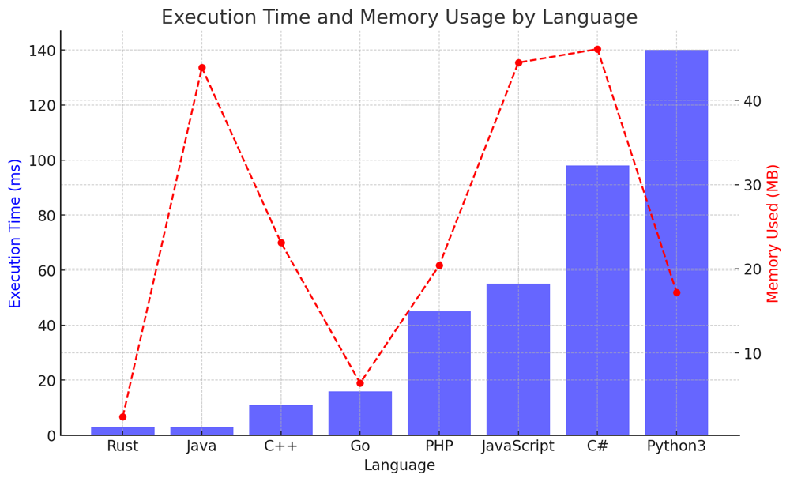

# ✅ 91.37% Ants' Behavior & One Line

**Author:** vanAmsen
**Votes:** 35
**Link:** [https://leetcode.com/problems/last-moment-before-all-ants-fall-out-of-a-plank/solutions/4246025/](https://leetcode.com/problems/last-moment-before-all-ants-fall-out-of-a-plank/solutions/4246025/)

---

# Intuition
When faced with this problem, the first visualization that comes to mind is ants moving along a line, bouncing back when they meet each other, and eventually falling off the plank. This seems like a dynamic system with multiple interactions. However, upon deeper contemplation, one realizes that the interaction (changing directions) of two ants doesn't affect the outcome of when they fall off. It's as if they just passed through one another. This simplifies our problem and makes it tractable.

# Live Coding & More
https://youtu.be/E-ygoOBUpOs?si=RaH5wXUjXc9MdB3K

# Approach
Our approach leverages the key observation that two ants meeting and changing direction is functionally equivalent to them passing straight through each other without interaction. This means that we can simply calculate the time it takes for each ant to fall off the plank if it were the only ant on the plank.

1. For ants moving to the left: An ant at position `p` will take exactly `p` seconds to fall off.
2. For ants moving to the right: An ant at position `p` will take exactly `n - p` seconds to fall off.

The last moment when an ant falls off the plank is the maximum of these times. Thus, we need to find:
- The maximum position of ants moving to the left (this gives the longest time for ants moving left).
- `n` minus the minimum position of ants moving to the right (this gives the longest time for ants moving right).

Finally, our answer is the maximum of the two times computed above.

# Why is our primary approach optimal?
Our chosen approach requires a single pass through each list (`left` and `right`) to find the max/min values, giving a time complexity of $O(n)$. This is optimal because we have to look at every ant at least once to determine the solution. The space complexity is $O(1)$ because we only store a constant amount of information (max and min values).

The alternative simulation approach would be much less efficient, with a time complexity in the worst case of $O(n^2)$ since we'd need to check each ant's position in each second. The collapsing plank approach, once fully understood, leads back to our primary approach, but it's a useful mental exercise to visualize the problem.

# Complexity
- **Time complexity**: $O(n)$ - We make a single pass through the `left` and `right` arrays.
- **Space complexity**: $O(1)$ - We only store the maximum and minimum values, which requires constant space.

# Code
``` Python []
class Solution:
    def getLastMoment(self, n: int, left: List[int], right: List[int]) -> int:
        return max(max(left, default=0), n - min(right, default=n))
```
``` C++ []
class Solution {
public:
    int getLastMoment(int n, vector<int>& left, vector<int>& right) {
        int maxLeft = left.empty() ? 0 : *max_element(left.begin(), left.end());
        int minRight = right.empty() ? n : *min_element(right.begin(), right.end());
        return max(maxLeft, n - minRight);
    }
};
```
``` Java []
public class Solution {
    public int getLastMoment(int n, int[] left, int[] right) {
        int maxLeft = left.length == 0 ? 0 : Arrays.stream(left).max().getAsInt();
        int minRight = right.length == 0 ? n : Arrays.stream(right).min().getAsInt();
        return Math.max(maxLeft, n - minRight);
    }
}
```
``` Go []
func getLastMoment(n int, left []int, right []int) int {
    maxLeft := 0
    for _, val := range left {
        if val > maxLeft {
            maxLeft = val
        }
    }
    
    minRight := n
    for _, val := range right {
        if val < minRight {
            minRight = val
        }
    }
    
    return int(math.Max(float64(maxLeft), float64(n - minRight)))
}
```
``` Rust []
impl Solution {
    pub fn get_last_moment(n: i32, left: Vec<i32>, right: Vec<i32>) -> i32 {
        let max_left = match left.iter().max() {
            Some(&max_val) => max_val,
            None => 0,
        };
        
        let min_right = match right.iter().min() {
            Some(&min_val) => min_val,
            None => n,
        };
        
        std::cmp::max(max_left, n - min_right)
    }
}
```
``` C# []
public class Solution {
    public int GetLastMoment(int n, int[] left, int[] right) {
        int maxLeft = left.Length == 0 ? 0 : left.Max();
        int minRight = right.Length == 0 ? n : right.Min();
        return Math.Max(maxLeft, n - minRight);
    }
}
```
``` JavaScript []
var getLastMoment = function(n, left, right) {
    const maxLeft = left.length === 0 ? 0 : Math.max(...left);
    const minRight = right.length === 0 ? n : Math.min(...right);
    return Math.max(maxLeft, n - minRight);
};
```
``` PHP []
class Solution {
    function getLastMoment($n, $left, $right) {
        $maxLeft = empty($left) ? 0 : max($left);
        $minRight = empty($right) ? $n : min($right);
        return max($maxLeft, $n - $minRight);
    }
}
```

In this code, the use of the `default` argument in the `max` and `min` functions ensures that we handle cases where the `left` or `right` lists might be empty, providing a default value to be used in such cases. This makes the code more concise and readable.

# Performance

| Language   | Execution Time (ms) | Memory Used  |
|------------|---------------------|--------------|
| Rust       | 3                   | 2.4 MB       |
| Java       | 3                   | 43.9 MB      |
| C++        | 11                  | 23.1 MB      |
| Go         | 16                  | 6.4 MB       |
| PHP        | 45                  | 20.4 MB      |
| JavaScript | 55                  | 44.5 MB      |
| C#         | 98                  | 46.1 MB      |
| Python3    | 140                 | 17.2 MB      |




---

# Alternative Approach - Collapsing the Plank Approach

This approach involves a mental model of shrinking the plank at a speed of 1 unit/second from both ends. This makes the ants seem like they are moving faster towards the end. We can visualize the problem as if the plank is collapsing from both ends, and the ants are stationary. The ant that's last to hit the shrinking end is the one that falls off last.

## Steps:

1. For each ant moving to the left, calculate how long it will take for the left end of the plank to collapse and reach the ant.
2. For each ant moving to the right, calculate how long it will take for the right end of the plank to collapse and reach the ant.
3. The maximum of all these times will be the time the last ant falls off.

``` Python []
class Solution:
    def getLastMoment(self, n: int, left: List[int], right: List[int]) -> int:
        left_times = [pos for pos in left]
        right_times = [n - pos for pos in right]
        return max(left_times + right_times)
```

# Complexity Analysis for the Collapsing the Plank Approach:

- **Time Complexity**: $O(n)$ as we go through the list of ants once.
- **Space Complexity**: $O(n)$ to store the times for all ants.

### Why does the Collapsing the Plank Approach work?
This approach works because of our key observation that ants changing direction upon meeting each other is functionally equivalent to them passing straight through each other without interaction. By imagining the plank collapsing, we're simply reframing the problem to view the "endpoint" (or time to fall off) for each ant without having to consider their interactions.

### Optimality:
While this approach provides a unique perspective, its computational complexity is the same as our primary approach. However, it may be more intuitive for some people, as it provides a clear visualization of the problem.