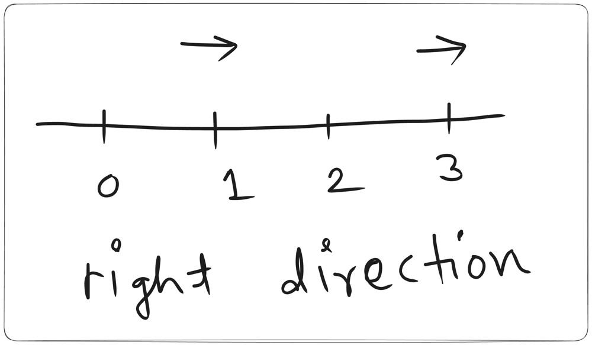
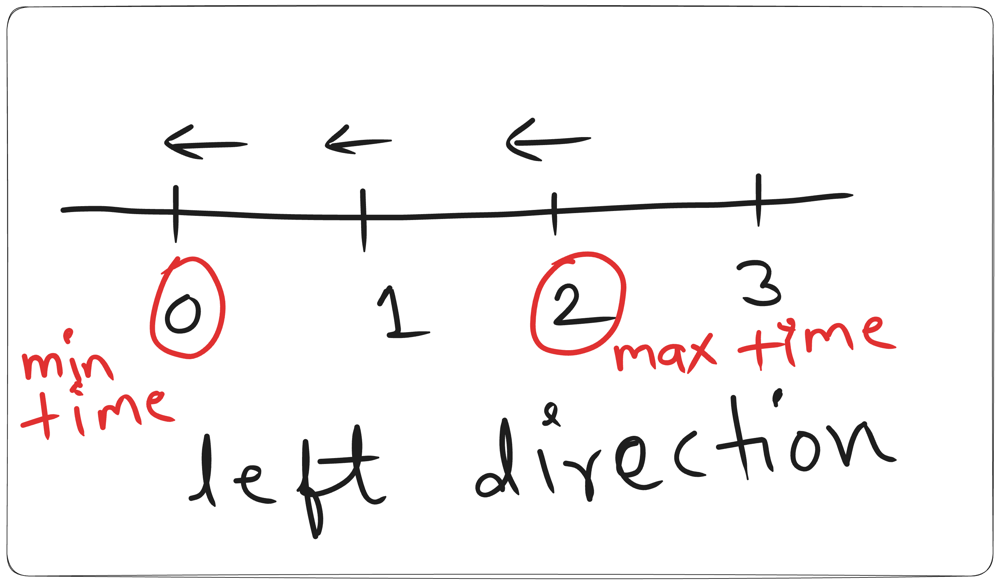
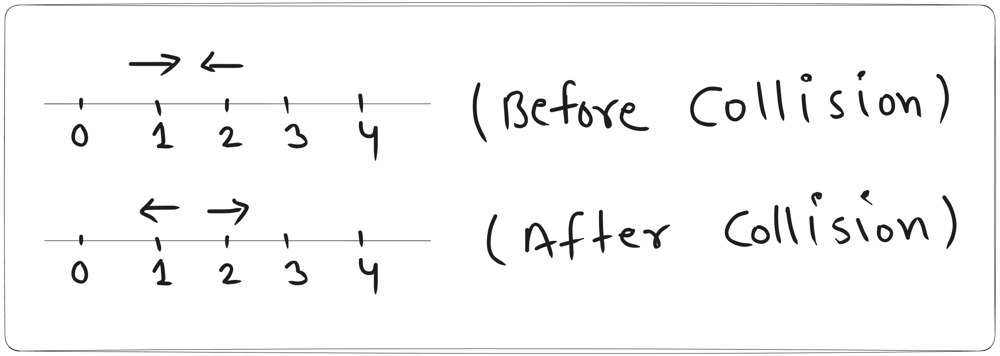

# 3 liner Solution - Code in 10 Languages 🔥 Full Explanation

**Author:** cs_iitian
**Votes:** 2
**Link:** [https://leetcode.com/problems/last-moment-before-all-ants-fall-out-of-a-plank/solutions/4246109/](https://leetcode.com/problems/last-moment-before-all-ants-fall-out-of-a-plank/solutions/4246109/)

---

# Intuition
<!-- Describe your first thoughts on how to solve this problem. -->

# Approach
### Case1 : `What happens if they all are going in right directions ?`


we can see that, the maximum time would be for the ant at 1, because it is far from the right end.
so if all ants are going in right directions my answer would be the time to reach from min index to n, which is `n-ind`


### Case2 : `What happens if they all are going in left directions ?`


we can see that, the maximum time would be for the ant at 2, because it is far from the left end.
so if all ants are going in left directions my answer would be the time to reach from min index to 0, which is `ind`

### Case3 : `What happens if they collide ?`


If you see the diagram, for Below Collision we have two assumptions now
1. `ant2` and `ant1` change their directions
2. `ant2` and `ant1` continued their directions
so to make problem simpler we can say, collision will do nothing. They both will continue their directions. ( Remember in reality they have changes their directions but we don't care about the ant we just care about reaching the end )
so here we can say the ant's going in right directions will fall in `Case1` abd ant's going in left directions will fall in `Case2`.

# Complexity
- Time complexity: O(n)
<!-- Add your time complexity here, e.g. $$O(n)$$ -->


- Space complexity: O(1)
<!-- Add your space complexity here, e.g. $$O(n)$$ -->

# Code
## C++
```
class Solution {
public:
    int getLastMoment(int n, vector<int>& left, vector<int>& right) {
        int li = left.empty() ? 0 : *max_element(left.begin(), left.end());
        int ri = right.empty() ? n : *min_element(right.begin(), right.end());
        return max(li, n - ri);
    }
};
```
## Java
```
class Solution {
    public int getLastMoment(int n, int[] left, int[] right) {
        int li = Arrays.stream(left).max().orElse(0);
        int ri = Arrays.stream(right).min().orElse(n);
        return Math.max(li, n-ri);
    }
}
```
## Python
```
class Solution:
    def getLastMoment(self, n: int, left: List[int], right: List[int]) -> int:
        li = max(left, default=0)
        ri = min(right, default=n)
        return max(li, n - ri)
```
## C#
```
public class Solution {
    public int GetLastMoment(int n, int[] left, int[] right) {
        int li = left.Length > 0 ? left.Max() : 0;
        int ri = right.Length > 0 ? right.Min() : n;
        return Math.Max(li, n - ri);
    }
}
```
## Javascript
```
var getLastMoment = function(n, left, right) {
    const li = left.length ? Math.max(...left) : 0;
    const ri = right.length ? Math.min(...right) : n;
    return Math.max(li, n - ri);
};
```
## Kotlin
```
class Solution {
    fun getLastMoment(n: Int, left: IntArray, right: IntArray): Int {
        val li = left.maxOrNull() ?: 0
        val ri = right.minOrNull() ?: n
        return maxOf(li, n - ri)
    }
}
```
## Go
```
func getLastMoment(n int, left []int, right []int) int {
    li := 0
    if len(left) > 0 {
        li = left[0]
        for i := 1; i < len(left); i++ {
            if left[i] > li {
                li = left[i]
            }
        }
    }
    
    ri := n
    if len(right) > 0 {
        ri = right[0]
        for i := 1; i < len(right); i++ {
            if right[i] < ri {
                ri = right[i]
            }
        }
    }
    
    return max(li, n - ri)
}

func max(a, b int) int {
    if a > b {
        return a
    }
    return b
}
```
## Ruby
```
def get_last_moment(n, left, right)
    li = left.empty? ? 0 : left.max
    ri = right.empty? ? n : right.min
    [li, n - ri].max
end
```
## Scala
```
object Solution {
    def getLastMoment(n: Int, left: Array[Int], right: Array[Int]): Int = {
        val li = if (left.nonEmpty) left.max else 0
        val ri = if (right.nonEmpty) right.min else n
        math.max(li, n - ri)
    }
}
```
## Rust
```
impl Solution {
    pub fn get_last_moment(n: i32, left: Vec<i32>, right: Vec<i32>) -> i32 {
        let li = left.iter().max().copied().unwrap_or(0);
        let ri = right.iter().min().copied().unwrap_or(n);
        i32::max(li, n - ri)
    }
}
```

See the full explanation here
https://youtu.be/AnY2dK2k7og

