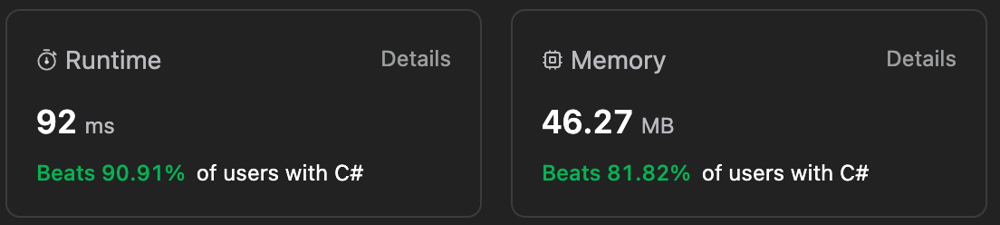

# 🔥 90.91 ||  🚀 Greedy || Solution in Both English & Hindi ⭐️

**Author:** Gourav-2002
**Votes:** 5
**Link:** [https://leetcode.com/problems/last-moment-before-all-ants-fall-out-of-a-plank/solutions/4246436/](https://leetcode.com/problems/last-moment-before-all-ants-fall-out-of-a-plank/solutions/4246436/)

---



# English Explanation

# Intuition :
**We are given two arrays left and right, which represent the position of the ants falling to the left and right respectively. We need to find the time at which the last ant falls off the rod. The idea is to find the maximum time taken by the ants to fall off the rod. The maximum time taken by the ants to fall off the rod is the maximum of the maximum time taken by the ants falling to the left and the maximum time taken by the ants falling to the right. The maximum time taken by the ants falling to the left is the maximum of the left array. The maximum time taken by the ants falling to the right is the maximum of the difference between the length of the rod and the right array.**

# Algorithm :
1. Initialize a variable t to 0. This variable will store the maximum time taken by the ants to fall off the rod.
2. If the left array is not empty, then find the maximum of the left array and store it in t.
3. If the right array is not empty, then find the maximum of the difference between the length of the rod and the right array and store it in t.
4. Return t.

# Complexity Analysis :
- Time Complexity: **O(n)**. We iterate over the left and right array of size n once.
- Space Complexity: **O(1)**. Constant extra space is used.

## \u2B06\uFE0F Please UpVote if you like it \u2B06\uFE0F.

# Code
``` Python []
class Solution:
    def getLastMoment(self, n: int, left: List[int], right: List[int]) -> int:
        t=0
        if left:
            t=max(left)
        if right:
            t=max(t,n-min(right))
        return t
```
``` C++ []
class Solution {
public:
    int getLastMoment(int n, vector<int>& left, vector<int>& right) {
        int t = 0;
        if (!left.empty()) {
            t = *max_element(left.begin(), left.end());
        }
        if (!right.empty()) {
            t = max(t, n - *min_element(right.begin(), right.end()));
        }
        return t;
    }
};
```
``` Java []
class Solution {
    public int getLastMoment(int n, int[] left, int[] right) {
        int t = 0;
        if (left.length > 0) {
            t = Arrays.stream(left).max().getAsInt();
        }
        if (right.length > 0) {
            t = Math.max(t, n - Arrays.stream(right).min().getAsInt());
        }
        return t;
    }
}
```
``` C# []
public class Solution {
    public int GetLastMoment(int n, int[] left, int[] right) {
        int t = 0;
        if (left.Length > 0) {
            t = left.Max();
        }
        if (right.Length > 0) {
            t = Math.Max(t, n - right.Min());
        }
        return t;
    }
}
```
``` TypeScript []
function getLastMoment(n: number, left: number[], right: number[]): number {
    let t = 0;
        if (left.length > 0) {
            t = Math.max(...left);
        }
        if (right.length > 0) {
            t = Math.max(t, n - Math.min(...right));
        }
        return t;
};
```
``` JavaScript []
/**
 * @param {number} n
 * @param {number[]} left
 * @param {number[]} right
 * @return {number}
 */
var getLastMoment = function(n, left, right) {
    let t = 0;
        if (left.length > 0) {
            t = Math.max(...left);
        }
        if (right.length > 0) {
            t = Math.max(t, n - Math.min(...right));
        }
        return t;
};
```
``` PHP []
class Solution {

    /**
     * @param Integer $n
     * @param Integer[] $left
     * @param Integer[] $right
     * @return Integer
     */
    function getLastMoment($n, $left, $right) {
        $t = 0;
        if (!empty($left)) {
            $t = max($left);
        }
        if (!empty($right)) {
            $t = max($t, $n - min($right));
        }
        return $t;
    }
}
```
``` Ruby []
# @param {Integer} n
# @param {Integer[]} left
# @param {Integer[]} right
# @return {Integer}
def get_last_moment(n, left, right)
    t = 0
    unless left.empty?
      t = left.max
    end
    unless right.empty?
      t = [t, n - right.min].max
    end
    t
  end
```

# Deep Dive :
Here is the code for the above algorithm with comments for better understanding.

``` Python []
class Solution:
    def getLastMoment(self, n: int, left: List[int], right: List[int]) -> int:
        t=0 # Initialize a variable t to 0. This variable will store the maximum time taken by the ants to fall off the rod.
        if left: # If the left array is not empty, then find the maximum of the left array and store it in t.
            t=max(left)
        if right: # If the right array is not empty, then find the maximum of the difference between the length of the rod and the right array and store it in t.
            t=max(t,n-min(right)) 
        return t # Return t.
```

# \uD83D\uDEA9 Ram Ram Bhai Sariyane \uD83D\uDE4F\uD83C\uDFFB

## Hindi Explanation :
Yaha pe humare pass 2 array hai left and right, jo ki rod pe girne wali ants ki position ko represent karte hai. Humhe last ant girne ki time nikalni hai. Humhe sabse pehle ye nikalna hai ki kitna time lagega ants ko girne me. Ants girne me kitna time lagega wo left array me se maximum time lagega ya right array me se maximum time lagega. Ants girne me left array se maximum time lagega wo left array ka maximum hoga. Ants girne me right array se maximum time lagega wo rod ki length aur right array ka difference ka maximum hoga.

Left array me se maximum time lene ke liye humne ek variable t ko 0 se initialize kiya hai. Right array me se maximum time lene ke liye humne ek variable t ko 0 se initialize kiya hai. Agar left array khali nahi hai to humne left array ka maximum t me store kiya hai. Agar right array khali nahi hai to humne rod ki length aur right array ka difference ka maximum t me store kiya hai. T ko return kar diya hai.

Left me se maximum iss liye liya kruki vo array bata rahi hai ki left side jo ants chal rahi hai unki positions kya hai. Or maanlo right array khali hai or left side ki array hai 3 or 4 (left=[3,4]) to ant jo 4 pe hai usko 0 tak ana hai usse jyada time lagega obviously aise he agr left khali ho to or right me 2 ants ho 1,2 position pe (right=[1,2]) to ab ye right side jari hai or jo piche hogi usko jyada time lagega kyuki usko uski position se n(length of wooden plank ) tak jana hai.

# Code Walkthrough :
1. Sabse pehle humne ek class banaya hai Solution ka naam se.
2. Solution class me humne ek function banaya hai getLastMoment ka naam se. Ye function 3 parameters leta hai n,left,right.
3. Humne ek variable t ko 0 se initialize kiya hai. Ye variable hume maximum time lene me help karega.
4. Agar left array khali nahi hai to humne left array ka maximum t me store kiya hai.
5. Agar right array khali nahi hai to humne rod ki length aur right array ka difference ka maximum t me store kiya hai.
6. T ko return kar diya hai.
# Code
## Tumhare Mummy Kasam UpVote karo\u2B06\uFE0F
``` Python []
class Solution:
    def getLastMoment(self, n: int, left: List[int], right: List[int]) -> int:
        t=0
        if left:
            t=max(left)
        if right:
            t=max(t,n-min(right))
        return t
```
``` C++ []
class Solution {
public:
    int getLastMoment(int n, vector<int>& left, vector<int>& right) {
        int t = 0;
        if (!left.empty()) {
            t = *max_element(left.begin(), left.end());
        }
        if (!right.empty()) {
            t = max(t, n - *min_element(right.begin(), right.end()));
        }
        return t;
    }
};
```
``` Java []
class Solution {
    public int getLastMoment(int n, int[] left, int[] right) {
        int t = 0;
        if (left.length > 0) {
            t = Arrays.stream(left).max().getAsInt();
        }
        if (right.length > 0) {
            t = Math.max(t, n - Arrays.stream(right).min().getAsInt());
        }
        return t;
    }
}
```
``` C# []
public class Solution {
    public int GetLastMoment(int n, int[] left, int[] right) {
        int t = 0;
        if (left.Length > 0) {
            t = left.Max();
        }
        if (right.Length > 0) {
            t = Math.Max(t, n - right.Min());
        }
        return t;
    }
}
```
``` TypeScript []
function getLastMoment(n: number, left: number[], right: number[]): number {
    let t = 0;
        if (left.length > 0) {
            t = Math.max(...left);
        }
        if (right.length > 0) {
            t = Math.max(t, n - Math.min(...right));
        }
        return t;
};
```
``` JavaScript []
/**
 * @param {number} n
 * @param {number[]} left
 * @param {number[]} right
 * @return {number}
 */
var getLastMoment = function(n, left, right) {
    let t = 0;
        if (left.length > 0) {
            t = Math.max(...left);
        }
        if (right.length > 0) {
            t = Math.max(t, n - Math.min(...right));
        }
        return t;
};
```
``` PHP []
class Solution {

    /**
     * @param Integer $n
     * @param Integer[] $left
     * @param Integer[] $right
     * @return Integer
     */
    function getLastMoment($n, $left, $right) {
        $t = 0;
        if (!empty($left)) {
            $t = max($left);
        }
        if (!empty($right)) {
            $t = max($t, $n - min($right));
        }
        return $t;
    }
}
```
``` Ruby []
# @param {Integer} n
# @param {Integer[]} left
# @param {Integer[]} right
# @return {Integer}
def get_last_moment(n, left, right)
    t = 0
    unless left.empty?
      t = left.max
    end
    unless right.empty?
      t = [t, n - right.min].max
    end
    t
  end
```

