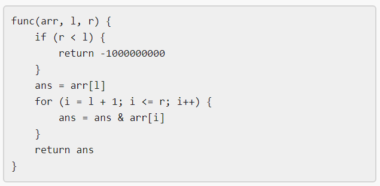

# [1521. Find a Value of a Mysterious Function Closest to Target](https://leetcode.com/problems/find-a-value-of-a-mysterious-function-closest-to-target/)

| Category | Difficulty | Likes | Dislikes |
| :------: | :--------: | :---: | :------: |
| Algorithms | Hard | 402 | 20 |

**Tags:** [`array`](https://leetcode.com/tag/array), [`binary-search`](https://leetcode.com/tag/binary-search), [`bit-manipulation`](https://leetcode.com/tag/bit-manipulation), [`segment-tree`](https://leetcode.com/tag/segment-tree)

**Companies:** `american-express`

## Description



Winston was given the above mysterious function `func`. He has an integer array `arr` and an integer `target` and he wants to find the values `l` and `r` that make the value `|func(arr, l, r) - target|` minimum possible.

Return *the minimum possible value* of `|func(arr, l, r) - target|`.

Notice that `func` should be called with the values `l` and `r` where `0 <= l, r < arr.length`.

 

**Example 1:**

```

Input: arr = [9,12,3,7,15], target = 5
Output: 2
Explanation: Calling func with all the pairs of [l,r] = [[0,0],[1,1],[2,2],[3,3],[4,4],[0,1],[1,2],[2,3],[3,4],[0,2],[1,3],[2,4],[0,3],[1,4],[0,4]], Winston got the following results [9,12,3,7,15,8,0,3,7,0,0,3,0,0,0]. The value closest to 5 is 7 and 3, thus the minimum difference is 2.

```

**Example 2:**

```

Input: arr = [1000000,1000000,1000000], target = 1
Output: 999999
Explanation: Winston called the func with all possible values of [l,r] and he always got 1000000, thus the min difference is 999999.

```

**Example 3:**

```

Input: arr = [1,2,4,8,16], target = 0
Output: 0

```

 

**Constraints:**

	- `1 <= arr.length <= 10^5`

	- `1 <= arr[i] <= 10^6`

	- `0 <= target <= 10^7`

---

**Links:** [Submissions](https://leetcode.com/problems/find-a-value-of-a-mysterious-function-closest-to-target/) | [Solutions](https://leetcode.com/problems/find-a-value-of-a-mysterious-function-closest-to-target/)
