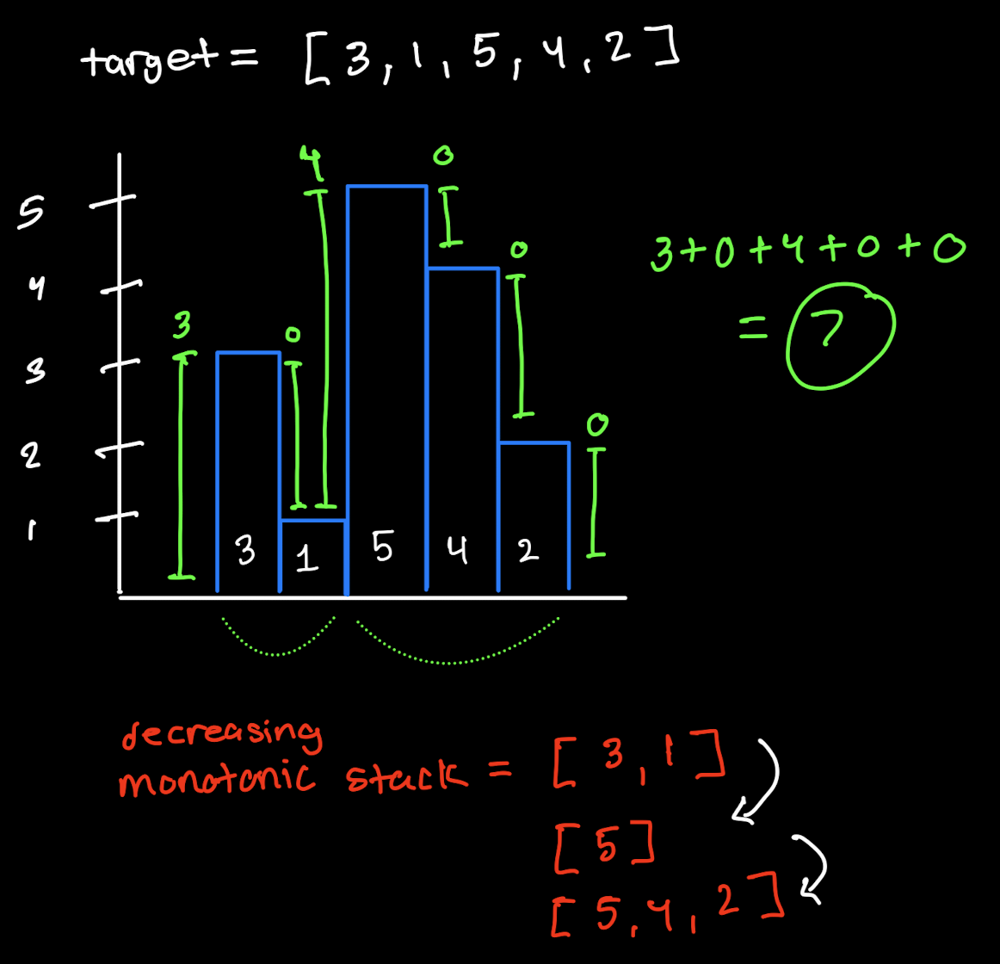
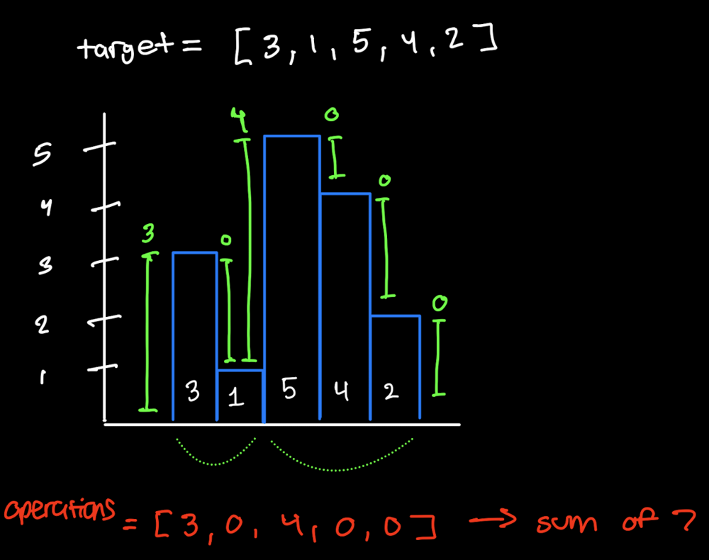

# Monotonic Stack to Greedy Solution

**Author:** deydev
**Votes:** 15
**Link:** [https://leetcode.com/problems/minimum-number-of-increments-on-subarrays-to-form-a-target-array/solutions/5778338/](https://leetcode.com/problems/minimum-number-of-increments-on-subarrays-to-form-a-target-array/solutions/5778338/)

---

# Intuition
Think of the numbers like building heights and we are constructing layer by layer from stratch.

1. Building the largest building before us forced us to already the build the smaller one we're on now. So no extra work.
2. If we want to build something even bigger, than we need to calculate how much extra work is needed. Which we do by seeing whats the difference we need to make up for when compared to the **building prior**. 




----
# Dec Monotonic Stack
``` python []
class Solution:
    # O(n) time | O(n) space
    def minNumberOperations(self, target: List[int]) -> int:
        operations = 0
        # monostack represents buildings that were built together
        # (height, work to make it)
        monostack = [(0, 0)]
        for h in target:
            work = max(0, h - monostack[-1][0])

            # if current building is larger than previous ones
            # it couldn't have been built all together
            while monostack and h >= monostack[-1][0]:
                _, prev_work = monostack.pop()
                operations += prev_work
            monostack.append((h, work))

        while monostack:
            operations += monostack.pop()[1]
        return operations
```
``` cpp []
class Solution {
public:
    // O(n) time | O(n) space
    int minNumberOperations(vector<int>& target) {
        int n = target.size();
        int operations = 0;
        stack<pair<int,int>> monostack; // {height, work needed}
        monostack.push({0, 0});

        for (int i = 0; i <= n; ++i) {
            int height = i < n ? target[i] : INT_MAX; // INT_MAX to force stack collapse at end, if needed
            int work = max(0, height - monostack.top().first);
            while (monostack.size() && height > monostack.top().first) {
                operations += monostack.top().second;
                monostack.pop();
            }
            monostack.push({height, work});
        }
        return operations;
    }
};
```

--- 

# Greedy Solution 
Since we forced to work on adjacent buildings. The only comparison we need is to the **building prior**. Thus the monotonic stack can be scrapped and we can see at which points we need to do "extra work".



```python []
class Solution:
    # O(n) time | O(1) space
    def minNumberOperations(self, target: List[int]) -> int:
        res = 0
        prev_height = 0

        for height in target:
            if prev_height < height:
                res += height - prev_height
            prev_height = height
        
        return res

```
``` cpp []
class Solution {
public:
    // O(n) time | O(1) space
    int minNumberOperations(vector<int>& target) {
        int operations = 0;
        int prevHeight = 0;

        for (int& height : target) {
            if (height > prevHeight) {
                operations += (height - prevHeight);
            }
            prevHeight = height;
        } 
        return operations;
    }
}

```


