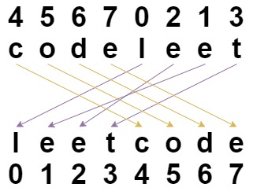

# [1528. Shuffle String](https://leetcode.com/problems/shuffle-string/)

| Category | Difficulty | Likes | Dislikes |
| :------: | :--------: | :---: | :------: |
| Algorithms | Easy | 2905 | 540 |

**Tags:** [`array`](https://leetcode.com/tag/array), [`string`](https://leetcode.com/tag/string)

**Companies:** `google`, `microsoft`

## Description

You are given a string `s` and an integer array `indices` of the **same length**. The string `s` will be shuffled such that the character at the `i^th` position moves to `indices[i]` in the shuffled string.

Return *the shuffled string*.

 

**Example 1:**


```

Input: s = &quot;codeleet&quot;, indices = [4,5,6,7,0,2,1,3]
Output: &quot;leetcode&quot;
Explanation: As shown, &quot;codeleet&quot; becomes &quot;leetcode&quot; after shuffling.

```

**Example 2:**

```

Input: s = &quot;abc&quot;, indices = [0,1,2]
Output: &quot;abc&quot;
Explanation: After shuffling, each character remains in its position.

```

 

**Constraints:**

	- `s.length == indices.length == n`

	- `1 <= n <= 100`

	- `s` consists of only lowercase English letters.

	- `0 <= indices[i] < n`

	- All values of `indices` are **unique**.

---

**Links:** [Submissions](https://leetcode.com/problems/shuffle-string/) | [Solutions](https://leetcode.com/problems/shuffle-string/)
