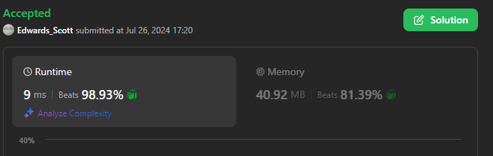

# 💢☠💫Easiest👾Faster✅💯 Lesser🧠 🎯 C++✅Python3🐍✅Java✅C✅Python🐍✅C#✅💥🔥💫Explained☠💥🔥 Beats 💯

**Author:** Edwards310
**Votes:** 4
**Link:** [https://leetcode.com/problems/count-good-triplets/solutions/5538845/](https://leetcode.com/problems/count-good-triplets/solutions/5538845/)

---

# Intuition



These are the almost same questions which are similar to this one which are as follows :-

---
***Q - 1460 -->*** https://leetcode.com/problems/make-two-arrays-equal-by-reversing-subarrays/solutions/5538697/easiestfaster-lesser-cpython3javacpythoncexplained-beats

***Q - 2475 -->*** https://leetcode.com/problems/number-of-unequal-triplets-in-array/solutions/5538953/easiestfaster-lesser-cpython3javacpythoncexplained-beats

***Q - 2367 -->*** https://leetcode.com/problems/number-of-arithmetic-triplets/solutions/5539085/easiestfaster-lesser-cpython3javacpythoncexplained-beats

***Q - 2908 -->*** https://leetcode.com/problems/minimum-sum-of-mountain-triplets-i/solutions/5539207/easiestfaster-lesser-cpython3javacpythoncexplained-beats

---

```C++ []
// Start Of Anuj Bhati aka Edwards310's Template...
using namespace std;

#define FOR(a, b, c) for (int a = b; a < c; a++)
#define FOR1(a, b, c) for (int a = b; a <= c; ++a)
#define Rep(i, n) FOR(i, 0, n)
#define Rep1(i, n) FOR1(i, 1, n)
// end of Anuj Bhati's aka Edwards310's Template
class Solution {
public:
    int countGoodTriplets(vector<int>& arr, int a, int b, int c) {
        int cnt = 0;
        int n = arr.size();
        Rep(i, n - 2){
            FOR(j, i + 1, n - 1){
                if(abs(arr[i] - arr[j]) <= a){
                    FOR(k, j + 1,  n){
                        if(abs(arr[j] - arr[k]) <= b and abs(arr[i] - arr[k]) <= c)
                            ++cnt;
                    }
                }
            }
        }
        return cnt;
    }
};
```
```python3 []
class Solution:
    def countGoodTriplets(self, arr: List[int], a: int, b: int, c: int) -> int:
        n = len(arr)
        cnt = 0
        for i in range(n - 2):
            for j in range(i + 1, n - 1):
                if abs(arr[i] - arr[j]) <= a:
                    for k in range(j + 1, n):
                        if abs(arr[j] - arr[k]) <= b and abs(arr[i] - arr[k]) <= c:
                            cnt += 1
        return cnt
```
```C# []
public class Solution {
    public int CountGoodTriplets(int[] arr, int a, int b, int c) {
        int cnt = 0;
        int n = arr.Length;
        for(int i = 0; i < n - 2; i++){
            for(int j = i + 1; j < n - 1; ++j){
                if(Math.Abs(arr[i] - arr[j]) <= a){
                    for(int k = j + 1; k < n; ++k){
                        if(Math.Abs(arr[j] - arr[k]) <= b && Math.Abs(arr[i] - arr[k]) <= c)
                            ++cnt;
                    }
                }
            }
        }
        return cnt;
    }
}
```
```Java []
class Solution {
    public int countGoodTriplets(int[] arr, int a, int b, int c) {
        int cnt = 0;
        int n = arr.length;
        for(int i = 0; i < n - 2; i++){
            for(int j = i + 1; j < n - 1; ++j){
                if(Math.abs(arr[i] - arr[j]) <= a){
                    for(int k = j + 1; k < n; ++k){
                        if(Math.abs(arr[j] - arr[k]) <= b && Math.abs(arr[i] - arr[k]) <= c)
                            ++cnt;
                    }
                }
            }
        }
        return cnt;
    }
}
```
```python []
class Solution(object):
    def countGoodTriplets(self, arr, a, b, c):
        """
        :type arr: List[int]
        :type a: int
        :type b: int
        :type c: int
        :rtype: int
        """
        n = len(arr)
        cnt = 0
        for i in range(n - 2):
            for j in range(i + 1, n - 1):
                if abs(arr[i] - arr[j]) <= a:
                    for k in range(j + 1, n):
                        if abs(arr[j] - arr[k]) <= b and abs(arr[i] - arr[k]) <= c:
                            cnt += 1
        return cnt
```
```C []


int countGoodTriplets(int* arr, int arrSize, int a, int b, int c) {
    int cnt = 0;
    int n = arrSize;
    for (int i = 0; i < n - 2; i++) {
        for (int j = i + 1; j < n - 1; ++j) {
            if (fabs(arr[i] - arr[j]) <= a) {
                for (int k = j + 1; k < n; ++k) {
                    if (fabs(arr[j] - arr[k]) <= b &&
                        fabs(arr[i] - arr[k]) <= c)
                        ++cnt;
                }
            }
        }
    }
    return cnt;
}
```

<!-- Describe your first thoughts on how to solve this problem. -->

# Approach
<!-- Describe your approach to solving the problem. -->

# Complexity
- Time complexity:
<!-- Add your time complexity here, e.g. $$O(n)$$ -->
     O(N^3)
- Space complexity:
<!-- Add your space complexity here, e.g. $$O(n)$$ -->
     O(1)
# Code
```
class Solution {
    public int countGoodTriplets(int[] arr, int a, int b, int c) {
        int cnt = 0;
        int n = arr.length;
        for(int i = 0; i < n - 2; i++){
            for(int j = i + 1; j < n - 1; ++j){
                if(Math.abs(arr[i] - arr[j]) <= a){
                    for(int k = j + 1; k < n; ++k){
                        if(Math.abs(arr[j] - arr[k]) <= b && Math.abs(arr[i] - arr[k]) <= c)
                            ++cnt;
                    }
                }
            }
        }
        return cnt;
    }
}
```

