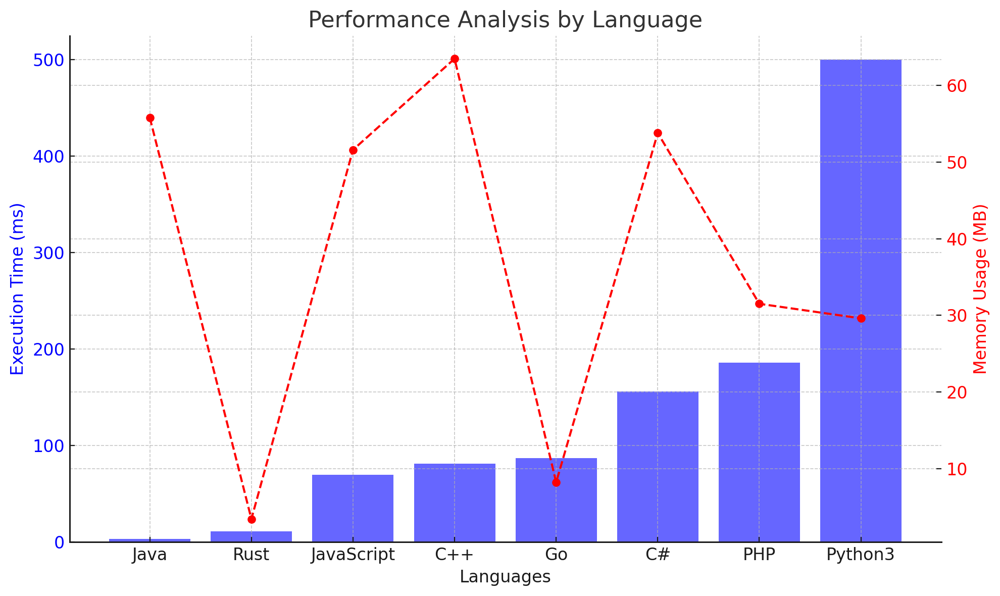

# ✅ 98.37% O(n) Final Winner

**Author:** vanAmsen
**Votes:** 105
**Link:** [https://leetcode.com/problems/find-the-winner-of-an-array-game/solutions/4250031/](https://leetcode.com/problems/find-the-winner-of-an-array-game/solutions/4250031/)

---

# Intuition
When first approaching this problem, we might think about simulating the entire process: comparing numbers, moving the smaller one to the end, and keeping track of the number of consecutive wins. However, a closer inspection reveals a couple of key insights. Firstly, if the game needs only one win (i.e., $ k = 1 $), the winner of the first round is the answer. Secondly, if $ k $ is large enough (i.e., $ k $ is equal to or larger than the length of the array), the maximum element in the array is bound to win eventually. These initial observations allow us to build a strategy that handles these edge cases separately, providing an efficient approach for the main logic.

# Live Coding & More
https://youtu.be/cbFwAvhG_C8?si=ussPA9wySWxCxLp3

# Approach
1. **Edge Cases**: Check if $ k $ is 1 or if $ k $ is equal to or larger than the length of the array. These cases allow for immediate conclusions.
2. **Initialization**: Initialize the current winner as the first element and set the consecutive wins count to zero.
3. **Iteration**: Iterate through the array starting from the second element. For each element:
   - If the current winner is greater, increment the consecutive win count.
   - If the current element is greater, it becomes the new winner and the consecutive win count resets to 1.
   - If at any point the consecutive win count reaches $ k $, the current winner is the answer.
4. **Final Winner**: If the loop completes without finding an answer, the current winner after the loop is the answer.

This approach ensures that we only iterate through the list once, making the solution efficient.

# Complexity

- **Time complexity**: $ O(n) $
  The solution iterates through the array once. In the worst-case scenario, we examine all elements in the array. Hence, the time complexity is linear with respect to the size of the array.

- **Space complexity**: $ O(1) $
  The solution uses a constant amount of extra space: a few variables to keep track of the current winner and the consecutive win count. Regardless of the size of the input, the space used remains constant.

# Code
``` Python []
class Solution:
    def getWinner(self, arr: List[int], k: int) -> int:
        if k == 1:
            return max(arr[0], arr[1])
        if k >= len(arr):
            return max(arr)
        
        current_winner = arr[0]
        consecutive_wins = 0
        
        for i in range(1, len(arr)):
            if current_winner > arr[i]:
                consecutive_wins += 1
            else:
                current_winner = arr[i]
                consecutive_wins = 1
            
            if consecutive_wins == k:
                return current_winner
        
        return current_winner
```
``` C++ []
class Solution {
public:
    int getWinner(std::vector<int>& arr, int k) {
        if (k == 1) {
            return std::max(arr[0], arr[1]);
        }
        if (k >= arr.size()) {
            return *std::max_element(arr.begin(), arr.end());
        }

        int current_winner = arr[0];
        int consecutive_wins = 0;

        for (int i = 1; i < arr.size(); ++i) {
            if (current_winner > arr[i]) {
                consecutive_wins++;
            } else {
                current_winner = arr[i];
                consecutive_wins = 1;
            }

            if (consecutive_wins == k) {
                return current_winner;
            }
        }

        return current_winner;
    }
};
```
``` Java []
public class Solution {
    public int getWinner(int[] arr, int k) {
        if (k == 1) {
            return Math.max(arr[0], arr[1]);
        }
        if (k >= arr.length) {
            return Arrays.stream(arr).max().getAsInt();
        }

        int current_winner = arr[0];
        int consecutive_wins = 0;

        for (int i = 1; i < arr.length; i++) {
            if (current_winner > arr[i]) {
                consecutive_wins++;
            } else {
                current_winner = arr[i];
                consecutive_wins = 1;
            }

            if (consecutive_wins == k) {
                return current_winner;
            }
        }

        return current_winner;
    }
}
```
``` C# []
public class Solution {
    public int GetWinner(int[] arr, int k) {
        if (k == 1) {
            return Math.Max(arr[0], arr[1]);
        }
        if (k >= arr.Length) {
            return arr.Max();
        }

        int current_winner = arr[0];
        int consecutive_wins = 0;

        for (int i = 1; i < arr.Length; i++) {
            if (current_winner > arr[i]) {
                consecutive_wins++;
            } else {
                current_winner = arr[i];
                consecutive_wins = 1;
            }

            if (consecutive_wins == k) {
                return current_winner;
            }
        }

        return current_winner;
    }
}
```
``` Go []
package main

func getWinner(arr []int, k int) int {
    if k == 1 {
        return max(arr[0], arr[1])
    }
    if k >= len(arr) {
        return maxArr(arr)
    }

    current_winner := arr[0]
    consecutive_wins := 0

    for i := 1; i < len(arr); i++ {
        if current_winner > arr[i] {
            consecutive_wins++
        } else {
            current_winner = arr[i]
            consecutive_wins = 1
        }

        if consecutive_wins == k {
            return current_winner
        }
    }

    return current_winner
}

func max(a, b int) int {
    if a > b {
        return a
    }
    return b
}

func maxArr(arr []int) int {
    m := arr[0]
    for _, val := range arr {
        if val > m {
            m = val
        }
    }
    return m
}
```
``` Rust []
impl Solution {
    pub fn get_winner(arr: Vec<i32>, k: i32) -> i32 {
        if k == 1 {
            return arr[0].max(arr[1]);
        }
        if k as usize >= arr.len() {
            return *arr.iter().max().unwrap();
        }

        let mut current_winner = arr[0];
        let mut consecutive_wins = 0;

        for &num in &arr[1..] {
            if current_winner > num {
                consecutive_wins += 1;
            } else {
                current_winner = num;
                consecutive_wins = 1;
            }

            if consecutive_wins == k {
                return current_winner;
            }
        }

        current_winner
    }
}
```
``` PHP []
class Solution {
    function getWinner($arr, $k) {
        if ($k == 1) {
            return max($arr[0], $arr[1]);
        }
        if ($k >= count($arr)) {
            return max($arr);
        }

        $current_winner = $arr[0];
        $consecutive_wins = 0;

        for ($i = 1; $i < count($arr); $i++) {
            if ($current_winner > $arr[$i]) {
                $consecutive_wins++;
            } else {
                $current_winner = $arr[$i];
                $consecutive_wins = 1;
            }

            if ($consecutive_wins == $k) {
                return $current_winner;
            }
        }

        return $current_winner;
    }
}
```
``` JavaScript []
/**
 * @param {number[]} arr
 * @param {number} k
 * @return {number}
 */
var getWinner = function(arr, k) {
        if (k === 1) {
            return Math.max(arr[0], arr[1]);
        }
        if (k >= arr.length) {
            return Math.max(...arr);
        }

        let current_winner = arr[0];
        let consecutive_wins = 0;

        for (let i = 1; i < arr.length; i++) {
            if (current_winner > arr[i]) {
                consecutive_wins++;
            } else {
                current_winner = arr[i];
                consecutive_wins = 1;
            }

            if (consecutive_wins === k) {
                return current_winner;
            }
        }

        return current_winner;
    }
```

# Performance
| Language   | Execution Time (ms) | Memory Usage (MB) |
|------------|---------------------|-------------------|
| Java       | 3                   | 55.8              |
| Rust       | 11                  | 3.4               |
| JavaScript | 70                  | 51.6              |
| C++        | 81                  | 63.5              |
| Go         | 87                  | 8.2               |
| C#         | 156                 | 53.8              |
| PHP        | 186                 | 31.5              |
| Python3    | 500                 | 29.6               |




# Conclusion
Understanding the rules of the game and the implications of the value of $ k $ were crucial in devising this efficient solution. By handling edge cases separately, we were able to focus on the main logic without unnecessary complications. This problem demonstrates the importance of thoroughly analyzing the problem statement to identify key insights that can simplify the solution.