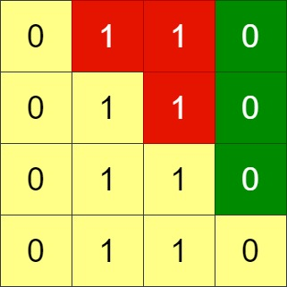

# [1536. Minimum Swaps to Arrange a Binary Grid](https://leetcode.com/problems/minimum-swaps-to-arrange-a-binary-grid/)

| Category | Difficulty | Likes | Dislikes |
| :------: | :--------: | :---: | :------: |
| Algorithms | Medium | 584 | 72 |

**Tags:** [`array`](https://leetcode.com/tag/array), [`greedy`](https://leetcode.com/tag/greedy), [`matrix`](https://leetcode.com/tag/matrix)


## Description

Given an `n x n` binary `grid`, in one step you can choose two **adjacent rows** of the grid and swap them.

A grid is said to be **valid** if all the cells above the main diagonal are **zeros**.

Return *the minimum number of steps* needed to make the grid valid, or **-1** if the grid cannot be valid.

The main diagonal of a grid is the diagonal that starts at cell `(1, 1)` and ends at cell `(n, n)`.

 

**Example 1:**


```

Input: grid = [[0,0,1],[1,1,0],[1,0,0]]
Output: 3

```

**Example 2:**


```

Input: grid = [[0,1,1,0],[0,1,1,0],[0,1,1,0],[0,1,1,0]]
Output: -1
Explanation: All rows are similar, swaps have no effect on the grid.

```

**Example 3:**


```

Input: grid = [[1,0,0],[1,1,0],[1,1,1]]
Output: 0

```

 

**Constraints:**

	- `n == grid.length` `== grid[i].length`

	- `1 <= n <= 200`

	- `grid[i][j]` is either `0` or `1`

---

**Links:** [Submissions](https://leetcode.com/problems/minimum-swaps-to-arrange-a-binary-grid/) | [Solutions](https://leetcode.com/problems/minimum-swaps-to-arrange-a-binary-grid/)
